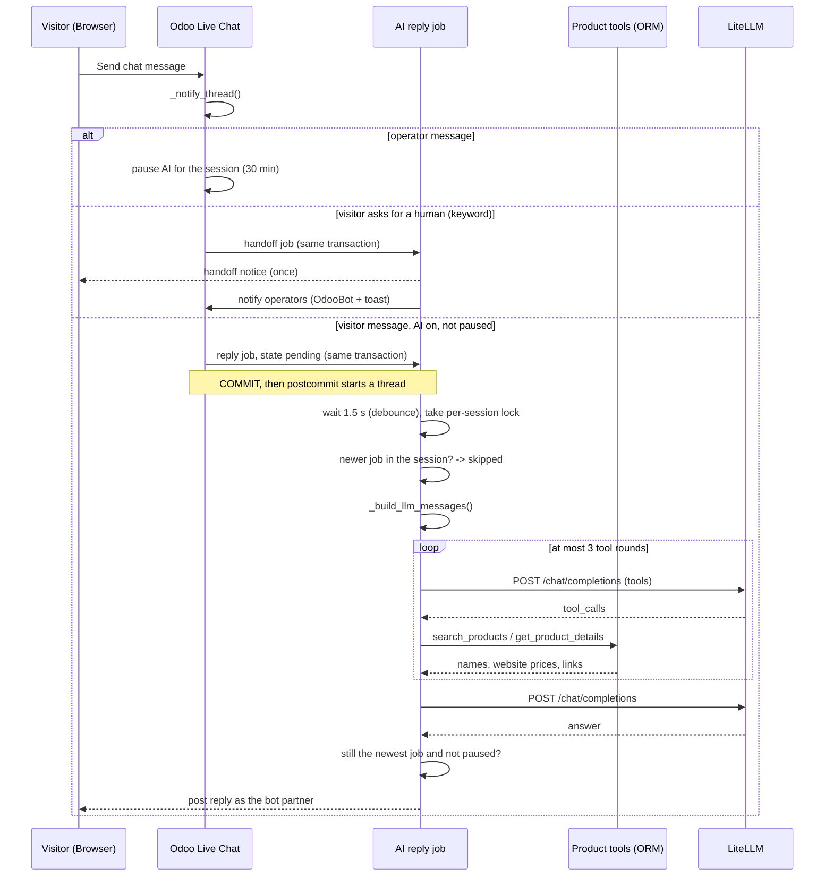
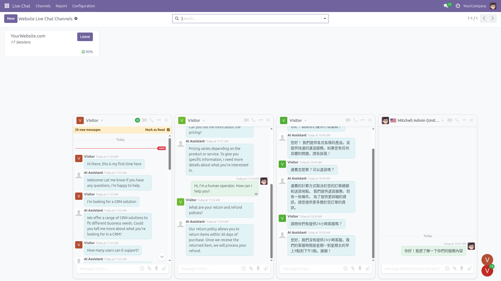
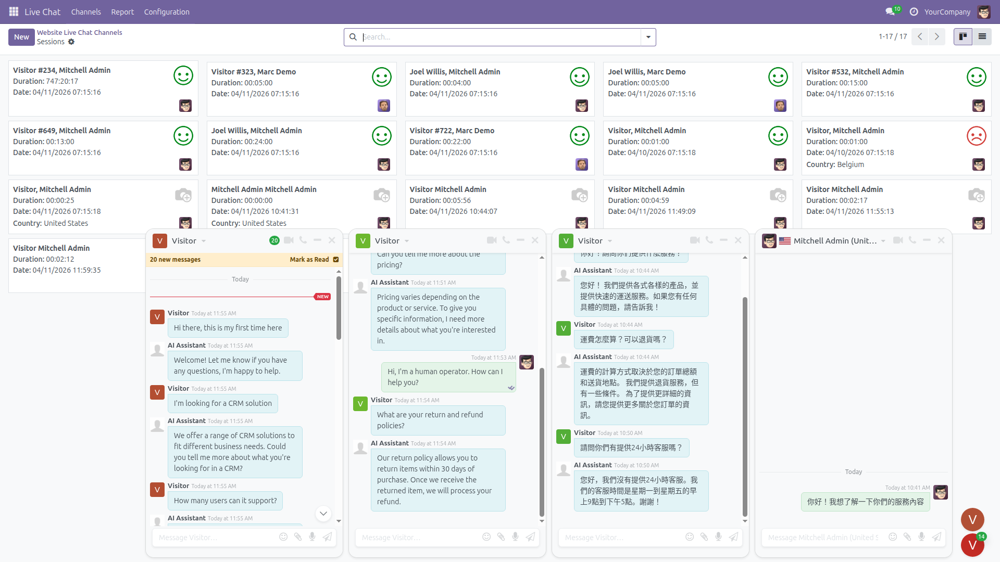
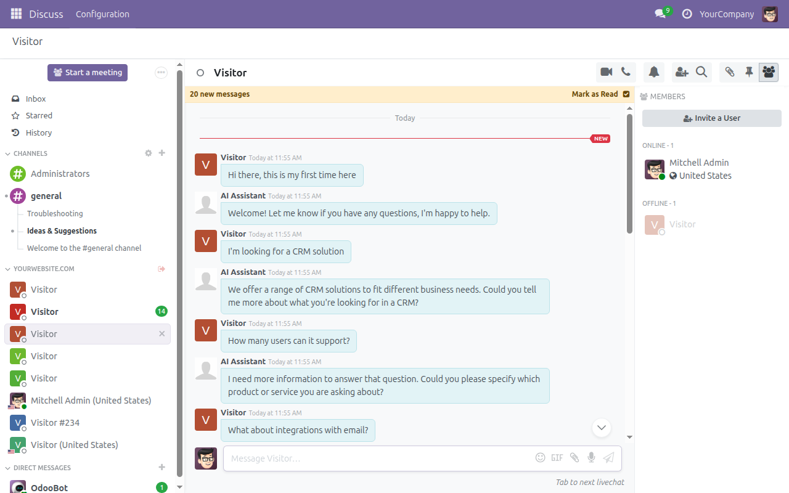
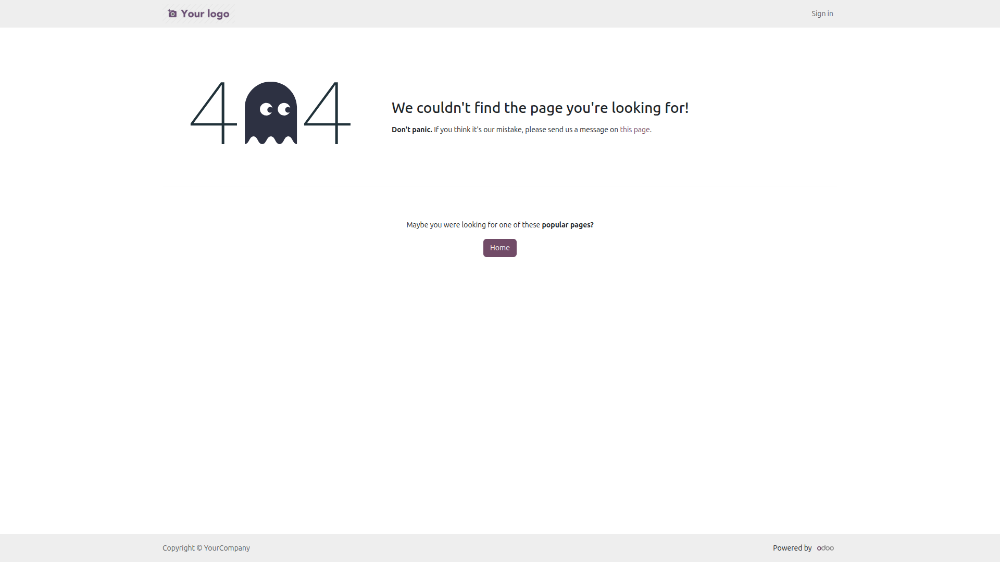
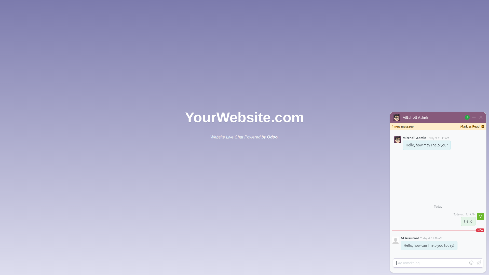
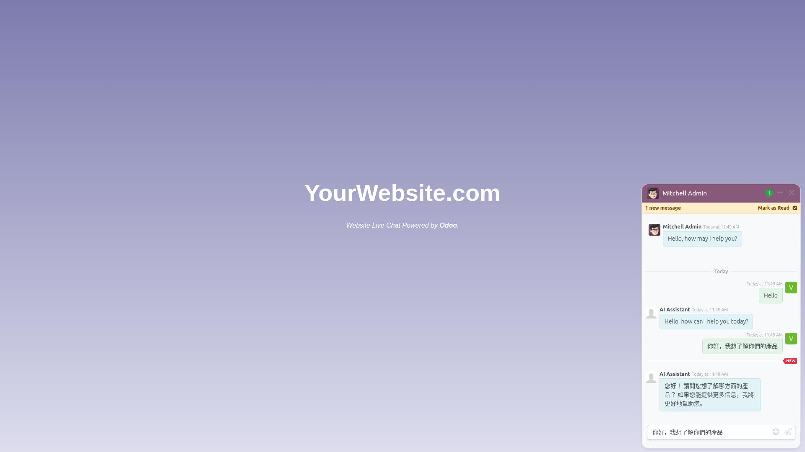
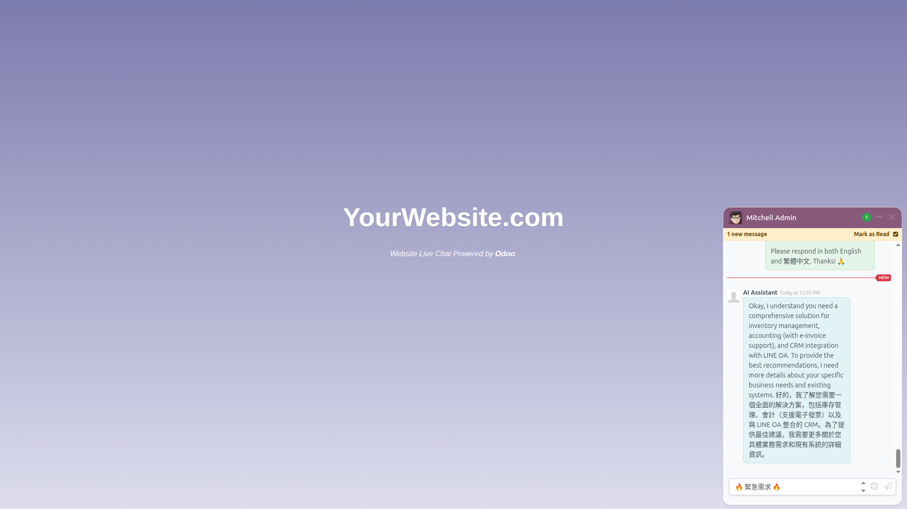

<p align="center">
  
  
  
  
  <a href="https://github.com/WOOWTECH/Woow_odoo_ai_livechat/actions/workflows/odoo-tests.yml"></a>
</p>

# Live Chat AI Integration for Odoo 18

**Answer Odoo Live Chat visitors with an LLM through the company LiteLLM gateway: durable reply jobs, human handoff, and product lookup tools that keep prices honest.**

> [繁體中文版 README](README_zh-TW.md)

---

## Table of Contents

- [Overview](#overview)
- [Upgrading from 18.0.1.0.x](#upgrading-from-18010x)
- [Why Use This Module](#why-use-this-module)
- [Architecture](#architecture)
- [Features](#features)
- [Screenshots](#screenshots)
- [Installation](#installation)
- [Configuration](#configuration)
- [Module Structure](#module-structure)
- [Security](#security)
- [Testing](#testing)
- [Troubleshooting](#troubleshooting)
- [Dependencies](#dependencies)
- [Contributing](#contributing)
- [Changelog](#changelog)
- [License](#license)
- [Credits](#credits)

---

## Overview

**im_livechat_ai** is an Odoo 18 module that answers Live Chat visitors with an LLM. When a visitor (a website guest or a logged-in portal customer) writes in an AI-enabled channel, the module queues a reply job in the same transaction as the message, and after commit sends the conversation to the company **LiteLLM** gateway (OpenAI-compatible `/v1/chat/completions`). The answer is posted back into the conversation by the channel's bot partner.

The connection (LiteLLM URL and API key) is one system-wide setting that only system administrators can see or change. Each channel only chooses a model from the list LiteLLM reports, plus its prompt and behaviour. Operators stay in control: when an operator replies, or the visitor asks for a human, the AI pauses for that conversation. When the eCommerce module is installed, the AI looks up published products, website prices and links with read-only tools instead of inventing them.

The default gateway is `https://paas-cs-32e92be2-5b2e4e66.woowtech.io/v1` and the default model is `chatgpt-pool/gpt-6-sol` (supports tool calling). Any OpenAI-compatible gateway works the same way.

---

## Upgrading from 18.0.1.0.x

> **AI replies are OFF after the upgrade until an administrator configures LiteLLM.**

Upgrading to 18.0.1.1.0 (`-u im_livechat_ai`, or the platform upgrade gate, which runs it when the manifest version changes) does the following automatically:

| What | Effect |
|---|---|
| Per-channel **API URL** and **API key** | Values wiped before the new code loads (pre-migration), then the columns are dropped. Old keys never stay in the database. |
| **Enable AI Integration** | Turned off on **every** channel. The server log lists the channels that had AI on. |
| **Retry Delay** | Removed (fixed backoff of 3 s, then 10 s). **Max Retries** converted from total calls to retries (old value - 1, at most 2). |
| Default English **Error Message** (or empty) | Replaced by the Traditional Chinese default. Custom messages are kept. |
| **Human Handoff Keywords** equal to the earlier default `真人,客服,人工,真人客服,human,agent,operator` (or empty) | Replaced by the new default of explicit requests (see [Step 5](#step-5-human-handoff)). Customised keywords are kept. |
| AI bot partners | Archived and tagged "AI 機器人", like Odoo chatbot partners; partners without an image get the module's robot avatar. |
| Existing **API logs** | Conversation content and upstream response bodies removed. |

Turning AI off, converting Max Retries and scrubbing the logs only happen when the pre-migration finds the 18.0.1.0.x columns (`ai_api_key`, `ai_api_base_url` or `ai_retry_delay`); it passes that to the post-migration in the temporary system parameter `im_livechat_ai.migration_1_1_0_legacy`, which the post-migration deletes. Running the 18.0.1.1.0 scripts again on an already migrated database changes nothing.

#### Rollout: replies after a restart or deploy

AI replies are normally sent by a thread of the Odoo process that received the visitor's message. Replies that were in progress when that process stopped (restart, deploy, worker recycled), and the AI answers sent when a handoff wait ends without an operator, are sent by the scheduled action **Live Chat AI: Recover Reply Jobs** (every 2 minutes), so they can take **about 1-2 minutes**. A **cron process is required**: run Odoo with `max_cron_threads >= 1` (or a separate cron process, e.g. `odoo --no-http --max-cron-threads=1`). Monitor it in **Settings > Live Chat AI > Reply Jobs** (last run of the cron and unfinished jobs older than 5 minutes, with a warning) or in **Live Chat > Configuration > AI Reply Jobs**.

After the upgrade, a system administrator:

1. Opens **Settings > Live Chat AI** (or **Live Chat > Configuration > AI Settings**).
2. Enters the **LiteLLM Base URL** and the dedicated **LiteLLM API Key** (`odoo-livechat`), saves.
3. Clicks **Fetch Available Models**, then **Test Connection**.
4. Re-enables AI on each channel (**Live Chat > Configuration > Channels > AI Integration**) and picks the model.

Revoke the old per-channel provider keys at the provider: the upgrade removes them from Odoo, but copies may exist elsewhere (backups, git history, logs).

---

## Why Use This Module

| Aspect | Without This Module | With This Module |
|---|---|---|
| **Response Time** | Visitors wait for a human agent | AI responds within seconds, 24/7 |
| **Agent Workload** | Every inquiry requires human attention | AI handles routine questions; operators take over at any time |
| **Prices and Specs** | Agents look them up | AI quotes only website data returned by the product tools, with links |
| **Reliability** | -- | Reply jobs survive restarts; rapid messages get one reply |
| **Human Handoff** | -- | Operator reply or "真人 / 客服" pauses the AI and notifies operators |
| **Key Safety** | -- | One admin-only LiteLLM key with budget and rate limits on the gateway |
| **Privacy** | -- | API logs without conversation content by default, admins only |
| **Infrastructure** | External services, middleware, glue code | Runs inside Odoo; only the LiteLLM gateway is called |

---

## Architecture

### High-Level Flow

```
┌─────────────┐   ┌───────────────────┐   ┌───────────────────────┐   ┌──────────────┐
│   Visitor   │──>│  Odoo Live Chat   │──>│  im_livechat.ai.job   │──>│   LiteLLM    │
│  (Browser)  │<──│ (discuss.channel) │<──│ (after commit thread, │<──│  /v1/chat/   │
└─────────────┘   └───────────────────┘   │  recovery cron)       │   │  completions │
   Chat UI          _notify_thread():      └──────────┬────────────┘   └──────────────┘
                    create job in the                 │ tool calls (max 3 calls) 
                    visitor's transaction             v
                                           ┌───────────────────────┐
                                           │ im_livechat.ai.tools  │
                                           │ search_products,      │
                                           │ get_product_details   │
                                           │ (ORM, read-only)      │
                                           └───────────────────────┘
```

### Sequence Diagram



### Decision Flowchart


---

## Features

### Core Capabilities

- **Company LiteLLM gateway** -- One system-wide OpenAI-compatible base URL and API key (Settings > Live Chat AI), managed by system administrators only.
- **Model dropdown per channel** -- Channels pick a model from the list cached by **Fetch Available Models** (`GET {base}/models`). The value already stored on a channel always stays selectable.
- **Multi-turn context** -- Recent history (1-200 messages) as system/user/assistant messages. Operator replies are sent as `assistant` messages marked `[真人客服 name]`, and the prompt tells the AI not to contradict them.
- **Visitors and portal customers** -- Guests, logged-in portal customers and the public user are answered, and so is an employee who opens the website chat as the visitor; operators (the session operator and internal users who join) and the bots never trigger the AI. Only visitor chat messages are answered, not the rating/feedback notification.

### Reliability (job queue)

- **Durable reply jobs** (`im_livechat.ai.job`) -- Created in the same transaction as the visitor message, so a job exists exactly when the message was committed. Processing starts after commit.
- **One reply for rapid messages** -- 1.5 s debounce, a PostgreSQL advisory lock per conversation (works across prefork workers and the cron process), and a job that has a newer job in the same conversation is skipped; the newest one answers with the full context.
- **Bounded calls** -- 45 s timeout per call, at most 2 retries (waiting 3 s, then 10 s), at most 3 processing runs per job.
- **Recovery cron** -- Every 2 minutes, jobs left pending or running by a restart or crash are run again; a job is never answered twice (it is skipped when the bot already replied after its message). Unfinished jobs older than 30 minutes are given up. The cron also runs the deferred replies of a handoff wait (triggered for the end of the wait). Requires a cron process (see [Rollout](#rollout-replies-after-a-restart-or-deploy)).
- **Monitoring** -- **Settings > Live Chat AI > Reply Jobs** (system administrators) shows the cron's last run and the number of pending/running jobs older than 5 minutes, with a warning when the cron has not run for 5 minutes or jobs are stuck.
- **Failure handling** -- After the last retry the visitor gets the channel's error message (Traditional Chinese by default) and the operators are notified (OdooBot message and a sticky notification).
- **Visible queue** -- **Live Chat > Configuration > AI Reply Jobs** shows every job's status, runs, LLM calls and short error.

### Human Handoff

Two kinds of pause, stored on the conversation (`discuss.channel.ai_paused_until`, `ai_pause_reason`):

- **Operator replied** (`operator`) -- When an internal user posts in a conversation, the AI stays quiet there for **30 minutes** (**Pause After Human Reply**, per channel, 1-1440). Each operator post extends the pause to now + 30 minutes (never shortens it). During this pause the AI sends nothing: no reply, no notice.
- **Visitor asked for a human** (`handoff`) -- Only explicit requests trigger it: `找真人`, `真人客服`, `轉真人`, `轉人工`, `人工客服`, `找客服`, `聯絡客服`, `我要客服`, `human agent`, `talk to a human`, `real person`, `live agent` (configurable). Chinese entries match anywhere in the message; English entries match whole words or phrases, case-insensitive, with any whitespace between the words. Single words such as `客服`, `人工`, `agent` no longer hand over (a question about "客服電話" is answered by the AI). The AI sends the handoff message once ("已幫您通知客服，請稍候。"), notifies the operators and **waits 10 minutes** (**Wait For Human After Handoff Request**, 1-1440).
- **Waiting notice** -- The first visitor message during that wait gets one fixed reply (**Waiting Notice**, default "已通知客服人員，請稍候。若客服暫時無法回覆，AI 助理會在 10 分鐘後繼續為您服務。"; `%(minutes)s` is replaced with the wait minutes). Once per wait (`discuss.channel.ai_pause_notice_sent`), no LLM call.
- **Operator takes over** -- An operator post during the wait turns it into an operator pause (30 minutes); the notice and the deferred replies are dropped quietly.
- **Auto-resume** -- If no operator replied when the wait ends, the AI answers everything the visitor wrote during the wait, without the visitor writing again: each such message gets a deferred reply job due at the end of the wait (`im_livechat.ai.job.deferred`), the recovery cron is triggered for that time, and the newest job answers them all in one reply (the others are skipped). Expect the answer within about a minute after the wait ends (cron wake-up).

### Product Lookup Tools (needs eCommerce)

- **search_products** -- Up to 8 published, sellable products: name (zh_TW when installed), website price range, short description, categories, absolute URL.
- **get_product_details** -- One product: description, attributes, variants with their website price and URL, optional attributes with extra prices.
- **Read-only ORM, no MCP** -- Only products published on the channel's website; prices are what a public visitor sees (website pricelist, tax display).
- **At most 3 tool rounds per reply** (5 calls per round, no new round after 90 s); then the model must answer with what it has.
- **Fixed price rule** -- The system prompt always says prices, specifications and stock may only come from the tools; without the tools (or with **Allow Product Lookup** off) the AI asks for contact details instead of quoting.
- **Per-channel switch** -- **Allow Product Lookup** (on by default).

### Privacy & Operations

- **API logs for Live Chat administrators only** -- Time, model, tokens, duration, status, requested tool names and a short error.
- **No conversation content by default** -- **Log Conversation Content** (off) stores request/response payloads only while debugging; turning it off erases stored content.
- **Retention** -- Logs and finished jobs older than **14 days** (configurable) are deleted daily.
- **Short errors** -- Test buttons and logs show the HTTP status and one short sentence; full upstream errors go to the server log only.

### AI Disclosure

- **Welcome message** -- While AI is enabled, the chat window shows the channel's **AI Welcome Message** (default "您好，我是 AI 客服助理，可以先為您解答商品與價格問題；需要真人客服請輸入「找真人」。") instead of the Odoo welcome message.
- **Bot avatar** -- AI messages are posted by the bot partner with the name of **Bot Name** and a robot avatar shipped with the module (`static/img/ai_bot.png`).
- **Identity** -- The system prompt always starts with "你是 {website or company name} 的 AI 客服助理「{bot name}」。被問到身分時就這樣回答；不要自稱 ChatGPT、GPT、Codex、OpenAI 或其他產品／模型名稱。", followed by the channel prompt, the operator note and the product rules.
- **Limit** -- The chat window header (and the author of the welcome message) still shows the session's human operator, as Odoo assigns one to every live chat session; the module does not change it.

### Security & Safety

- **XSS protection** -- AI replies are escaped; only markdown links / bare `http(s)` URLs become links and `**text**` bold.
- **Loop prevention** -- AI bots, OdooBot and the session operator never trigger the AI.
- **AI settings for Live Chat managers only** -- The channel's AI fields (prompt, model, handoff keywords, error text, ...) and "Test AI Connection" are restricted to Live Chat managers; operators, employees and portal customers cannot read them. The bot partner is created by the module and cannot be chosen.
- **Links only to the store** -- AI replies only turn URLs of `web.base.url` and the website domains into links; other URLs stay plain text.
- **Traditional Chinese** -- Visitor/operator texts in Traditional Chinese; full `zh_TW` translation of the interface.

---

## Screenshots

> The screenshots were taken with 18.0.1.0.0. The channel form now has a model dropdown instead of the API URL/key fields, and the connection lives in Settings > Live Chat AI.

### Livechat Channel List

<p align="center">
  
</p>
<p align="center"><em>Overview of livechat channels with AI integration status</em></p>

### AI Configuration Tab

<p align="center">
  
</p>
<p align="center"><em>Per-channel AI configuration (18.0.1.0.0 layout)</em></p>

### Admin Discuss View

<p align="center">
  
</p>
<p align="center"><em>Administrator view of AI-powered conversations in Odoo Discuss</em></p>

### Visitor Chat Experience

<p align="center">
  
</p>
<p align="center"><em>Visitor-facing livechat widget with AI responses</em></p>

### End-to-End Test Results

<p align="center">
  
  
</p>
<p align="center"><em>E2E tests: basic greeting (left) and Chinese language support (right)</em></p>

<p align="center">
  
</p>
<p align="center"><em>Stress test with concurrent conversations</em></p>

---

## Installation

### Standard Odoo Installation

1. **Clone the repository** and add it to the addons path. The canonical module is the `im_livechat_ai/` directory at the repository root (the only copy):

   ```bash
   git clone https://github.com/WOOWTECH/Woow_odoo_ai_livechat.git /path/to/Woow_odoo_ai_livechat
   ```

   ```ini
   addons_path = /path/to/odoo/addons,/path/to/Woow_odoo_ai_livechat
   ```

2. **Update the module list** in Odoo:

   - Navigate to **Apps** and click **Update Apps List**
   - Search for **"Live Chat AI Integration"**
   - Click **Install**

3. **Dependencies**: `im_livechat` (required). Install **eCommerce** (`website_sale`) for the product lookup tools.

4. **Configure LiteLLM** (see [Configuration](#configuration)); AI stays off until then.

### Docker / Podman Deployment

A local development stack is provided in `odoo-ailivechat/`. It mounts the canonical module from the repository root (`../im_livechat_ai`). No password is committed: copy the templates and fill them in.

1. **Create the local config** (both files are git-ignored):

   ```bash
   cd odoo-ailivechat/
   cp .env.example .env                           # set POSTGRES_PASSWORD (e.g. openssl rand -base64 24)
   cp config/odoo.conf.example config/odoo.conf   # admin_passwd empty = database manager locked
   ```

2. **Start the containers:**

   ```bash
   docker compose up -d
   # or
   podman-compose up -d
   ```

   This starts two containers:
   - `odoo-ailivechat-web` -- Odoo 18 (port `ODOO_PORT`, default 9094, mapped to internal 8069)
   - `odoo-ailivechat-db` -- PostgreSQL 16

3. **Create the database with the module** (the database manager is disabled by `list_db = False`):

   ```bash
   docker compose run --rm odoo -d odooailivechat -i im_livechat_ai --without-demo=all --stop-after-init
   docker compose restart odoo
   ```

4. **Access Odoo** at `http://localhost:9094`.

---

## Configuration

### Step 1: System-wide LiteLLM connection (system administrators only)

Open **Settings > Live Chat AI** (also reachable from **Live Chat > Configuration > AI Settings**). Only `base.group_system` can see or change these settings; values are stored in `ir.config_parameter`.

| Setting | Description | Default |
|---|---|---|
| **LiteLLM Base URL** (`im_livechat_ai.base_url`) | OpenAI-compatible base URL of the company LiteLLM gateway, ending in `/v1`. | `https://paas-cs-32e92be2-5b2e4e66.woowtech.io/v1` |
| **LiteLLM API Key** (`im_livechat_ai.api_key`) | Dedicated `odoo-livechat` key. Write-only: never shown again after saving; leave empty to keep the current key. | -- |
| **Fetch Available Models** | Calls `GET {base}/models` and caches the list used by the channel model dropdown (`im_livechat_ai.model_cache`). | -- |
| **Test Connection** | Sends a tiny request with the default model; shows only the HTTP status and a short message (details go to the server log). | -- |
| **Log Conversation Content** (`im_livechat_ai.log_payload`) | Store request/response payloads in the API logs. Turning it off erases stored content. | Off |
| **Log Retention (days)** (`im_livechat_ai.log_retention_days`) | The daily cleanup deletes older API logs and finished reply jobs. | `14` |
| **Reply Jobs** (read-only) | Last run of **Live Chat AI: Recover Reply Jobs** and the number of pending/running jobs older than 5 minutes, with a warning when the cron has not run for 5 minutes or jobs are stuck. | -- |

Only system administrators get these values: `default_get`/`get_values` of `res.config.settings` drop the `livechat_ai_*` values for everyone else (portal users, Live Chat managers included), the fields are restricted to `base.group_system`, and `set_values` refuses non-administrators.

Recommended LiteLLM key (`odoo-livechat`): restricted to the chosen model, a monthly budget (e.g. USD 20) and a rate limit (e.g. 20 requests per minute), so a leaked key has a bounded cost and its usage shows up in the gateway's spend tracking.

### Step 2: Enable AI on a channel (Live Chat managers)

Navigate to **Live Chat > Configuration > Channels**, select a channel, and open the **AI Integration** tab. Enabling AI requires a model and a configured LiteLLM key; the bot partner is created at that moment.

Validation: every range below is checked on each save, whether AI is on or off, and enabling AI re-checks all of them (values stored by an earlier version must be fixed first). The model must be in the cached LiteLLM list (or be the default `chatgpt-pool/gpt-6-sol`) when it is chosen or changed, or when AI is enabled; an unchanged older value (e.g. `MiniMax-M1`) does not block saving other fields. At reply time Max Tokens, Max History and Temperature are clamped to their ranges again (a stored 0 Max Tokens is sent as 1024).

| Field | Description | Default |
|---|---|---|
| **Enable AI Integration** (`ai_enabled`) | Turn AI replies on for this channel. | Off |
| **Model** (`ai_model`) | Model from the cached LiteLLM list. | `chatgpt-pool/gpt-6-sol` |
| **Allow Product Lookup** (`ai_product_lookup`) | Let the AI use the product tools (needs eCommerce). | On |

### Step 3: Define AI behaviour

| Field | Description | Default |
|---|---|---|
| **System Prompt** (`ai_system_prompt`) | Persona, knowledge scope and style. The product price rule (and the operator note) are always appended. | *(empty)* |
| **Temperature** (`ai_temperature`) | Randomness, 0.0 - 2.0. | `0.7` |
| **Max Tokens** (`ai_max_tokens`) | Maximum tokens in the AI's answer, 1 - 8192. | `1024` |
| **Max History Messages** (`ai_max_history`) | Recent messages sent as context, 1 - 200. | `50` |

### Step 4: Reliability and errors

| Field | Description | Default |
|---|---|---|
| **Max Retries** (`ai_max_retries`) | Retries after a failed or timed-out call, 0 - 2 (45 s timeout; waits 3 s, then 10 s). | `2` |
| **Error Message** (`ai_error_message`) | Sent to the visitor when every retry failed (operators are notified too). | 抱歉，AI 客服暫時無法回覆。請稍後再試，或留下您的聯絡方式，我們的客服人員會盡快與您聯繫。 |

### Step 5: Human handoff

| Field | Description | Default |
|---|---|---|
| **Pause After Human Reply (minutes)** (`ai_handoff_pause_minutes`) | How long the AI stays quiet after an operator post (each post extends it), 1 - 1440. | `30` |
| **Wait For Human After Handoff Request (minutes)** (`ai_handoff_wait_minutes`) | How long the AI waits for an operator after a handoff request before it answers again, 1 - 1440. | `10` |
| **Human Handoff Keywords** (`ai_handoff_keywords`) | Comma-separated; Chinese entries match anywhere, English words/phrases match whole words, case-insensitive. | `找真人,真人客服,轉真人,轉人工,人工客服,找客服,聯絡客服,我要客服,human agent,talk to a human,real person,live agent` |
| **Handoff Message** (`ai_handoff_message`) | Sent once to the visitor who asked for a human. | 已幫您通知客服，請稍候。 |
| **Waiting Notice** (`ai_pause_notice`) | Sent once to the first visitor message during the wait; `%(minutes)s` becomes the wait minutes (other text is sent as written). | 已通知客服人員，請稍候。若客服暫時無法回覆，AI 助理會在 %(minutes)s 分鐘後繼續為您服務。 |

The pause is stored on the conversation: `discuss.channel.ai_paused_until`, `ai_pause_reason` (`operator` / `handoff`) and `ai_pause_notice_sent`. See [Human Handoff](#human-handoff) for the behaviour.

### Step 6: Bot identity

| Field | Description | Default |
|---|---|---|
| **Bot Name** (`ai_bot_name`) | Display name of the AI in the chat (also used in the identity block of the prompt). | `AI 客服助理` |
| **Bot Partner** (`ai_bot_partner_id`) | Archived `res.partner` tagged "AI 機器人" with the robot avatar, created when AI is enabled. | Auto-created |
| **AI Welcome Message** (`ai_welcome_message`) | Welcome message of the chat window while AI is enabled. | 您好，我是 AI 客服助理，可以先為您解答商品與價格問題；需要真人客服請輸入「找真人」。 |

### Step 7: Test & monitor

- **Test AI Connection** (Live Chat managers) checks the channel's model; the result shows the HTTP status and a short message only.
- **View API Logs** (Live Chat managers) opens this channel's logs: tokens, time, status, requested tools. Conversation content is only present while **Log Conversation Content** is on.
- **AI Reply Jobs** (Live Chat managers): the queue with filters for pending/running, failed, skipped and handoff jobs; deferred replies of a handoff wait are marked **Deferred** and wait for their **Run After** time.
- **Settings > Live Chat AI > Reply Jobs** (system administrators): last run of the recovery cron and stuck jobs (see [Rollout](#rollout-replies-after-a-restart-or-deploy)).

---

## Module Structure

```
im_livechat_ai/
├── __init__.py
├── __manifest__.py                      # v18.0.1.1.0
├── models/
│   ├── im_livechat_channel.py           # Channel AI fields, LiteLLM connection
│   │                                    #   (_llm_request, _fetch_llm_models),
│   │                                    #   reply generation with tool rounds and
│   │                                    #   retries, bot partner, handoff keywords
│   ├── discuss_channel.py               # _notify_thread hook: pause on operator
│   │                                    #   post, handoff, job creation; author
│   │                                    #   classification; _build_llm_messages
│   ├── livechat_ai_job.py               # im_livechat.ai.job: durable reply queue,
│   │                                    #   post-commit threads, advisory lock,
│   │                                    #   recovery cron, operator notification
│   ├── livechat_ai_tools.py             # im_livechat.ai.tools: search_products,
│   │                                    #   get_product_details (read-only ORM)
│   ├── llm_api_log.py                   # llm.api.log: metadata-only API logs,
│   │                                    #   retention cleanup
│   └── res_config_settings.py           # Settings > Live Chat AI (admins only)
├── views/
│   ├── im_livechat_channel_views.xml    # "AI Integration" tab on the channel form
│   ├── llm_api_log_views.xml            # API logs (menu: AI API Logs)
│   ├── livechat_ai_job_views.xml        # Reply jobs (menu: AI Reply Jobs)
│   └── res_config_settings_views.xml    # Settings page + menu: AI Settings
├── data/
│   └── ai_data.xml                      # "AI 機器人" tag, default bot partner,
│                                        #   daily log cleanup cron, 2-minute
│                                        #   job recovery cron
├── security/
│   └── ir.model.access.csv              # Logs and jobs: Live Chat managers (read/delete)
├── migrations/18.0.1.1.0/
│   ├── pre-migrate.py                   # Wipe per-channel API URL/key
│   └── post-migrate.py                  # Drop old columns, AI off, scrub logs,
│                                        #   Chinese error message, tag bot partners
├── tests/                               # 371 tests (see Testing)
└── i18n/
    └── zh_TW.po                         # Traditional Chinese translation
```

The repository also contains `odoo-ailivechat/` (local Docker stack, mounts the module above), `.github/workflows/odoo-tests.yml` (CI) and `docs/`.

---

## Security

### LiteLLM key

The LiteLLM URL and key live in `ir.config_parameter`, which only `base.group_system` can read or write, and every settings field also carries `groups='base.group_system'`. Channels only choose a model, so a Live Chat user or manager can neither read the key nor send it to another URL. The key is write-only in the settings form and is not stored in the transient settings table. Errors shown in the interface or stored in logs never contain upstream response bodies.

### API logs and conversation content

`llm.api.log` and `im_livechat.ai.job` are readable by Live Chat administrators only. By default logs keep no conversation content; **Log Conversation Content** is meant for short debugging sessions, and switching it off erases what was stored. The daily cleanup applies the retention (default 14 days).

### XSS protection

AI replies are escaped with `markupsafe` before posting. Only markdown links and bare URLs with `http(s)` become links (`target="_blank" rel="noopener noreferrer"`), `**text**` becomes bold, and newlines become `<br/>`; every text and URL is escaped.

### Loop prevention and authors

1. **Bot exclusion** -- The channel's `ai_bot_partner_id`, the default AI bot and OdooBot never trigger the AI.
2. **Operators** -- Partners with an internal (non-share) user are operators: their posts pause the AI and are sent to the LLM as colleague replies.
3. **Session operator** -- The conversation's assigned operator without an internal user (e.g. an Odoo chatbot) is treated as a bot.
4. **Visitors** -- Guests, portal users and the public user are visitors.

### Product tools

The tools are read-only ORM searches limited to products published on the channel's website and allowed for sale; no MCP or external call is involved, and the number of rounds and calls per reply is capped.

### Input validation

- The LiteLLM base URL must start with `http://` or `https://`.
- Temperature (0.0-2.0), max history (1-200), max retries (0-2), pause and wait minutes (1-1440), max tokens (1-8192) and log retention (>= 1 day) are checked on every save, AI on or off, and all of them again when AI is enabled; at reply time max tokens, max history and temperature are clamped.
- The model must be in the cached LiteLLM list (or the default) when it is chosen or changed, or when AI is enabled.
- Enabling AI requires a model and a configured system LiteLLM key.

---

## Testing

### Test Suite Overview

The module has **371 automated tests**. All HTTP calls are mocked: no LiteLLM key or network access is needed.

| Test File | Tests | Coverage |
|---|---|---|
| `test_im_livechat_ai.py` | 25 | Channel fields, constraints, LLM call, bot messages, logs |
| `test_discuss_channel.py` | 18 | Message interception, visitor detection, context building |
| `test_integration.py` | 9 | End-to-end flow, multi-turn, retries, error fallback |
| `test_edge_cases.py` | 97 | Edge cases: payloads, think tags, XSS, limits, logging |
| `test_litellm_settings.py` | 42 | Settings access (admin only), write-only key, model list, privacy, migration |
| `test_ai_job.py` | 38 | Job creation in the visitor transaction, debounce, lock, skip, retries, recovery cron |
| `test_handoff.py` | 43 | Portal visitors, operator pause, handoff keywords, operator roles, bot partner, Chinese defaults |
| `test_product_tools.py` | 37 | search_products / get_product_details, published-only, prices, tool rounds and limits |
| `test_review_fixes.py` | 20 | Branch review fixes: AI config access, bot partner protection, which messages trigger, no open transaction during LLM calls, retries migration |
| `test_pause_disclosure.py` | 42 | Explicit handoff keywords, operator pause vs handoff wait, waiting notice, auto-resume (deferred jobs), range/model validation, settings privacy, job monitoring, AI disclosure, identity block, idempotent migration |

### Running the Tests

```bash
# Fresh database; website_sale, website_livechat and portal are needed by some tests
odoo -d test_db -i website_sale,website_livechat,portal,im_livechat_ai \
  --without-demo=all --test-enable --test-tags /im_livechat_ai --stop-after-init

# With the Docker stack
docker compose run --rm odoo -d test_db -i website_sale,website_livechat,portal,im_livechat_ai \
  --without-demo=all --test-enable --test-tags /im_livechat_ai --stop-after-init
```

Check that the log contains `Starting ...` lines for `odoo.addons.im_livechat_ai.tests`: a tag that selects nothing also ends with "0 failed".

### Continuous Integration

`.github/workflows/odoo-tests.yml` runs the same command on every pull request (Odoo `odoo:18.0` container + PostgreSQL 16 service) and fails when Odoo exits non-zero, when no `im_livechat_ai` test started, or when the log contains any `FAIL`, `ERROR` or `CRITICAL` line. Protect the main branch with this check so a red PR cannot be merged.

### E2E Testing

The 15-scenario end-to-end plan of 18.0.1.0.0 is kept in `docs/plans/`. For 18.0.1.1.0, verify on a test database with the real LiteLLM key: three rapid messages give one reply, an operator reply pauses the AI, "我要找真人" pauses and notifies, and a product price question returns the website price with a link.

---

## Troubleshooting

### AI is not responding to visitor messages

1. **After an upgrade from 18.0.1.0.x** AI is off on every channel: configure LiteLLM and re-enable the channels (see [Upgrading](#upgrading-from-18010x)).
2. **LiteLLM configured?** Settings > Live Chat AI shows "A key is configured"; **Test Connection** succeeds.
3. **Paused?** An operator replied less than the pause time ago (default 30 minutes), or the visitor asked for a human and the wait (default 10 minutes) is not over: the AI answers when the wait ends, through the recovery cron.
4. **Cron process** -- Settings > Live Chat AI > Reply Jobs warns when **Live Chat AI: Recover Reply Jobs** has not run for 5 minutes: start a cron process (`max_cron_threads >= 1`).
5. **Author** -- Messages from internal users (e.g. an administrator testing in the widget while logged in) pause the AI instead of being answered; test as a guest or portal user.
6. **AI Reply Jobs** -- Look at the job of the message: `skipped` (a newer message answered), `failed` (see Error), or still `pending` (is the recovery cron active?).
7. **Server log** -- Search for `odoo.addons.im_livechat_ai`.

### The model I want is not in the dropdown

Click **Fetch Available Models** in Settings > Live Chat AI. The list is what the LiteLLM key may use.

### The AI does not know product prices

Product lookup needs the eCommerce module, **Allow Product Lookup** on the channel, and the product published on the channel's website. Without the tools the AI asks the visitor for contact details instead of quoting.

### API returns errors

| Error | Cause | Solution |
|---|---|---|
| `HTTP 401` | Key invalid or revoked | Enter a valid key in Settings > Live Chat AI |
| `HTTP 403` | Key may not use this model | Allow the model for the key in LiteLLM, or choose another model |
| `HTTP 404` | Wrong base URL or model | The base URL must end in `/v1`; fetch the model list again |
| `HTTP 429` | Rate limit or budget reached | Check the key's limits and spend in LiteLLM |
| `HTTP 5xx` | Gateway or provider issue | Retried automatically (3 s, 10 s); check LiteLLM status |
| Timeout / connection | Network or firewall | Odoo must reach the LiteLLM URL; calls time out after 45 s |

### Bot messages show raw HTML

AI replies are escaped on purpose; only links and bold are rendered. Ask the model for plain text in the system prompt.

---

## Dependencies

### Odoo Modules

| Module | Type | Purpose |
|---|---|---|
| `im_livechat` | Required | Odoo's built-in Live Chat module (base for livechat channels) |
| `mail` | Required | `discuss.channel`, `mail.message` and messaging |
| `website_sale` | Optional | Product lookup tools (published products, website prices) |

### Python Packages

All required Python packages are part of the standard Odoo 18 distribution:

| Package | Purpose |
|---|---|
| `requests` | HTTP client for LiteLLM calls |
| `markupsafe` | XSS protection for bot responses |
| `psycopg2` | PostgreSQL adapter (READ COMMITTED job cursors) |

### External service

A LiteLLM (or other OpenAI-compatible) gateway with `/v1/chat/completions` and `/v1/models`; tool calling is needed for the product tools.

---

## Contributing

- The module at the repository root (`im_livechat_ai/`) is the only copy; the platform image syncs it from this repository's version tags instead of patching its own copy.
- Bump the manifest version when models, views, data or migrations change: the platform upgrade gate only runs the module upgrade on a version change.
- Commit messages say in one line what changed and why. Pull requests use `.github/pull_request_template.md` (what / why / how tested) and must pass the **Odoo tests** workflow.
- Never commit keys or passwords: only `*.example` templates; `.env`, `config/odoo.conf` and `.playwright-cli/` are git-ignored.

---

## Changelog

### v18.0.1.1.0

- **LiteLLM system setting**: the connection moved to Settings > Live Chat AI (administrators only, write-only key, short errors); per-channel API URL/key removed. Channel model is a dropdown fed by **Fetch Available Models**; default `chatgpt-pool/gpt-6-sol`.
- **Upgrade**: wipes and drops the old per-channel key/URL, **turns AI off on every channel** until an administrator configures LiteLLM and re-enables it, removes Retry Delay, caps Max Retries to 2, translates the default error message, archives and tags the bot partners, scrubs old logs.
- **Job queue**: durable `im_livechat.ai.job` reply jobs created with the visitor message, processed after commit with a 1.5 s debounce and a per-conversation lock; rapid messages get one reply; 45 s timeout, at most 2 retries (3 s / 10 s); recovery cron every 2 minutes; error message plus operator notification on failure.
- **Handoff / pause**: portal customers are answered; an operator reply pauses the AI for 30 minutes (per channel); handoff keywords send one notice, pause and notify operators; operator replies are sent to the LLM as marked colleague replies; the bot partner is created when AI is enabled.
- **Product tools**: `search_products` and `get_product_details` (read-only ORM, published products, website prices, links), at most 3 tool rounds per reply, per-channel **Allow Product Lookup**, and a fixed prompt rule against invented prices.
- **Privacy**: API logs and jobs for Live Chat administrators only; no conversation content unless **Log Conversation Content** is on; 14-day retention (configurable).
- **Repository**: single module copy (Docker stack mounts it), config templates instead of committed passwords, GitHub Actions test workflow, PR template, zh_TW translation of all new strings.
- **Handoff (owner review)**: explicit handoff keywords only (old default migrated, custom kept); two pause kinds -- operator reply (30 minutes, extended per post, silent) and handoff wait (10 minutes, `ai_handoff_wait_minutes`) with one waiting notice (`ai_pause_notice`) and auto-resume: deferred reply jobs run by the recovery cron at the end of the wait answer what the visitor wrote meanwhile, unless an operator took over.
- **Validation**: range checks on every save (AI on or off) and again when AI is enabled; runtime clamp of Max Tokens/History/Temperature; the model must be in the cached LiteLLM list when chosen or when AI is enabled.
- **Settings privacy and monitoring**: non-administrators no longer get the LiteLLM URL, log settings or model cache through `default_get`/`get_values`, and `set_values` refuses them; Settings shows the recovery cron's last run and stuck jobs.
- **AI disclosure**: robot avatar on the bot partners, AI welcome message (`ai_welcome_message`), fixed identity block at the start of the system prompt.
- **Migration**: the legacy-only steps (AI off, retries conversion, log scrub) need the 18.0.1.0.x columns, so re-running the scripts on a migrated database changes nothing.

### v18.0.1.0.0 (Initial Release)

- Per-channel AI configuration with 17 configurable fields
- Direct integration with OpenAI-compatible `/v1/chat/completions` API
- Multi-turn conversation context with configurable history depth
- Background daemon thread processing for non-blocking operation
- XSS protection and HTML sanitization pipeline
- Three-layer loop prevention (bot, OdooBot, operators)
- Configurable retry logic with delay for API resilience
- PostgreSQL serialization failure recovery
- Token usage tracking and API call logging
- 30-day automatic log cleanup via scheduled cron
- Test AI Connection and View API Logs action buttons
- 55 automated tests (28 unit + 18 channel + 9 integration)
- 15-scenario end-to-end test coverage
- Traditional Chinese (zh_TW) translation
- Docker / Podman deployment configuration

---

## License

This module is licensed under the **GNU Lesser General Public License v3.0 (LGPL-3)**.

---

## Credits

Developed and maintained by **[WOOWTECH](https://github.com/WOOWTECH)**.

<p align="center">
  <a href="https://github.com/WOOWTECH/Woow_odoo_ai_livechat/issues">Bug Reports & Feature Requests</a>
</p>

---

<p align="center"><sub>Built by <a href="https://github.com/WOOWTECH">WOOWTECH</a> &bull; Powered by Odoo 18</sub></p>
