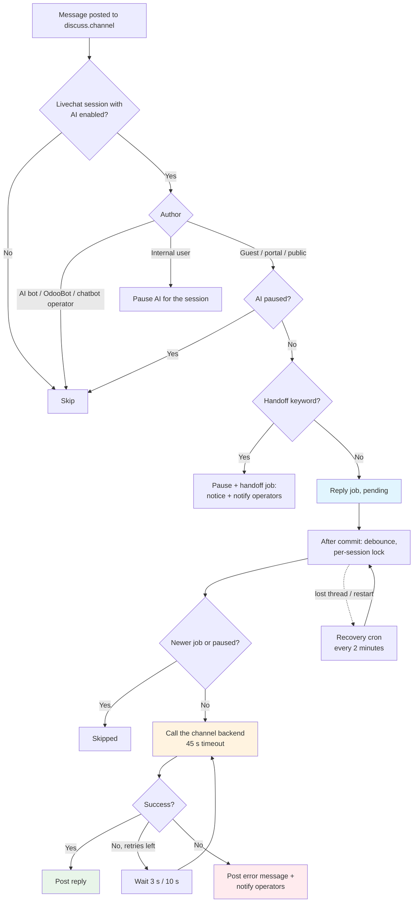

<p align="center">
  
  
  
  
  <a href="https://github.com/WOOWTECH/Woow_odoo_ai_livechat/actions/workflows/odoo-tests.yml"></a>
</p>

# Live Chat AI Integration for Odoo 18

**Answer Odoo Live Chat visitors through an AI backend chosen per channel (OpenAI compatible such as LiteLLM or Hermes, or an n8n webhook): durable reply jobs and human handoff. Odoo records, forwards and manages; the backend does the rest.**

> [繁體中文版 README](README_zh-TW.md)

---

## Table of Contents

- [Overview](#overview)
- [Upgrading to 18.0.1.2.0](#upgrading-to-180120)
- [Upgrading from 18.0.1.0.x](#upgrading-from-18010x)
- [Why Use This Module](#why-use-this-module)
- [Architecture](#architecture)
- [Features](#features)
- [Screenshots](#screenshots)
- [Installation](#installation)
- [Configuration](#configuration)
- [AI backends: LiteLLM, Hermes, n8n](#ai-backends-litellm-hermes-n8n)
- [Module Structure](#module-structure)
- [Security](#security)
- [Testing](#testing)
- [Troubleshooting](#troubleshooting)
- [Dependencies](#dependencies)
- [Contributing](#contributing)
- [Changelog](#changelog)
- [License](#license)
- [Credits](#credits)

---

## Overview

**im_livechat_ai** is an Odoo 18 module that answers Live Chat visitors through an AI backend. When a visitor (a website guest or a logged-in portal customer) writes in an AI-enabled channel, the module queues a reply job in the same transaction as the message, and after commit sends the conversation to **the channel's backend**. The answer is posted back into the conversation by the channel's bot partner.

Every channel has its own backend connection, set by a system administrator on the channel's **AI** tab (Live Chat > Configuration > Channels):

| Backend type | Endpoint URL | Access token | Typical backends |
|---|---|---|---|
| **OpenAI compatible (LiteLLM, Hermes…)** | base URL ending in `/v1`; `/chat/completions` is appended | API key, sent as `Authorization: Bearer <token>` | LiteLLM, Hermes, any OpenAI-compatible server |
| **n8n Webhook** | full production webhook URL (also a Chat Trigger's `.../webhook/<id>/chat`) | optional signing secret of `X-Woow-Signature` (HMAC-SHA256), **never sent**; empty = requests are not signed | an n8n workflow (Webhook node + AI Agent + Respond to Webhook, or a Chat Trigger) |

Odoo only **records, forwards and manages** the conversation: the persona, tools (product lookup, Odoo MCP, ...), moderation and permissions all belong to the backend. Operators stay in control: when an operator replies, or the visitor asks for a human, the AI pauses for that conversation. There is no default URL and no default model: AI stays off until an administrator fills in a channel's connection. Nothing of this module appears in the Settings app.

The request formats are compatible with the n8n section of `woow_ai_contact` (docs/PROTOCOL.md): same headers, signature, session id, payload and answers, so an n8n workflow written for this module also works after a later move to `woow_ai_contact`.

---

## Upgrading to 18.0.1.2.0

`-u im_livechat_ai` (or the platform upgrade gate) runs the 18.0.1.2.0 post-migration:

| What | Effect |
|---|---|
| Backend type | `OpenAI compatible` on every channel (18.0.1.1.0 only spoke that protocol). |
| `im_livechat_ai.base_url` / `im_livechat_ai.api_key` (Settings > Live Chat AI) | Copied to **every** channel's Endpoint URL (trailing `/` and `/chat/completions` removed) and Access Token, where the channel has none yet. A key without a URL gets the URL 18.0.1.1.0 used by default. |
| `im_livechat_ai.log_payload` / `im_livechat_ai.log_retention_days` | Copied to every channel (**Log Conversation Content**, **Log Retention (days)**). |
| All `im_livechat_ai.*` system parameters | Deleted (the key included; the model cache is no longer used). |
| **Enable AI Integration**, model | Unchanged: a channel with AI on and copied credentials keeps answering. The model stays as text. |
| **Visitor Files** (new) | "Download link only" on Hermes channels (model `hermes-agent` or an endpoint URL containing `hermes`), "Attach the file" on the others. A value already set is kept. |
| Settings > Live Chat AI, menu Live Chat > Configuration > AI Settings | Removed. |
| Product lookup tools, Temperature, Max Tokens, model list, identity block | Removed: the backend does this now. |

The server log has one WARNING line with counts only (channels, URLs and tokens copied, parameters deleted, AI-enabled channels with a connection), never values. The script is idempotent: once the parameters are gone a re-run changes nothing, and values already on a channel are never overwritten. A database without these parameters (and with AI off) is left as it is.

After the upgrade, a channel that relied on the Odoo product tools answers without them: point it at a backend that has its own product data tools (for example Hermes or n8n with the Odoo MCP server), or keep AI off there.

---

## Upgrading from 18.0.1.0.x

> **AI replies are OFF after the upgrade until an administrator configures each channel's backend.**

Upgrading to 18.0.1.1.0 (`-u im_livechat_ai`, or the platform upgrade gate, which runs it when the manifest version changes) does the following automatically:

| What | Effect |
|---|---|
| Per-channel **API URL** and **API key** | Values wiped before the new code loads (pre-migration), then the columns are dropped. Old keys never stay in the database. |
| **Enable AI Integration** | Turned off on **every** channel. The server log lists the channels that had AI on. |
| **Retry Delay** | Removed (fixed backoff of 3 s, then 10 s). **Max Retries** converted from total calls to retries (old value - 1, at most 2). |
| Default English **Error Message** (or empty) | Replaced by the Traditional Chinese default. Custom messages are kept. |
| **Human Handoff Keywords** equal to the earlier default `真人,客服,人工,真人客服,human,agent,operator` (or empty) | Replaced by the new default of explicit requests (see [Step 5](#step-5-human-handoff)). Customised keywords are kept. |
| AI bot partners | Archived and tagged "AI 機器人", like Odoo chatbot partners; partners without an image get the module's robot avatar. |
| Existing **API logs** | Conversation content and upstream response bodies removed. |

Every row above except the API URL/key columns (turning AI off, Max Retries, error message, handoff keywords, bot partners and avatars, log scrub) only happens when the pre-migration finds the 18.0.1.0.x columns (`ai_api_key`, `ai_api_base_url` or `ai_retry_delay`); it passes that to the post-migration in the temporary system parameter `im_livechat_ai.migration_1_1_0_legacy`, which the post-migration deletes. Running the 18.0.1.1.0 scripts again on an already migrated database changes nothing, also not values an administrator cleared or changed after the upgrade (an emptied bot name or error message, an unarchived bot partner).

### Rollout: replies after a restart or deploy

AI replies are normally sent by a thread of the Odoo process that received the visitor's message. Replies that were in progress when that process stopped (restart, deploy, worker recycled), and the AI answers sent when a handoff wait ends without an operator, are sent by the scheduled action **Live Chat AI: Recover Reply Jobs** (every 2 minutes), so they can take **about 1-2 minutes**. A **cron process is required**: run Odoo with `max_cron_threads >= 1` (or a separate cron process, e.g. `odoo --no-http --max-cron-threads=1`). Monitor it on each channel's **AI** tab (**Reply Jobs**: last run of the cron and unfinished jobs older than 5 minutes, with a warning) or in **Live Chat > Configuration > AI Reply Jobs**.

After an upgrade from 18.0.1.0.x (directly to 18.0.1.2.0 the 18.0.1.1.0 and 18.0.1.2.0 scripts both run), a system administrator:

1. Opens **Live Chat > Configuration > Channels**, the channel, tab **AI Integration**.
2. Chooses the **Backend Type**, enters the **Endpoint URL**, the **Access Token** (and the **Model** for LiteLLM), saves.
3. Clicks **Test Connection**, then re-enables AI on the channel.

Revoke the old per-channel provider keys at the provider: the upgrade removes them from Odoo, but copies may exist elsewhere (backups, git history, logs).

---

## Why Use This Module

| Aspect | Without This Module | With This Module |
|---|---|---|
| **Response Time** | Visitors wait for a human agent | AI responds within seconds, 24/7 |
| **Agent Workload** | Every inquiry requires human attention | AI handles routine questions; operators take over at any time |
| **Backends** | -- | Per channel: LiteLLM, Hermes or an n8n workflow, each with its own token |
| **Reliability** | -- | Reply jobs survive restarts; rapid messages get one reply |
| **Human Handoff** | -- | Operator reply or "真人 / 客服" pauses the AI and notifies operators |
| **Key Safety** | -- | Tokens set by system administrators only, write-only, never sent to n8n |
| **Privacy** | -- | API logs without conversation content by default, admins only |
| **Infrastructure** | External services, middleware, glue code | Odoo records and forwards; the backend owns tools and permissions |

---

## Architecture

### High-Level Flow

```
┌─────────────┐   ┌───────────────────┐   ┌───────────────────────┐   ┌──────────────┐
│   Visitor   │──>│  Odoo Live Chat   │──>│  im_livechat.ai.job   │──>│ channel backend:   │
│  (Browser)  │<──│ (discuss.channel) │<──│ (after commit thread, │<──│ openai /v1/chat/   │
└─────────────┘   └───────────────────┘   │  recovery cron)       │   │ completions, or a  │
   Chat UI          _notify_thread():      └───────────────────────┘   │ signed n8n webhook │
                    create job in the                                  └────────────────────┘
                    visitor's transaction
```

### Sequence Diagram

```mermaid
sequenceDiagram
    participant V as Visitor (Browser)
    participant O as Odoo Live Chat
    participant J as AI reply job
    participant B as Channel backend (openai / n8n)

    V->>O: Send chat message
    O->>O: _notify_thread()
    alt operator message
        O->>O: pause AI for the session (30 min)
    else visitor asks for a human (keyword)
        O->>J: handoff job (same transaction)
        J-->>V: handoff notice (once)
        J->>O: notify operators (OdooBot + toast)
    else visitor message, AI on, not paused
        O->>J: reply job, state pending (same transaction)
        Note over O,J: COMMIT, then postcommit starts a thread
        J->>J: wait 1.5 s (debounce), take per-session lock
        J->>J: newer job in the session? -> skipped
        J->>J: _ai_conversation(): history, prompt, events
        J->>B: POST (openai: Bearer; n8n: signed body)
        B-->>J: answer (n8n: reply / replies / skip)
        J->>J: still the newest job and not paused?
        J-->>V: post reply as the bot partner
    end
```

### Decision Flowchart



---

## Features

### Core Capabilities

- **Backend per channel** -- OpenAI compatible (LiteLLM, Hermes, ...) or an n8n webhook, with its own endpoint URL and access token, set by system administrators on the channel's AI tab. Live Chat managers see only whether the connection is set.
- **Free-text model** -- The model is a text field (optional; required to enable AI on an OpenAI compatible backend, since LiteLLM needs it; Hermes ignores it; n8n does not use it). It is only sent when set.
- **Multi-turn context** -- Recent history (1-200 messages). Visitors are `user` turns, the AI bot is `assistant`, operators are `user` turns marked `[真人客服 name]` (as in `woow_ai_contact`), and a conversation event tells the AI not to contradict them. OpenAI messages always start and end with a user turn.
- **Visitors and portal customers** -- Guests, logged-in portal customers and the public user are answered, and so is an employee who opens the website chat as the visitor; operators (the session operator and internal users who join) and the bots never trigger the AI. Only visitor chat messages are answered, not the rating/feedback notification.

### Reliability (job queue)

- **Durable reply jobs** (`im_livechat.ai.job`) -- Created in the same transaction as the visitor message, so a job exists exactly when the message was committed. Processing starts after commit.
- **One reply for rapid messages** -- 1.5 s debounce, a PostgreSQL advisory lock per conversation (works across prefork workers and the cron process), and a job that has a newer job in the same conversation is skipped; the newest one answers with the full context.
- **Bounded calls** -- 45 s timeout per call (n8n: 90 s, under Cloudflare's 100 s), at most 2 retries (waiting 3 s, then 10 s), at most 3 processing runs per job. OpenAI compatible calls are retried on any failure; n8n calls only when the connection could not be opened or n8n answered HTTP 429 / 503 -- never after a read timeout (the agent may still be running; a workflow is never started twice).
- **Recovery cron** -- Every 2 minutes, jobs left pending or running by a restart or crash are run again; a job is never answered twice (it is skipped when the bot already replied after its message). Unfinished jobs older than 30 minutes are given up. The cron also runs the deferred replies of a handoff wait (triggered for the end of the wait). Requires a cron process (see [Rollout](#rollout-replies-after-a-restart-or-deploy)).
- **Monitoring** -- The **Reply Jobs** block of each channel's AI tab (Live Chat managers) shows the cron's last run and the number of pending/running jobs older than 5 minutes, with a warning when the cron has not run for 5 minutes or jobs are stuck.
- **Failure handling** -- After the last retry the visitor gets the channel's error message (Traditional Chinese by default) and the operators are notified (OdooBot message and a sticky notification).
- **Visible queue** -- **Live Chat > Configuration > AI Reply Jobs** shows every job's status, runs, backend calls and short error.

### Human Handoff

Two kinds of pause, stored on the conversation (`discuss.channel.ai_paused_until`, `ai_pause_reason`):

- **Operator replied** (`operator`) -- When an internal user posts in a conversation, the AI stays quiet there for **30 minutes** (**Pause After Human Reply**, per channel, 1-1440). Each further operator post extends the pause to now + 30 minutes (never shortens it). During this pause the AI sends nothing: no reply, no notice.
- **Visitor asked for a human** (`handoff`) -- Only explicit requests trigger it: `找真人`, `真人客服`, `轉真人`, `轉人工`, `人工客服`, `找客服`, `聯絡客服`, `我要客服`, `human agent`, `talk to a human`, `real person`, `live agent` (configurable). Chinese entries match anywhere in the message; English entries match whole words or phrases, case-insensitive, with any whitespace between the words. Single words such as `客服`, `人工`, `agent` no longer hand over (a question about "客服電話" is answered by the AI). The AI sends the handoff message once ("已幫您通知客服，請稍候。"), notifies the operators and **waits 10 minutes** (**Wait For Human After Handoff Request**, 1-1440).
- **Waiting notice** -- The first visitor message during that wait gets one fixed reply (**Waiting Notice**, default "已通知客服人員，請稍候。若客服暫時無法回覆，AI 助理會在 10 分鐘後繼續為您服務。"; `%(minutes)s` is replaced with the wait minutes). Once per wait (`discuss.channel.ai_pause_notice_sent`), no backend call.
- **Operator takes over** -- An operator post during the wait turns it into an operator pause that ends 30 minutes after that post, even when the wait was set longer (a 120-minute wait does not keep the AI quiet for 120 minutes); the notice and the deferred replies are dropped quietly.
- **Auto-resume** -- If no operator replied when the wait ends, the AI answers everything the visitor wrote during the wait, without the visitor writing again: each such message gets a deferred reply job due at the end of the wait (`im_livechat.ai.job.deferred`), the recovery cron is triggered for that time, and the newest job answers them all in one reply (the others are skipped). Expect the answer within about a minute after the wait ends (cron wake-up).

### Privacy & Operations

- **AI API logs for Live Chat administrators only** -- Time, backend type, model, tokens, duration, status, HTTP status and a short error.
- **No conversation content by default** -- **Log Conversation Content** (per channel, system administrators, off) stores request/response bodies only while debugging; turning it off erases that channel's stored content. The token is never part of a stored body.
- **Retention** -- Logs and finished jobs older than the channel's **Log Retention (days)** (default 14) are deleted daily.
- **Short errors** -- Test buttons and logs show the HTTP status and one short sentence; full upstream errors go to the server log only.

### AI Disclosure

- **Welcome message** -- While AI is enabled, the chat window shows the channel's **AI Welcome Message** (default for new channels "您好，我是 AI 客服助理，有什麼可以幫您？需要真人客服請輸入「找真人」。") instead of the Odoo welcome message.
- **Bot avatar** -- AI messages are posted by the bot partner with the name of **Bot Name** and a robot avatar shipped with the module (`static/img/ai_bot.png`).
- **Identity** -- Odoo no longer adds an identity block: the backend (or the channel's optional system prompt) decides the persona.
- **Limit** -- The chat window header (and the author of the welcome message) still shows the session's human operator, as Odoo assigns one to every live chat session; the module does not change it.

### Security & Safety

- **XSS protection** -- AI replies are escaped; only markdown links / bare `http(s)` URLs become links and `**text**` bold.
- **Loop prevention** -- AI bots, OdooBot and the session operator never trigger the AI.
- **AI settings for Live Chat managers only** -- The channel's AI fields (prompt, model, handoff keywords, error text, ...) are restricted to Live Chat managers; operators, employees and portal customers cannot read them. The connection (backend type, endpoint URL, access token, content logging) and **Test Connection** are for system administrators only. The bot partner is created by the module and cannot be chosen.
- **Links only to the store** -- AI replies only turn URLs of `web.base.url` and the website domains into links; other URLs stay plain text.
- **Traditional Chinese** -- Visitor/operator texts in Traditional Chinese; full `zh_TW` translation of the interface.

---

## Screenshots

> The screenshots were taken with 18.0.1.0.0. Since 18.0.1.2.0 the AI tab has the **AI Backend Connection** block (backend type, endpoint URL, access token, model) instead.

### Livechat Channel List

<p align="center">
  
</p>
<p align="center"><em>Overview of livechat channels with AI integration status</em></p>

### AI Configuration Tab

<p align="center">
  
</p>
<p align="center"><em>Per-channel AI configuration (18.0.1.0.0 layout)</em></p>

### Admin Discuss View

<p align="center">
  
</p>
<p align="center"><em>Administrator view of AI-powered conversations in Odoo Discuss</em></p>

### Visitor Chat Experience

<p align="center">
  
</p>
<p align="center"><em>Visitor-facing livechat widget with AI responses</em></p>

### End-to-End Test Results

<p align="center">
  
  
</p>
<p align="center"><em>E2E tests: basic greeting (left) and Chinese language support (right)</em></p>

<p align="center">
  
</p>
<p align="center"><em>Stress test with concurrent conversations</em></p>

---

## Installation

### Standard Odoo Installation

1. **Clone the repository** and add it to the addons path. The canonical module is the `im_livechat_ai/` directory at the repository root (the only copy):

   ```bash
   git clone https://github.com/WOOWTECH/Woow_odoo_ai_livechat.git /path/to/Woow_odoo_ai_livechat
   ```

   ```ini
   addons_path = /path/to/odoo/addons,/path/to/Woow_odoo_ai_livechat
   ```

2. **Update the module list** in Odoo:

   - Navigate to **Apps** and click **Update Apps List**
   - Search for **"Live Chat AI Integration"**
   - Click **Install**

3. **Dependencies**: `im_livechat` (required).

4. **Configure a backend per channel** (see [Configuration](#configuration)); AI stays off until then.

### Docker / Podman Deployment

A local development stack is provided in `odoo-ailivechat/`. It mounts the canonical module from the repository root (`../im_livechat_ai`). No password is committed: copy the templates and fill them in.

1. **Create the local config** (both files are git-ignored):

   ```bash
   cd odoo-ailivechat/
   cp .env.example .env                           # set POSTGRES_PASSWORD (e.g. openssl rand -base64 24)
   cp config/odoo.conf.example config/odoo.conf   # admin_passwd empty = database manager locked
   ```

2. **Start the containers:**

   ```bash
   docker compose up -d
   # or
   podman-compose up -d
   ```

   This starts two containers:
   - `odoo-ailivechat-web` -- Odoo 18 (port `ODOO_PORT`, default 9094, mapped to internal 8069)
   - `odoo-ailivechat-db` -- PostgreSQL 16

3. **Create the database with the module** (the database manager is disabled by `list_db = False`):

   ```bash
   docker compose run --rm odoo -d odooailivechat -i im_livechat_ai --without-demo=all --stop-after-init
   docker compose restart odoo
   ```

4. **Access Odoo** at `http://localhost:9094`.

---

## Configuration

Everything is on the channel: **Live Chat > Configuration > Channels > (channel) > AI Integration** tab.

### Step 1: Backend connection (system administrators only)

| Field | Description | Default |
|---|---|---|
| **Backend Type** (`ai_backend_type`) | `OpenAI compatible (LiteLLM, Hermes…)` or `n8n Webhook`. Live Chat managers see it read-only. | OpenAI compatible |
| **Endpoint URL** (`ai_endpoint_url`) | OpenAI compatible: base URL ending in `/v1` (a pasted `/chat/completions` is removed). n8n: the full production webhook URL. `https://` only; `http://` only for `localhost`, `127.0.0.1`, `::1` and hosts ending in `.svc.cluster.local` (a short service name such as `http://hermes:8642/v1` is refused). | *(empty)* |
| **Access Token** (`ai_api_token`) | OpenAI compatible (required): the API key (`Authorization: Bearer <token>`). n8n (optional): the signing secret (never sent); empty = requests are not signed, e.g. for a public Chat Trigger. Write-only: never shown again after saving (the form says whether one is saved); leave empty to keep it. | *(empty)* |
| **Model (optional)** (`ai_model`) | Free text. Required to enable AI on an OpenAI compatible backend (LiteLLM needs it); Hermes ignores it; n8n does not use it. Live Chat managers may change it. | *(empty)* |
| **Visitor Files** (`ai_document_mode`) | OpenAI compatible backends: **Attach the file (LiteLLM / OpenAI)** sends visitor documents (PDF, Word, Excel, text) as they are; **Download link only (Hermes…)** sends a signed download link instead (the backend downloads the file itself). Images are attached in both modes; n8n always gets links. See [Visitor files](#visitor-files). Live Chat managers may change it. | Attach the file (`link` for Hermes channels after the upgrade) |
| **Test Connection** | OpenAI compatible: a small chat completion with the channel's model. n8n: a `{"event": "ping", ..., "action": "loadPreviousSession"}` POST (signed when a secret is set) that must get HTTP 200; a Chat Trigger answers it without running the agent. Shows the HTTP status and one sentence only. | -- |
| **Log Conversation Content** (`ai_log_payload`) | Keep request/response bodies in this channel's AI API logs; turning it off erases them. | Off |

Live Chat managers see one line instead of these fields: "後端連線已設定（由系統管理員管理）" or "尚未設定後端連線，請系統管理員填寫". They cannot read or write the URL, the token or the content logging, and they can enable AI only when the connection is complete.

### Step 2: Enable AI on a channel (Live Chat managers)

| Field | Description | Default |
|---|---|---|
| **Enable AI Integration** (`ai_enabled`) | Turn AI replies on for this channel. Needs a complete connection (URL; for OpenAI compatible backends also the token and the model); the bot partner is created at that moment. | Off |
| **System Prompt** (`ai_system_prompt`) | Optional instructions sent with every request. Empty: no system message from Odoo except conversation events (operator replies, end of a handoff wait). | *(empty)* |
| **Max History Messages** (`ai_max_history`) | Recent messages sent as context, 1 - 200. | `50` |

Validation: every range is checked on each save, whether AI is on or off, and enabling AI re-checks all of them. At reply time Max History is clamped again.

### Step 3: Logs

| Field | Description | Default |
|---|---|---|
| **Log Retention (days)** (`ai_log_retention_days`) | The daily cleanup deletes this channel's older AI API logs and finished reply jobs, 1 - 3650. | `14` |
| **Reply Jobs** (read-only) | Last run of **Live Chat AI: Recover Reply Jobs** and the number of pending/running jobs older than 5 minutes, with a warning when the cron has not run for 5 minutes or jobs are stuck. | -- |

### Step 4: Reliability and errors

| Field | Description | Default |
|---|---|---|
| **Max Retries** (`ai_max_retries`) | Retries after a failed call, 0 - 2 (45 s timeout; waits 3 s, then 10 s). n8n: only when the call could not be delivered or got HTTP 429 / 503. | `2` |
| **Error Message** (`ai_error_message`) | Sent to the visitor when every retry failed (operators are notified too). | 抱歉，AI 客服暫時無法回覆。請稍後再試，或留下您的聯絡方式，我們的客服人員會盡快與您聯繫。 |

### Step 5: Human handoff

| Field | Description | Default |
|---|---|---|
| **Pause After Human Reply (minutes)** (`ai_handoff_pause_minutes`) | How long the AI stays quiet after an operator post (each post extends it), 1 - 1440. | `30` |
| **Wait For Human After Handoff Request (minutes)** (`ai_handoff_wait_minutes`) | How long the AI waits for an operator after a handoff request before it answers again, 1 - 1440. | `10` |
| **Human Handoff Keywords** (`ai_handoff_keywords`) | Comma-separated; Chinese entries match anywhere, English words/phrases match whole words, case-insensitive. | `找真人,真人客服,轉真人,轉人工,人工客服,找客服,聯絡客服,我要客服,human agent,talk to a human,real person,live agent` |
| **Handoff Message** (`ai_handoff_message`) | Sent once to the visitor who asked for a human. | 已幫您通知客服，請稍候。 |
| **Waiting Notice** (`ai_pause_notice`) | Sent once to the first visitor message during the wait; `%(minutes)s` becomes the wait minutes (other text is sent as written). | 已通知客服人員，請稍候。若客服暫時無法回覆，AI 助理會在 %(minutes)s 分鐘後繼續為您服務。 |

The pause is stored on the conversation: `discuss.channel.ai_paused_until`, `ai_pause_reason` (`operator` / `handoff`) and `ai_pause_notice_sent`. See [Human Handoff](#human-handoff) for the behaviour.

### Step 6: Bot identity

| Field | Description | Default |
|---|---|---|
| **Bot Name** (`ai_bot_name`) | Display name of the AI in the chat. | `AI 客服助理` |
| **Bot Partner** (`ai_bot_partner_id`) | Archived `res.partner` tagged "AI 機器人" with the robot avatar, created when AI is enabled. | Auto-created |
| **AI Welcome Message** (`ai_welcome_message`) | Welcome message of the chat window while AI is enabled. | 您好，我是 AI 客服助理，有什麼可以幫您？需要真人客服請輸入「找真人」。 |

### Step 7: Test & monitor

- **Test Connection** (system administrators) checks the channel's backend; the result shows the HTTP status and a short message only.
- **AI API Logs** (Live Chat managers) opens this channel's logs: backend, model, tokens, time, status, HTTP status. Conversation content is only present while **Log Conversation Content** is on.
- **AI Reply Jobs** (Live Chat managers): the queue with filters for pending/running, failed, skipped and handoff jobs; deferred replies of a handoff wait are marked **Deferred** and wait for their **Run After** time.
- **Reply Jobs** block on the AI tab: last run of the recovery cron and stuck jobs (see [Rollout](#rollout-replies-after-a-restart-or-deploy)).

---

## AI backends: LiteLLM, Hermes, n8n

All three are configured the same way on the channel's AI tab (system administrators): **Backend Type**, **Endpoint URL**, **Access Token**, then **Test Connection**, then a Live Chat manager enables AI. Each channel can use a different backend.

### LiteLLM (OpenAI compatible)

| Field | Value |
|---|---|
| Backend Type | OpenAI compatible (LiteLLM, Hermes…) |
| Endpoint URL | `https://litellm.example.com/v1` |
| Access Token | a LiteLLM virtual key for this channel (`sk-...`), restricted to the model, with a budget and a rate limit |
| Model | required, e.g. `chatgpt-pool/gpt-6-sol` |

### Hermes (OpenAI compatible)

| Field | Value |
|---|---|
| Backend Type | OpenAI compatible (LiteLLM, Hermes…) |
| Endpoint URL | `http://hermes.<namespace>.svc.cluster.local:8642/v1` (in-cluster), or a public `https://` URL whose proxy lets `/v1` through with Bearer auth |
| Access Token | Hermes' `API_SERVER_KEY` |
| Model | any text, e.g. `hermes-agent` (Hermes ignores it and uses its own model; the module needs a value to enable AI on an OpenAI compatible backend) |
| Visitor Files | **Download link only (Hermes…)**: Hermes refuses `file` parts; its agent downloads the signed link |

Hermes loads its own tools: point Live Chat channels (anonymous visitors) at a Hermes that loads only public, read-only tools.

### Request (OpenAI compatible)

```http
POST {endpoint}/chat/completions
Authorization: Bearer <access token>
Content-Type: application/json
```

```json
{
  "model": "chatgpt-pool/gpt-6-sol",
  "messages": [
    {"role": "system", "content": "<channel system prompt and conversation events, only when there are any>"},
    {"role": "user", "content": "請問營業時間？"}
  ],
  "user": "woow-ai-0edfec80-42",
  "metadata": {"session_id": "woow-ai-0edfec80-42", "odoo_guest_id": "7", "odoo_name": "訪客", "odoo_lang": "zh_TW",
               "odoo_is_portal": "false", "odoo_is_guest": "true", "livechat_channel": "官網客服"}
}
```

- `model` only when set; no `tools`, `temperature`, `max_tokens` or `stream` (the backend decides). Not streamed; 45 s timeout.
- `messages` start and end with a user turn: the welcome message before the first visitor message is dropped; bot messages after the last visitor message are moved before it (quoted in one leading user turn when they would come first).
- `user` and `metadata.session_id` = `woow-ai-<first 8 hex of database.uuid>-<discuss.channel id>`: stable for one conversation. `metadata` values are strings; no email.
- Answer: a normal chat completion, `choices[0].message.content` (text or text parts). `<think>` blocks are removed.
- A visitor message with attachments becomes a list of content parts, see [Visitor files](#visitor-files).

### n8n Webhook

| Field | Value |
|---|---|
| Backend Type | n8n Webhook |
| Endpoint URL | the **production** webhook URL, e.g. `https://n8n.example.com/webhook/livechat-ai` (or `http://n8n.<namespace>.svc.cluster.local:5678/webhook/livechat-ai`) |
| Access Token | recommended: a random signing secret, e.g. `openssl rand -hex 32`; the same value goes into n8n's environment as `WOOW_AI_SIGNING_SECRET`. Optional: leave empty for a workflow without signature check (requests are then not signed) |
| Model | not used |

Request (`POST {endpoint}`), compact UTF-8 JSON, **no `Authorization` header**; the two signature headers only when a secret is set:

```http
Content-Type: application/json
X-Woow-Timestamp: 1793430000
X-Woow-Signature: sha256=<hex HMAC-SHA256(secret, "<X-Woow-Timestamp>.<raw body>")>
```

```json
{
  "event": "message",
  "session_id": "woow-ai-0edfec80-42",
  "contact": {"id": 3, "name": "官網客服"},
  "user": {"user_id": null, "partner_id": null, "guest_id": 7, "name": "訪客", "email": "", "lang": "zh_TW",
           "tz": "Asia/Taipei", "is_portal": false, "is_guest": true, "company_id": null, "visitor_key": "guest:7"},
  "channel": {"id": 42, "type": "livechat",
              "livechat": {"livechat_channel_id": 3, "livechat_channel_name": "官網客服", "channel_id": 3,
                           "channel_name": "官網客服", "operator_name": "客服小明", "country_code": "TW",
                           "visitor_kind": "guest"}},
  "system_prompt": "",
  "message": {"id": 991, "text": "請問營業時間？", "attachments": []},
  "history": [{"role": "assistant", "text": "您好，有什麼可以幫您？", "attachments": []}],
  "events": [{"time": "2026-11-01T07:55:00Z", "kind": "operator", "text": "..."}],
  "action": "sendMessage",
  "sessionId": "woow-ai-0edfec80-42",
  "chatInput": "請問營業時間？"
}
```

- `action`, `sessionId` and `chatInput` are the fields an n8n **Chat Trigger** reads (same values as `session_id` and `message.text`); a Webhook-node workflow can ignore them.
- `contact` is the Live Chat channel; `channel` is the conversation (`discuss.channel`). `message` is the visitor message being answered; `history` the rest of the context (operators are `user` entries starting with `[真人客服 name] `). `events` holds facts the model must know (`operator`: operators wrote in the conversation; `resume`: a handoff wait ended without an operator); `[]` when none. `attachments` lists the files of visitor messages as `{"id", "name", "mimetype", "size", "url", "expires_at"}` with a signed download URL valid one hour (nothing is inlined); bot and operator entries always have `[]`. See [Visitor files](#visitor-files).
- `user` follows the visitor rows of woow_ai_contact docs/LIVECHAT.md (guest, portal user, employee as visitor, partner without user, public user). Visitors are often anonymous: when `channel.type` is `livechat` or `user.is_guest` is true, give the model public data tools only.
- The **Test Connection** button sends `{"event": "ping", "contact": {...}, "action": "loadPreviousSession", "sessionId": "woow-ai-ping-<channel id>"}`; answer HTTP 200 (for example `{"skip": true}`) to any non-`message` event. A Chat Trigger answers `loadPreviousSession` itself, without running the agent.

Answer: HTTP 200 with JSON, within 90 s:

```json
{"reply": {"text": "markdown 文字"}}
{"reply": "text"}
{"replies": [{"text": "第一則"}, {"text": "第二則"}]}
{"skip": true}
{"output": "markdown 文字"}
```

`reply` posts one message, `replies` several (at most 10), `skip` none (the job is done without a message), `output` (the default answer of an n8n AI Agent and of a Chat Trigger) one message. An n8n item list (`[{"reply": ...}]`, `[{"output": ...}]`) is accepted. Anything else (non-200, not JSON, no `reply`/`replies`/`skip`/`output`, empty text) is an error: the visitor gets the channel's error message, the operators are notified and the AI API log keeps the HTTP status. When the agent fails, answer non-200 (e.g. 502). Calls time out after 90 s and are retried only when the connection could not be opened or n8n answered 429 / 503; never after a read timeout (the agent may still be running) or another answer. Redirects are not followed. Reply attachments are not supported (text only).

#### Verify the signature (required)

Verify the **raw bytes** (enable *Raw Body* on the Webhook node), reject a timestamp more than 300 s away and compare in constant time. Code node (needs `NODE_FUNCTION_ALLOW_BUILTIN=crypto`; keep the secret in an environment variable, never in the workflow):

```js
const crypto = require('crypto');
const SECRET = $env.WOOW_AI_SIGNING_SECRET;
const item = $input.first();
const raw = (await this.helpers.getBinaryDataBuffer(0, 'data')).toString('utf8');
const h = Object.fromEntries(Object.entries(item.json.headers || {}).map(([k, v]) => [k.toLowerCase(), v]));
const ts = String(h['x-woow-timestamp'] || '');
if (!/^\d+$/.test(ts) || Math.abs(Date.now() / 1000 - Number(ts)) > 300) throw new Error('stale');
const expected = 'sha256=' + crypto.createHmac('sha256', SECRET).update(ts + '.' + raw).digest('hex');
const a = Buffer.from(expected), b = Buffer.from(String(h['x-woow-signature'] || ''));
if (a.length !== b.length || !crypto.timingSafeEqual(a, b)) throw new Error('bad signature');
return [{ json: JSON.parse(raw) }];
```

#### n8n Chat Trigger (hosted chat) workflows

An existing workflow that starts with a **Chat Trigger** node (public chat, no authentication) can be used as it is, for example the smart-home advisor:

- **Endpoint URL**: `<n8n>/webhook/<webhookId>/chat` (e.g. `https://n8n.example.com/webhook/smart-home-advisor/chat`); **Access Token** empty (a public Chat Trigger checks no signature; if you add a check, set the secret).
- Odoo sends `action: "sendMessage"`, `sessionId` and `chatInput` (with all the protocol fields); the Chat Trigger answers `{"output": "..."}`, posted as one message (markdown links to the website and `**bold**` are rendered).
- Agents of this kind take about 20-30 s per answer: the n8n timeout is 90 s and a read timeout is never retried.
- Limits: such a workflow keeps **its own memory per `sessionId`** and ignores Odoo's `history` and `events`, so it does not see what a human operator wrote during a handoff, and it cannot verify that the request comes from Odoo. For new workflows prefer a **Webhook** node entry with the signature check below.

#### Minimal n8n workflow

1. **Webhook** -- HTTP Method `POST`, Path e.g. `livechat-ai`, Authentication `None`, option *Raw Body* on, Respond `Using 'Respond to Webhook' Node`.
2. **Code** -- the signature check above (throws on a bad signature, so nothing else runs and n8n answers non-200).
3. **IF** -- `{{ $json.event }}` equals `message`; the false branch goes to a **Respond to Webhook** node answering `{"skip": true}` (the ping of Test Connection).
4. **AI Agent** -- Prompt `{{ $json.message.text }}`; system message `{{ ($json.system_prompt || 'You are the customer service assistant of our website.') + ($json.events.length ? '\n\nConversation events (facts, not your words):\n' + $json.events.map(e => '- ' + e.time + ' ' + e.text).join('\n') : '') }}`; a chat model; optional memory keyed by `{{ $json.session_id }}`; public, read-only tools only (product search, opening hours).
5. **Respond to Webhook** -- Respond With `JSON`, Response Body `{{ JSON.stringify({ reply: { text: $json.output } }) }}`.

Copy the production webhook URL into **Endpoint URL** and the secret into **Access Token**, click **Test Connection** (HTTP 200), then enable AI. n8n keeps the webhook body (the conversation) with each execution: set an execution retention, or do not save successful executions. A workflow that takes longer than 90 s (Cloudflare cuts at about 100 s) should answer `{"skip": true}` at once.

---

### Visitor files

Images and files that **visitors** send in the chat go to the backend as they are: Odoo extracts no text and converts nothing (owner decision 39, same rules as woow_ai_contact). Attachments of bot, OdooBot and operator messages are never sent.

**OpenAI compatible backends** -- the user turn of the message that carried the files becomes a list of parts:

```json
{"role": "user", "content": [
  {"type": "text", "text": "請看報價單\n[附件] 報價單.pdf（application/pdf，85.2 KB）：檔案已附在這則訊息"},
  {"type": "image_url", "image_url": {"url": "data:image/png;base64,..."}},
  {"type": "file", "file": {"filename": "報價單.pdf", "file_data": "data:application/pdf;base64,..."}}
]}
```

| What | How it is sent |
|---|---|
| Images (png, jpeg, gif, webp; type detected from the content, not the name) | `image_url` data URI, in both modes. Only the 3 most recent visitor messages, at most 4 images, 5 MB each. |
| Documents (PDF, Word `docx`, Excel `xlsx`/`xls`, `txt`/`md`/`csv`/`tsv`/`json`), **Visitor Files = Attach the file** | `file` part with the original bytes and the original mimetype, plus a line `[附件] <name>（<mimetype>，<size>）：檔案已附在這則訊息`. Only the 5 most recent visitor messages, at most 5 documents, 5 MB each. |
| Documents in **Download link only** mode, older files, other files (archives, audio, video...) and anything over a limit | a line `[附件] <name>（<mimetype>，<size>）：<signed url>`; a file skipped because of a limit also gets `[附件說明] <name>：<reason>`. |
| Dangerous or active types: html, svg, xml, javascript, executables and scripts, zip archives with executables, archives Odoo cannot look into (rar, 7z, tar, gz...) | always a link, never inlined (checked on the name, the uploaded type and the content). |

All data URIs of one request share **7 MB** (images first, newest first; Hermes rejects requests over 10 MB). The limits are constants at the top of `models/discuss_channel.py`.

**n8n** -- `message.attachments` and `history[].attachments` carry `{"id", "name", "mimetype", "size", "url", "expires_at"}`; nothing is inlined. The workflow downloads what it needs.

**Signed download URL** (both backends): `GET {web.base.url}/im_livechat_ai/attachment/<id>/<expires>.<hex HMAC-SHA256(database.secret, "im_livechat_ai|<id>|<checksum>|<expires>")>`, valid 1 hour. Only attachments of messages in a live chat session are served, as a download (`Content-Disposition: attachment`, `X-Content-Type-Options: nosniff`, `Cache-Control: private, no-store`); an expired or wrong signature, or any other attachment, is a 404. The URL is built on the system parameter **`web.base.url`**, which must be the public address of the site (the backend downloads from there; with several databases on one server, the URL must reach this database through the db filter).

**Logs**: with Log Conversation Content on, the base64 of every data URI is stored as `<N bytes base64 omitted>`.

---

## Module Structure

```
im_livechat_ai/
├── __init__.py                          # uninstall hook (drops the token column)
├── __manifest__.py                      # v18.0.1.2.0
├── models/
│   ├── im_livechat_channel.py           # Channel AI fields, per-channel backend
│   │                                    #   connection (write-only token column),
│   │                                    #   openai / n8n requests, signing, answer
│   │                                    #   parsing, retries, bot partner, handoff
│   │                                    #   keywords, AI tab monitoring
│   ├── discuss_channel.py               # _notify_thread hook: pause on operator
│   │                                    #   post, handoff, job creation; author
│   │                                    #   classification; visitor identity;
│   │                                    #   _ai_conversation / _build_llm_messages;
│   │                                    #   visitor files (limits, signed URLs)
│   ├── livechat_ai_job.py               # im_livechat.ai.job: durable reply queue,
│   │                                    #   post-commit threads, advisory lock,
│   │                                    #   recovery cron, operator notification
│   └── llm_api_log.py                   # llm.api.log: AI API logs (metadata only
│                                        #   unless enabled), per-channel retention
├── controllers/
│   └── main.py                          # signed download of visitor attachments
│                                        #   (/im_livechat_ai/attachment/...)
├── views/
│   ├── im_livechat_channel_views.xml    # "AI Integration" tab on the channel form
│   ├── llm_api_log_views.xml            # AI API logs (menu: AI API Logs)
│   └── livechat_ai_job_views.xml        # Reply jobs (menu: AI Reply Jobs)
├── data/
│   └── ai_data.xml                      # "AI 機器人" tag, default bot partner,
│                                        #   daily log cleanup cron, 2-minute
│                                        #   job recovery cron
├── security/
│   └── ir.model.access.csv              # Logs and jobs: Live Chat managers (read/delete)
├── migrations/
│   ├── 18.0.1.1.0/                      # From 18.0.1.0.x: wipe per-channel keys,
│   │                                    #   AI off, scrub logs, bot partners
│   └── 18.0.1.2.0/                      # System parameters -> every channel,
│                                        #   then delete im_livechat_ai.* parameters;
│                                        #   Visitor Files per channel (Hermes: link)
├── tests/                               # 359 tests (see Testing)
└── i18n/
    └── zh_TW.po                         # Traditional Chinese translation
```

The repository also contains `odoo-ailivechat/` (local Docker stack, mounts the module above), `.github/workflows/odoo-tests.yml` (CI) and `docs/`.

---

## Security

### Backend connection and token

The endpoint URL, the access token and content logging carry `groups='base.group_system'` and are refused on create/write for everyone else; Live Chat managers only see a computed "connection ready" flag and the backend type (read-only). The token lives in an SQL-only column (`ai_api_token_secret`, not an ORM field): no read of the channel ever returns it, the form field is write-only, copies of a channel get no URL and no token, and uninstalling the module drops the column. For n8n the token is optional and only the HMAC key of `X-Woow-Signature`; it is never sent (n8n stores the headers of every execution). Redirects are never followed, so a token is never sent to another host. Errors shown in the interface or stored in logs never contain upstream response bodies.

### API logs and conversation content

`llm.api.log` and `im_livechat.ai.job` are readable by Live Chat administrators only. By default logs keep no conversation content (and never the base64 of visitor files: `<N bytes base64 omitted>`); **Log Conversation Content** (per channel) is meant for short debugging sessions, and switching it off erases what was stored for that channel. The daily cleanup applies each channel's retention (default 14 days).

### XSS protection

AI replies are escaped with `markupsafe` before posting. Only markdown links and bare URLs with `http(s)` become links (`target="_blank" rel="noopener noreferrer"`), `**text**` becomes bold, and newlines become `<br/>`; every text and URL is escaped.

### Loop prevention and authors

1. **Bot exclusion** -- The channel's `ai_bot_partner_id`, the default AI bot and OdooBot never trigger the AI.
2. **Operators** -- Partners with an internal (non-share) user are operators: their posts pause the AI and are sent to the backend as marked colleague replies.
3. **Session operator** -- The conversation's assigned operator without an internal user (e.g. an Odoo chatbot) is treated as a bot.
4. **Visitors** -- Guests, portal users and the public user are visitors.

### Input validation

- The endpoint URL must be `https://`; `http://` only for `localhost`, `127.0.0.1`, `::1` and `*.svc.cluster.local` hosts (checked on save and again before every call).
- Max history (1-200), max retries (0-2), pause and wait minutes (1-1440) and log retention (1-3650 days) are checked on every save, AI on or off, and again when AI is enabled; at reply time max history is clamped.
- Enabling AI requires the endpoint URL, the token and, for OpenAI compatible backends, a model.

---

## Testing

### Test Suite Overview

The module has **359 automated tests**. All HTTP calls are mocked: no key or network access is needed.

| Test File | Tests | Coverage |
|---|---|---|
| `test_im_livechat_ai.py` | 22 | Channel fields and defaults, constraints, backend call, connection test, logs |
| `test_discuss_channel.py` | 18 | Message interception, visitor detection, context building |
| `test_integration.py` | 9 | End-to-end flow, retries, error fallback, per-channel connection |
| `test_edge_cases.py` | 97 | Edge cases: payloads, HTTP errors, think tags, XSS, limits, logging |
| `test_backend.py` | 47 | Connection access (manager vs system admin), write-only token, URL rule, OpenAI request shape, n8n signing / payload / answers, retry policy per backend, per-channel log settings, n8n Chat Trigger (no secret, `output`, 90 s timeout), 18.0.1.2.0 and 18.0.1.1.0 migrations |
| `test_ai_job.py` | 38 | Job creation in the visitor transaction, debounce, lock, skip, retries, recovery cron |
| `test_handoff.py` | 43 | Portal visitors, operator pause, handoff keywords, operator roles, bot partner, Chinese defaults |
| `test_review_fixes.py` | 20 | AI config access, bot partner protection, connection test permission, which messages trigger, no open transaction during backend calls |
| `test_attachments.py` | 23 | Visitor files: images as `image_url` data URIs (type from the content), documents as `file` parts with the original bytes and type, link mode, dangerous types link-only, size / count / age limits and the 7 MB budget with `[附件說明]`, visitor messages only, n8n attachments with signed URLs, the signed download route (200 with security headers; expired, wrong signature, non-live-chat attachment -> 404), base64 removed from the log payload, Visitor Files upgrade rule |
| `test_pause_disclosure.py` | 42 | Explicit handoff keywords, operator pause vs handoff wait, waiting notice, auto-resume, range validation, free-text model, no Settings page, job monitoring on the AI tab, AI disclosure, idempotent 18.0.1.1.0 migration |

### Running the Tests

```bash
# Fresh database; website_sale, website_livechat and portal are needed by some tests
odoo -d test_db -i website_sale,website_livechat,portal,im_livechat_ai \
  --without-demo=all --test-enable --test-tags /im_livechat_ai --stop-after-init

# With the Docker stack
docker compose run --rm odoo -d test_db -i website_sale,website_livechat,portal,im_livechat_ai \
  --without-demo=all --test-enable --test-tags /im_livechat_ai --stop-after-init
```

Check that the log contains `Starting ...` lines for `odoo.addons.im_livechat_ai.tests`: a tag that selects nothing also ends with "0 failed".

### Continuous Integration

`.github/workflows/odoo-tests.yml` runs the same command on every pull request (Odoo `odoo:18.0` container + PostgreSQL 16 service) and fails when Odoo exits non-zero, when no `im_livechat_ai` test started, or when the log contains any `FAIL`, `ERROR` or `CRITICAL` line. Protect the main branch with this check so a red PR cannot be merged.

### E2E Testing

The 15-scenario end-to-end plan of 18.0.1.0.0 is kept in `docs/plans/`. For 18.0.1.2.0, verify on a test database with a real backend per type: **Test Connection** succeeds, three rapid messages give one reply, an operator reply pauses the AI, "我要找真人" pauses and notifies, and an n8n workflow sees a valid signature.

---

## Troubleshooting

### AI is not responding to visitor messages

1. **After an upgrade from 18.0.1.0.x** AI is off on every channel: configure the backend and re-enable the channels (see [Upgrading](#upgrading-from-18010x)).
2. **Backend configured?** The channel's AI tab says "後端連線已設定（由系統管理員管理）"; **Test Connection** (system administrators) succeeds.
3. **Paused?** An operator replied less than the pause time ago (default 30 minutes), or the visitor asked for a human and the wait (default 10 minutes) is not over: the AI answers when the wait ends, through the recovery cron.
4. **Cron process** -- The **Reply Jobs** block of the AI tab warns when **Live Chat AI: Recover Reply Jobs** has not run for 5 minutes: start a cron process (`max_cron_threads >= 1`).
5. **Author** -- Messages from internal users (e.g. an administrator testing in the widget while logged in) pause the AI instead of being answered; test as a guest or portal user.
6. **AI Reply Jobs** -- Look at the job of the message: `skipped` (a newer message answered), `failed` (see Error), or still `pending` (is the recovery cron active?).
7. **Server log** -- Search for `odoo.addons.im_livechat_ai`.

### The AI does not know product prices

Odoo no longer looks up products (18.0.1.2.0). Give the backend its own product tools (for example the Odoo MCP server in Hermes or n8n), limited to public data for Live Chat visitors.

### API returns errors

| Error | Cause | Solution |
|---|---|---|
| `HTTP 401` | Key invalid or revoked (n8n: signature rejected) | Enter a valid token on the channel's AI tab; for n8n use the same secret in the workflow |
| `HTTP 403` | Key may not use this model | Allow the model for the key in LiteLLM, or change the model |
| `HTTP 404` | Wrong URL or model | OpenAI compatible: the URL must end in `/v1`; n8n: use the production webhook URL and activate the workflow |
| `HTTP 3xx` | The URL redirects (e.g. a login proxy) | Redirects are not followed: use the final URL, or an in-cluster `*.svc.cluster.local` URL |
| `HTTP 429` | Rate limit or budget reached | Check the key's limits and spend in LiteLLM |
| `HTTP 5xx` | Backend or provider issue | OpenAI compatible: retried (3 s, 10 s); n8n: only 503 is retried; check the backend |
| Timeout / connection | Network or firewall | Odoo must reach the endpoint URL; calls time out after 45 s |
| `回應格式不正確` | n8n answered without `reply` / `replies` / `skip` | Return `{"reply": {"text": ...}}` from the Respond to Webhook node |

### Bot messages show raw HTML

AI replies are escaped on purpose; only links and bold are rendered. Ask the model for plain text in the system prompt.

---

## Dependencies

### Odoo Modules

| Module | Type | Purpose |
|---|---|---|
| `im_livechat` | Required | Odoo's built-in Live Chat module (base for livechat channels) |
| `mail` | Required | `discuss.channel`, `mail.message` and messaging |

### Python Packages

All required Python packages are part of the standard Odoo 18 distribution:

| Package | Purpose |
|---|---|
| `requests` | HTTP client for backend calls |
| `markupsafe` | XSS protection for bot responses |
| `psycopg2` | PostgreSQL adapter (READ COMMITTED job cursors) |

### External service

Per channel: an OpenAI-compatible server with `/v1/chat/completions` (LiteLLM, Hermes, ...) or an n8n instance with a webhook workflow.

---

## Contributing

- The module at the repository root (`im_livechat_ai/`) is the only copy; the platform image syncs it from this repository's version tags instead of patching its own copy.
- Bump the manifest version when models, views, data or migrations change: the platform upgrade gate only runs the module upgrade on a version change.
- Commit messages say in one line what changed and why. Pull requests use `.github/pull_request_template.md` (what / why / how tested) and must pass the **Odoo tests** workflow.
- Never commit keys or passwords: only `*.example` templates; `.env`, `config/odoo.conf` and `.playwright-cli/` are git-ignored.

---

## Changelog

### v18.0.1.2.0

- **All settings on the Live Chat channel**: nothing of the module in the Settings app any more (Settings > Live Chat AI and the AI Settings menu removed).
- **Generic backend per channel**: Backend Type (OpenAI compatible or n8n Webhook), Endpoint URL and Access Token on every channel, set by system administrators only (write-only token in an SQL-only column; https only, http for local and in-cluster hosts). Live Chat managers see whether the connection is set. Test Connection (system administrators): a small chat completion, or a signed n8n ping.
- **n8n protocol** of woow_ai_contact: `X-Woow-Timestamp` / `X-Woow-Signature` HMAC signing (optional secret, never sent), session id `woow-ai-<db8>-<conversation>`, `user` identity per visitor kind, `channel.livechat`, `events`; answers `reply` / `replies` / `skip`; retried only when not delivered or on 429 / 503. **n8n Chat Trigger** workflows work too: `action` / `sessionId` / `chatInput` in the body, `{"output": ...}` answers, no secret needed, 90 s timeout.
- **OpenAI requests**: `model` only when set, messages that start and end with a user turn, `user` and string `metadata`; no tools, temperature or max_tokens. Operators are user turns marked `[真人客服 name]`.
- **Removed**: product lookup tools and Allow Product Lookup, Temperature, Max Tokens, the LiteLLM model list and its cache, the default URL and model, the identity block and product rules in the system prompt. The backend does all of this.
- **Per-channel logs**: Log Conversation Content and Log Retention (days) per channel; AI API logs record the backend type and the HTTP status; the AI tab shows the recovery cron monitoring.
- **Visitor files** (owner decision 39): visitor images go to OpenAI compatible backends as `image_url` data URIs, documents as `file` parts with the original bytes and type (Visitor Files = Attach the file) or as signed download links (Download link only, e.g. Hermes); n8n gets the attachments with signed URLs. Signed download route `/im_livechat_ai/attachment/<id>/<expires>.<hmac>` (1 hour, live chat attachments only). No text extraction. Dangerous types are links only; size, count and 7 MB limits; base64 is not stored in the logs.
- **Migration**: the 18.0.1.1.0 system parameters are copied to every channel and then deleted; AI state and models are kept; Visitor Files becomes "Download link only" on Hermes channels (model `hermes-agent` or a URL containing `hermes`) and "Attach the file" elsewhere (see [Upgrading to 18.0.1.2.0](#upgrading-to-180120)).

### v18.0.1.1.0

- **LiteLLM system setting**: the connection moved to Settings > Live Chat AI (administrators only, write-only key, short errors); per-channel API URL/key removed. Channel model is a dropdown fed by **Fetch Available Models**; default `chatgpt-pool/gpt-6-sol`.
- **Upgrade**: wipes and drops the old per-channel key/URL, **turns AI off on every channel** until an administrator configures LiteLLM and re-enables it, removes Retry Delay, caps Max Retries to 2, translates the default error message, archives and tags the bot partners, scrubs old logs.
- **Job queue**: durable `im_livechat.ai.job` reply jobs created with the visitor message, processed after commit with a 1.5 s debounce and a per-conversation lock; rapid messages get one reply; 45 s timeout, at most 2 retries (3 s / 10 s); recovery cron every 2 minutes; error message plus operator notification on failure.
- **Handoff / pause**: portal customers are answered; an operator reply pauses the AI for 30 minutes (per channel); handoff keywords send one notice, pause and notify operators; operator replies are sent to the LLM as marked colleague replies; the bot partner is created when AI is enabled.
- **Product tools**: `search_products` and `get_product_details` (read-only ORM, published products, website prices, links), at most 3 tool rounds per reply, per-channel **Allow Product Lookup**, and a fixed prompt rule against invented prices.
- **Privacy**: API logs and jobs for Live Chat administrators only; no conversation content unless **Log Conversation Content** is on; 14-day retention (configurable).
- **Repository**: single module copy (Docker stack mounts it), config templates instead of committed passwords, GitHub Actions test workflow, PR template, zh_TW translation of all new strings.
- **Handoff (owner review)**: explicit handoff keywords only (old default migrated, custom kept); two pause kinds -- operator reply (30 minutes, extended per post, silent) and handoff wait (10 minutes, `ai_handoff_wait_minutes`) with one waiting notice (`ai_pause_notice`) and auto-resume: deferred reply jobs run by the recovery cron at the end of the wait answer what the visitor wrote meanwhile, unless an operator took over.
- **Validation**: range checks on every save (AI on or off) and again when AI is enabled; runtime clamp of Max Tokens/History/Temperature; the model must be in the cached LiteLLM list when chosen or when AI is enabled.
- **Settings privacy and monitoring**: non-administrators no longer get the LiteLLM URL, log settings or model cache through `default_get`/`get_values`, and `set_values` refuses them; Settings shows the recovery cron's last run and stuck jobs.
- **AI disclosure**: robot avatar on the bot partners, AI welcome message (`ai_welcome_message`), fixed identity block at the start of the system prompt.
- **Migration**: every data conversion (AI off, retries, log scrub, error message, bot name, bot partners, keywords, avatars) needs the 18.0.1.0.x columns, so re-running the scripts on a migrated database changes nothing.

### v18.0.1.0.0 (Initial Release)

- Per-channel AI configuration with 17 configurable fields
- Direct integration with OpenAI-compatible `/v1/chat/completions` API
- Multi-turn conversation context with configurable history depth
- Background daemon thread processing for non-blocking operation
- XSS protection and HTML sanitization pipeline
- Three-layer loop prevention (bot, OdooBot, operators)
- Configurable retry logic with delay for API resilience
- PostgreSQL serialization failure recovery
- Token usage tracking and API call logging
- 30-day automatic log cleanup via scheduled cron
- Test AI Connection and View API Logs action buttons
- 55 automated tests (28 unit + 18 channel + 9 integration)
- 15-scenario end-to-end test coverage
- Traditional Chinese (zh_TW) translation
- Docker / Podman deployment configuration

---

## License

This module is licensed under the **GNU Lesser General Public License v3.0 (LGPL-3)**.

---

## Credits

Developed and maintained by **[WOOWTECH](https://github.com/WOOWTECH)**.

<p align="center">
  <a href="https://github.com/WOOWTECH/Woow_odoo_ai_livechat/issues">Bug Reports & Feature Requests</a>
</p>

---

<p align="center"><sub>Built by <a href="https://github.com/WOOWTECH">WOOWTECH</a> &bull; Powered by Odoo 18</sub></p>
