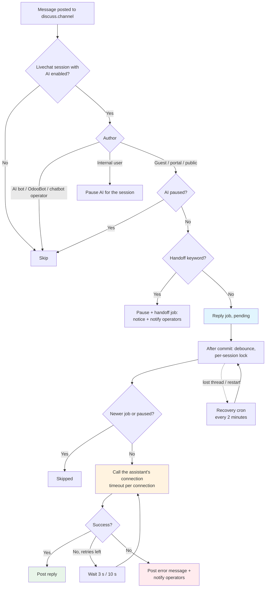
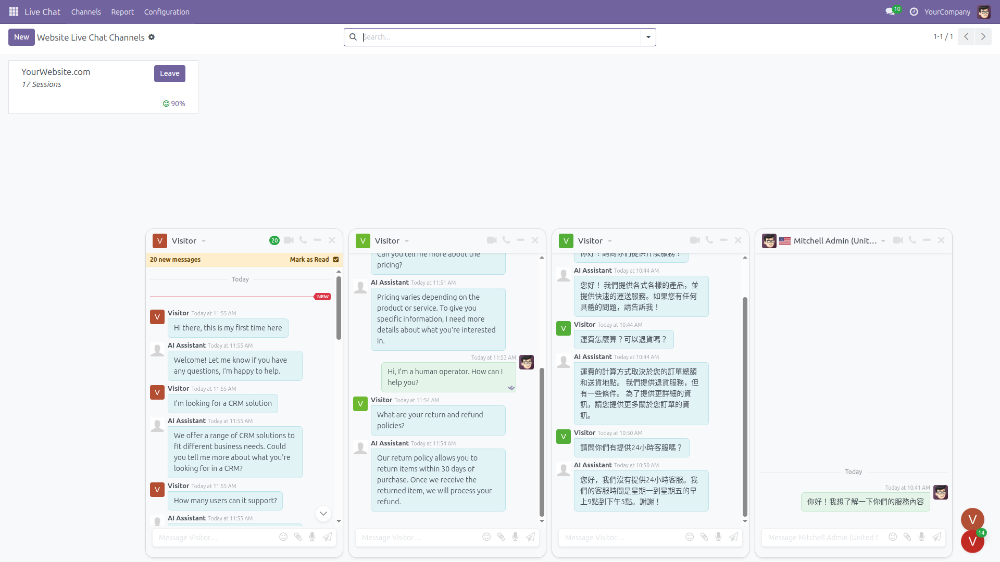
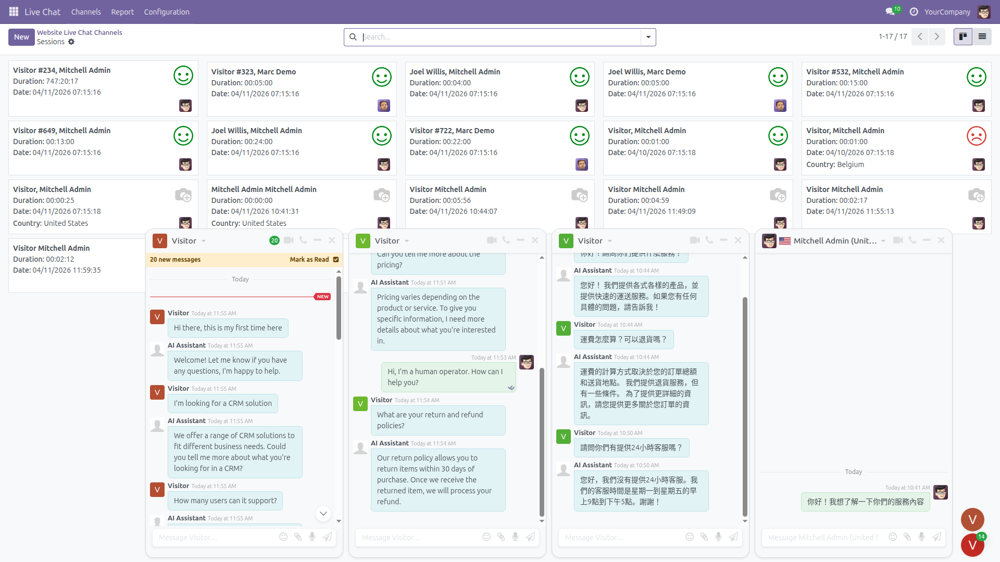
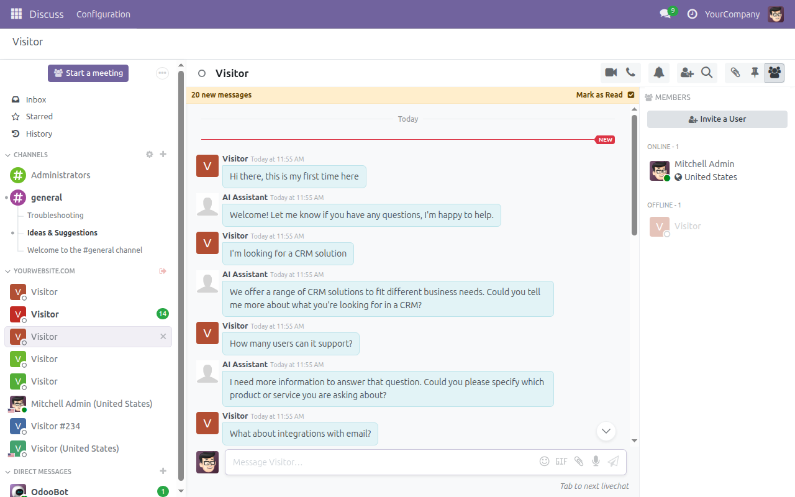
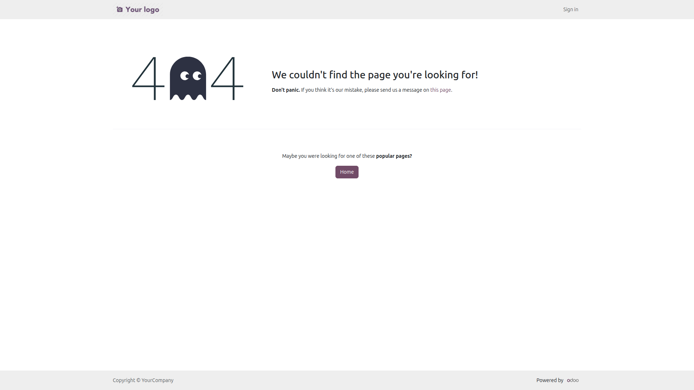
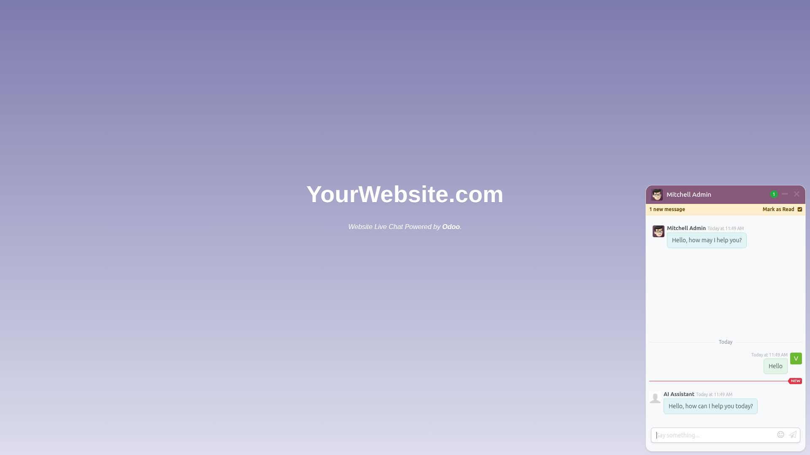
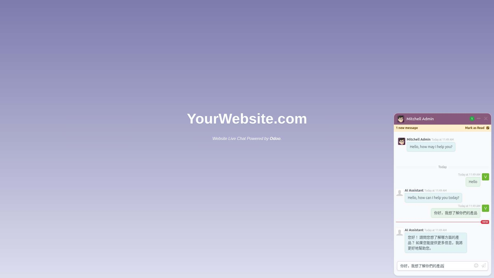
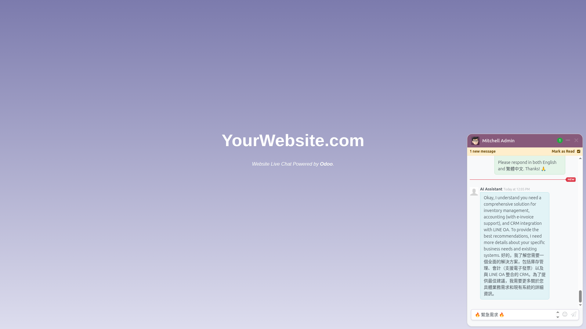

<p align="center">
  
  
  
  
  <a href="https://github.com/WOOWTECH/Woow_odoo_ai_livechat/actions/workflows/odoo-tests.yml"></a>
</p>

# Live Chat AI Integration for Odoo 18

**Answer Odoo Live Chat visitors with AI assistants. Each channel picks an AI assistant; the assistant's AI connection is a LiteLLM server or an n8n webhook. Durable reply jobs and human handoff. Odoo records, forwards and manages; the backend does the rest.**

> [繁體中文版 README](README_zh-TW.md)

---

## Table of Contents

- [Three separate AI products](#three-separate-ai-products)
- [Alignment (contract v1)](#alignment-contract-v1)
- [Overview](#overview)
- [Upgrading to 18.0.2.0.0](#upgrading-to-180200)
- [Upgrading to 18.0.1.2.1](#upgrading-to-180121)
- [Upgrading to 18.0.1.2.0](#upgrading-to-180120)
- [Upgrading from 18.0.1.0.x](#upgrading-from-18010x)
- [Why Use This Module](#why-use-this-module)
- [Architecture](#architecture)
- [Features](#features)
- [Screenshots](#screenshots)
- [Installation](#installation)
- [Configuration](#configuration)
- [AI backends: LiteLLM and n8n](#ai-backends-litellm-and-n8n)
- [Protocol](#protocol)
- [Module Structure](#module-structure)
- [Privacy and security](#privacy-and-security)
- [Testing](#testing)
- [Troubleshooting](#troubleshooting)
- [Dependencies](#dependencies)
- [Contributing](#contributing)
- [Changelog](#changelog)
- [License](#license)
- [Credits](#credits)

---

## Three separate AI products

Since 2026-11-24 discuss AI, project AI and Live Chat AI are three separate products. Each has its own runtime core and is downloaded and deployed on its own; they share no code and no data.

| Product | Modules | Repository |
|---|---|---|
| Discuss AI | `woow_ai_contact`, `woow_ai_contact_portal_discuss` | Gitea `woow-paas/Woow_odoo_discuss_ai` (GitHub mirror `WOOWTECH/Woow_odoo_discuss_ai`) |
| Project AI | `woow_ai_task` | Gitea `woow-paas/Woow_odoo_project_ai` |
| Live Chat AI (this repository) | `im_livechat_ai` | GitHub `WOOWTECH/Woow_odoo_ai_livechat` |

Live Chat AI is upgraded in place (18.0.2.0.0). The bridge `woow_ai_contact_livechat`, which once moved Live Chat channels onto the Discuss AI core, was removed from Discuss AI in 18.0.2.1.0 and was installed on no site; this module refuses to upgrade while it is installed.

## Alignment (contract v1)

The three products are configured and run the same way through one written contract, [docs/CONTRACT.md](docs/CONTRACT.md): connection and assistant fields, roles and menus, how a turn runs, the n8n and LiteLLM wire formats, what people see, logs and usage, `neutralize.sql`, the zh_TW glossary and the upgrade rules. **This release (18.0.2.0.0) implements contract v1.** Live Chat is the text-only product: whole (not streamed) LiteLLM replies, no identity block in the system message, clickable links only to the site's own hosts (contract 3.1).

The contract package is copied byte for byte into `im_livechat_ai/tests/contract/` (fixtures, the shared checks and `SHA256SUMS`; check with `cd im_livechat_ai/tests/contract && sha256sum -c SHA256SUMS`). `tests/test_contract.py` runs the twelve contract checks against this module's own code (test tag `woow_ai_contract`). Never edit the package here: a contract change is a new contract version.

---

## Overview

**im_livechat_ai** answers Odoo Live Chat visitors through an AI backend. When a visitor (a website guest or a logged-in portal customer) writes in a channel whose AI is on, the module queues a reply job in the same transaction as the message and, after commit, sends the conversation to the backend of **the channel's AI assistant**. The answer is posted back into the conversation by the assistant's bot partner.

Two layers, as in Discuss AI and Project AI (contract 3.2):

| Layer | Who sets it up | Where | What |
|---|---|---|---|
| **AI connection** 「AI 連線」 | system administrators | Live Chat > Configuration > AI Connections | where the brain is: **LiteLLM** (OpenAI chat completions: base URL ending in `/v1`, API key, model) or an **n8n webhook** (production URL, optional signing secret); timeout, retries, how documents are sent, request content logging, 「可給客戶使用」, readiness and **Test Connection** |
| **AI assistant** 「AI 助理」 | system administrators | Live Chat > Configuration > AI Assistants | the persona: name and image (its bot partner), its AI connection, system prompt, history messages, error message; **「可用在 Live Chat」** makes it selectable for Live Chat channels |
| **Live Chat channel**, tab 「AI 助理」 | Live Chat managers | Live Chat > Configuration > Channels | **Answer With AI**, which AI assistant (only those available in Live Chat), welcome message, handoff texts, pause and wait minutes, optional handoff keywords |

Odoo only **records, forwards and manages** the conversation: the persona, tools (product lookup, Odoo MCP, ...), moderation and permissions belong to the backend. Operators stay in control: when an operator replies, or the visitor asks for a human, the AI pauses for that conversation. There is no default URL and no default model: AI stays off until a system administrator sets up an AI connection and an AI assistant and a Live Chat manager picks the assistant. Nothing of this module appears in the Settings app.

**Limits live in the LiteLLM key.** Give each Live Chat connection its own LiteLLM virtual key with requests and tokens per minute, parallel requests and a budget. Odoo has no usage limit, only technical queue caps: one reply at a time per conversation, at most 30 unfinished replies per Live Chat channel (system parameter `im_livechat_ai.max_active_jobs`; 0 turns the cap off), a 1.5 s debounce, at most 3 runs per reply job, and reply jobs older than 30 minutes are given up. **AI Usage** counts replies and tokens per month, as a reference for invoicing by hand. Details: [docs/PROTOCOL.md](docs/PROTOCOL.md#limits-and-queue-caps).

---

## Upgrading to 18.0.2.0.0

`-u im_livechat_ai` (or the platform upgrade gate, which runs it on the version change) moves every channel's backend settings into the two layers:

| What | Effect |
|---|---|
| Channels with AI on, an endpoint URL or a system prompt | Each gets its **own AI assistant** (name, prompt, history, error message; it reuses the channel's bot partner) with **「可用在 Live Chat」** ticked, and the channel picks it. **Answer With AI** stays as it was. |
| Backend type, URL, key, model, documents, timeout, retries | One **AI connection per distinct setting**: channels whose settings and key are all equal share one. The values follow the 18.0.1.3.5 runtime rules (the URL normalized; an n8n timeout of 0 becomes 120 s and a LiteLLM one 45 s; values below 10 s become 10 s; at most 2 retries; a history of 0 becomes 50). |
| The key | Copied and compared **in SQL only**: it never enters Python, a log, a description or an exception. The 18.0.1.x column keeps its copy for a rollback; it is cleared there when the key is replaced or removed on 18.0.2.0.0. |
| 「可給客戶使用」 | Always on for LiteLLM; off for n8n until a system administrator ticks it. Live Chat only shows a warning on the channel's tab. |
| Log Request Content | Off on the new connections; content stored for channels that logged it is erased. The old call logs are linked to their assistant and connection. |
| Menus | Live Chat > Configuration: 「AI 連線」, 「AI 助理」, 「回覆工作」, 「呼叫紀錄」, 「AI 用量」, for system administrators only. Live Chat managers keep the channel's 「AI 助理」 tab. |
| Hermes | Not supported any more (LiteLLM or n8n only). The server log lists (INFO, ids only) the connections that look like Hermes; they are not changed. |
| Translations | This module's shipped translations are reloaded: a translation an administrator changed for one of its terms is replaced by the shipped one. |

**What can stop answering after the upgrade.** An AI-enabled channel answers only when its assistant is active and available in Live Chat and its connection is ready: active, an allowed URL and, for LiteLLM, a key and a model. The upgrade copies the settings as they were, so a channel that could not answer before (no URL, LiteLLM without a key or a model) still cannot. It now gets **no reply job**: the conversation gets one notice per blocked period and the operators one alert. The post-migration WARNING line lists those channel ids.

**Before you upgrade:**

1. Check the version: `SELECT latest_version FROM ir_module_module WHERE name = 'im_livechat_ai';` must be 18.0.1.1.0 or later (all known sites run 18.0.1.3.5).
2. Run this read-only inventory (18.0.1.2.0 or later; it prints ids and booleans only):

   ```sql
   SELECT id, ai_enabled,
          COALESCE(btrim(ai_endpoint_url), '') <> '' AS has_url,
          ai_api_token_secret IS NOT NULL AS has_key,
          COALESCE(ai_backend_type, 'openai') AS backend,
          COALESCE(btrim(ai_model), '') <> '' AS has_model
     FROM im_livechat_channel
    WHERE ai_enabled OR COALESCE(btrim(ai_endpoint_url), '') <> ''
    ORDER BY id;
   ```

   A row with `ai_enabled` and no URL, or with `backend = 'openai'` and no key or no model, is a channel that will be blocked: fix it on 18.0.1.3.5 first, or turn its AI off.

**The upgrade stops, and changes nothing, when:**

- the database is below 18.0.1.1.0: upgrade to 18.0.1.3.5 first;
- `woow_ai_contact_livechat` is installed, to upgrade or to remove: uninstall it first;
- the retired 18.0.1.1.0 Settings view (`im_livechat_ai.res_config_settings_view_form_livechat_ai`) is still there and is not the plain original (edited, inherited by another view, or with another xmlid), or another Settings view still names one of the removed `livechat_ai_*` fields: review those views by hand. The plain retired view is deleted automatically.

**After the upgrade:** read the WARNING line, open **AI Connections** (readiness, **Test Connection**) and give every LiteLLM key its limits.

**Rollback to 18.0.1.3.5.** Prefer fixing forward. To go back, deploy the 18.0.1.3.5 code and run `-u im_livechat_ai`. The 18.0.1.x channel columns were kept for one version, so the channels get back the settings they had at the upgrade. Assistants and connections created or changed on 18.0.2.0.0 are lost, a key replaced on 18.0.2.0.0 must be entered again, and channels created on 18.0.2.0.0 have no 18.0.1.3.5 settings: turn their AI off. Odoo keeps the tables of removed models and a later re-upgrade would reuse their rows, so after a successful rollback run this once (it prints nothing; it is `im_livechat_ai/migrations/18.0.2.0.0/rollback-cleanup.sql`). It deletes the monthly AI Usage of the rolled-back period too (its rows point to the assistants and the connections): export the AI Usage list first if you invoice from it.

```sql
DO $$
BEGIN
  IF NOT EXISTS (SELECT 1 FROM ir_model WHERE model IN ('im_livechat.ai.connection', 'im_livechat.ai.assistant')) THEN
    IF to_regclass('im_livechat_ai_usage_month') IS NOT NULL THEN DELETE FROM im_livechat_ai_usage_month; END IF;
    IF to_regclass('im_livechat_ai_assistant') IS NOT NULL THEN DELETE FROM im_livechat_ai_assistant; END IF;
    IF to_regclass('im_livechat_ai_connection') IS NOT NULL THEN DELETE FROM im_livechat_ai_connection; END IF;
    DELETE FROM ir_attachment WHERE res_model IN ('im_livechat.ai.assistant', 'im_livechat.ai.connection');
  END IF;
END $$;
```

It removes the keys and frees the bot partners, so a later re-upgrade gives each channel one assistant again, with its bot partner. **Never uninstall as a rollback:** uninstalling drops the module's tables, with the connections and their keys, the assistants, the reply jobs and the call logs.

---

## Messages answered by another automation (18.0.1.3.0)

A message posted with the context key `im_livechat_ai_skip` is recorded in the
session but never answered, paused or handed off by the AI. The LINE bridge
(`woow_odoo_line_liff` 18.0.3.4.0, and the BNI keyword menu) posts a visitor's
message this way when its keyword auto-reply has already answered it, so the
visitor does not get two answers. Messages written as a company's own partner
(automations posting as the company) count as the bot, never as a visitor.

## Upgrading to 18.0.1.2.1

Upgrade straight to 18.0.1.2.1; do not stop at 18.0.1.2.0 when coming from 18.0.1.1.0.
18.0.1.2.0 removed the Settings page, but the old Settings view stayed in the database until
the very end of the upgrade. When another installed module also adds to the Settings form and
loads after this one, its view check sees the old view (which names the removed
`livechat_ai_*` fields) and the whole upgrade stops with
`Field "livechat_ai_base_url" does not exist in model "res.config.settings"`.
The 18.0.1.2.1 pre-migration deletes that view first. It also repairs a database where an
18.0.1.2.0 upgrade already stopped this way: upgrade it again with 18.0.1.2.1.
Nothing else changes.

## Upgrading to 18.0.1.2.0

`-u im_livechat_ai` (or the platform upgrade gate) runs the 18.0.1.2.0 post-migration:

| What | Effect |
|---|---|
| Backend type | `OpenAI compatible` on every channel (18.0.1.1.0 only spoke that protocol). |
| `im_livechat_ai.base_url` / `im_livechat_ai.api_key` (Settings > Live Chat AI) | Copied to **every** channel's Endpoint URL (trailing `/` and `/chat/completions` removed) and Access Token, where the channel has none yet. A key without a URL gets the URL 18.0.1.1.0 used by default. |
| `im_livechat_ai.log_payload` / `im_livechat_ai.log_retention_days` | Copied to every channel (**Log Conversation Content**, **Log Retention (days)**). |
| All `im_livechat_ai.*` system parameters | Deleted (the key included; the model cache is no longer used). |
| **Enable AI Integration**, model | Unchanged: a channel with AI on and copied credentials keeps answering. The model stays as text. |
| **Human Handoff Keywords** still equal to the 18.0.1.1.0 default list | Cleared (owner decision 40: the backend decides the handoff; the keywords are an optional pre-filter, empty by default). Custom lists are kept. The WARNING line has the count. |
| **Visitor Files** (new) | "Download link only" on Hermes channels (model `hermes-agent` or an endpoint URL containing `hermes`), "Attach the file" on the others. A value already set is kept. |
| Settings > Live Chat AI, menu Live Chat > Configuration > AI Settings | Removed. |
| Product lookup tools, Temperature, Max Tokens, model list, identity block | Removed: the backend does this now. |

The server log has one WARNING line with counts only (channels, URLs and tokens copied, parameters deleted, AI-enabled channels with a connection), never values. The script is idempotent: once the parameters are gone a re-run changes nothing, and values already on a channel are never overwritten. A database without these parameters (and with AI off) is left as it is.

After the upgrade, a channel that relied on the Odoo product tools answers without them: point it at a backend that has its own product data tools (for example Hermes or n8n with the Odoo MCP server), or keep AI off there.

---

## Upgrading from 18.0.1.0.x

> **AI replies are OFF after the upgrade until an administrator configures each channel's backend.**

Upgrading to 18.0.1.1.0 (`-u im_livechat_ai`, or the platform upgrade gate, which runs it when the manifest version changes) does the following automatically:

| What | Effect |
|---|---|
| Per-channel **API URL** and **API key** | Values wiped before the new code loads (pre-migration), then the columns are dropped. Old keys never stay in the database. |
| **Enable AI Integration** | Turned off on **every** channel. The server log lists the channels that had AI on. |
| **Retry Delay** | Removed (fixed backoff of 3 s, then 10 s). **Max Retries** converted from total calls to retries (old value - 1, at most 2). |
| Default English **Error Message** (or empty) | Replaced by the Traditional Chinese default. Custom messages are kept. |
| **Human Handoff Keywords** equal to the earlier default `真人,客服,人工,真人客服,human,agent,operator` (or empty) | Replaced by the new default of explicit requests (see [Step 5](#step-5-human-handoff)). Customised keywords are kept. |
| AI bot partners | Archived and tagged "AI 機器人", like Odoo chatbot partners; partners without an image get the module's robot avatar. |
| Existing **API logs** | Conversation content and upstream response bodies removed. |

Every row above except the API URL/key columns (turning AI off, Max Retries, error message, handoff keywords, bot partners and avatars, log scrub) only happens when the pre-migration finds the 18.0.1.0.x columns (`ai_api_key`, `ai_api_base_url` or `ai_retry_delay`); it passes that to the post-migration in the temporary system parameter `im_livechat_ai.migration_1_1_0_legacy`, which the post-migration deletes. Running the 18.0.1.1.0 scripts again on an already migrated database changes nothing, also not values an administrator cleared or changed after the upgrade (an emptied bot name or error message, an unarchived bot partner).

### Rollout: replies after a restart or deploy

AI replies are normally sent by a thread of the Odoo process that received the visitor's message. Replies that were in progress when that process stopped (restart, deploy, worker recycled), and the AI answers sent when a handoff wait ends without an operator, are sent by the scheduled action **Live Chat AI: Recover Reply Jobs** (every 2 minutes), so they can take **about 1-2 minutes**. A **cron process is required**: run Odoo with `max_cron_threads >= 1` (or a separate cron process, e.g. `odoo --no-http --max-cron-threads=1`). Since 18.0.2.0.0 system administrators monitor it on the AI assistant form (**Reply Processing**: last run of the cron and unfinished jobs older than 5 minutes, with a warning) and in **Live Chat > Configuration > Reply Jobs**.

After an upgrade from 18.0.1.0.x (directly to 18.0.1.2.0 the 18.0.1.1.0 and 18.0.1.2.0 scripts both run), a system administrator:

1. Opens **Live Chat > Configuration > Channels**, the channel, tab **AI Integration**.
2. Chooses the **Backend Type**, enters the **Endpoint URL**, the **Access Token** (and the **Model** for LiteLLM), saves.
3. Clicks **Test Connection**, then re-enables AI on the channel.

Revoke the old per-channel provider keys at the provider: the upgrade removes them from Odoo, but copies may exist elsewhere (backups, git history, logs).

---

## Why Use This Module

| Aspect | Without This Module | With This Module |
|---|---|---|
| **Response Time** | Visitors wait for a human agent | AI responds within seconds, 24/7 |
| **Agent Workload** | Every inquiry requires human attention | AI handles routine questions; operators take over at any time |
| **Backends** | -- | AI assistants on LiteLLM or n8n connections, one picked per channel |
| **Reliability** | -- | Reply jobs survive restarts; rapid messages get one reply |
| **Human Handoff** | -- | Operator reply or "真人 / 客服" pauses the AI and notifies operators |
| **Key Safety** | -- | Keys set by system administrators only, write-only, never logged; the n8n signing secret is never sent |
| **Privacy** | -- | Call logs without conversation content by default, system administrators only |
| **Infrastructure** | External services, middleware, glue code | Odoo records and forwards; the backend owns tools and permissions |

---

## Architecture

### High-Level Flow

```
┌─────────────┐   ┌───────────────────┐   ┌───────────────────────┐   ┌──────────────┐
│   Visitor   │──>│  Odoo Live Chat   │──>│  im_livechat.ai.job   │──>│ channel backend:   │
│  (Browser)  │<──│ (discuss.channel) │<──│ (after commit thread, │<──│ openai /v1/chat/   │
└─────────────┘   └───────────────────┘   │  recovery cron)       │   │ completions, or a  │
   Chat UI          _notify_thread():      └───────────────────────┘   │ signed n8n webhook │
                    create job in the                                  └────────────────────┘
                    visitor's transaction
```

### Sequence Diagram

```mermaid
sequenceDiagram
    participant V as Visitor (Browser)
    participant O as Odoo Live Chat
    participant J as AI reply job
    participant B as Channel backend (openai / n8n)

    V->>O: Send chat message
    O->>O: _notify_thread()
    alt operator message
        O->>O: pause AI for the session (30 min)
    else visitor asks for a human (keyword)
        O->>J: handoff job (same transaction)
        J-->>V: handoff notice (once)
        J->>O: notify operators (OdooBot + toast)
    else visitor message, AI on, not paused
        O->>J: reply job, state pending (same transaction)
        Note over O,J: COMMIT, then postcommit starts a thread
        J->>J: wait 1.5 s (debounce), take per-session lock
        J->>J: newer job in the session? -> skipped
        J->>J: _ai_conversation(): history, prompt, events
        J->>B: POST (openai: Bearer; n8n: signed body)
        B-->>J: answer (n8n: reply / replies / skip)
        J->>J: still the newest job and not paused?
        J-->>V: post reply as the bot partner
    end
```

### Decision Flowchart



---

## Features

### Core Capabilities

- **AI assistants and AI connections** -- System administrators set up AI connections (LiteLLM or an n8n webhook, with the key and call settings) and AI assistants (the persona: its connection, prompt, history and error message), and tick 「可用在 Live Chat」 on the assistants meant for visitors. Live Chat managers pick one of those per channel; they never see a URL, a key or a prompt.
- **Readiness** -- Every connection has a readiness check (「可以使用」 or 「未就緒」, with fixed reasons) and a **Test Connection** button (LiteLLM `GET /models`, n8n ping). A channel whose AI cannot answer queues no job: the visitor gets one notice per blocked period, the operators one alert.
- **Multi-turn context** -- Recent history (1-200 messages). Visitors are `user` turns, the AI bot is `assistant`, operators are `user` turns marked `[真人客服 name]` (as in `woow_ai_contact`), and a conversation event tells the AI not to contradict them. OpenAI messages always start and end with a user turn.
- **Visitors and portal customers** -- Guests, logged-in portal customers and the public user are answered, and so is an employee who opens the website chat as the visitor; operators (the session operator and internal users who join) and the bots never trigger the AI. Only visitor chat messages are answered, not the rating/feedback notification.

### Reliability (job queue)

- **Durable reply jobs** (`im_livechat.ai.job`) -- Created in the same transaction as the visitor message, so a job exists exactly when the message was committed. Processing starts after commit.
- **One reply for rapid messages** -- 1.5 s debounce, a PostgreSQL advisory lock per conversation (works across prefork workers and the cron process), and a job that has a newer job in the same conversation is skipped; the newest one answers with the full context.
- **Bounded calls** -- The connection's timeout bounds the whole answer, retries included (10 - 300 s; 45 s for LiteLLM and 120 s for n8n by default). At most 2 retries (0 - 2, default 1; waits 3 s, then 10 s, only within the timeout), and only when the request was not sent or the backend answered HTTP 429 / 503 -- never after a read timeout (the backend may still be working; a workflow is never started twice). At most 3 processing runs per job.
- **Recovery cron** -- Every 2 minutes, jobs left pending or running by a restart or crash are run again; a job is never answered twice (it is skipped when the bot already replied after its message). Unfinished jobs older than 30 minutes are given up. The cron also runs the deferred replies of a handoff wait (triggered for the end of the wait). Requires a cron process (see [Rollout](#rollout-replies-after-a-restart-or-deploy)).
- **Monitoring** -- The **Reply Processing** block of the AI assistant form (system administrators) shows the cron's last run and the pending/running jobs older than 5 minutes, with a warning when the cron has not run for 5 minutes or jobs are stuck.
- **Failure handling** -- After the last retry the visitor gets the AI assistant's error message (a default in the visitor's language when it is empty) and the operators are notified (OdooBot message and a sticky notification; after HTTP 429 at most once per channel in 10 minutes).
- **Visible queue** -- **Live Chat > Configuration > Reply Jobs** (system administrators) shows every job's status, runs, backend calls and short error.

### Human Handoff

Two kinds of pause, stored on the conversation (`discuss.channel.ai_paused_until`, `ai_pause_reason`):

- **Operator replied** (`operator`) -- When an internal user posts in a conversation, the AI stays quiet there for **30 minutes** (**Pause After Human Reply**, per channel, 1-1440). Each further operator post extends the pause to now + 30 minutes (never shortens it). During this pause the AI sends nothing: no reply, no notice.
- **Visitor asked for a human** (`handoff`) -- **The backend decides** (owner decision 40, the same protocol as Discuss AI): the visitor message goes to the backend as usual, and an answer that asks for a human hands over. LiteLLM backends end the reply with a line `[[handoff]]` (case-insensitive; spaces inside, backticks and the markdown escape `\[\[handoff\]\]` are accepted); n8n answers `"handoff": true` (top level or first item of an item list, optional `"handoff_reason"`, at most 300 characters kept), or ends `output` with the marker. Odoo removes the marker, posts the reply text (the channel's **Handoff Message** when there is none; with `handoff`, `skip` is ignored), then runs the handoff: the AI **waits 10 minutes** for an operator (**Wait For Human After Handoff Request**, 1-1440), the operators are notified (with the reason) and the reply job records it (**Handoff Decided By** = AI backend, **Handoff Reason**). If an operator posts while the backend is answering, the answer is discarded and nothing is handed over. **The only prompt text Odoo adds** for this: on a channel with operators (an internal user among the Live Chat channel's operators) the system message of a LiteLLM request ends with the line 「訪客要求真人客服、想跟真人說話時，在回覆最後單獨一行寫 [[handoff]]，系統就會轉接真人客服（不要說無法轉接；只問電話或聯絡方式不算）。When the visitor asks for a human, end your reply with a line [[handoff]] and Odoo hands the conversation to a human operator.」; n8n gets `channel.livechat.handoff_available`. **Handoff keywords** are an optional pre-filter, **empty by default**: a visitor message containing one is handed over at once without calling the backend (Chinese entries match anywhere, English words or phrases as whole words, case-insensitive).
- **Waiting notice** -- The first visitor message during that wait gets one fixed reply (**Waiting Notice**, default "已通知客服人員，請稍候。若客服暫時無法回覆，AI 助理會在 10 分鐘後繼續為您服務。"; `%(minutes)s` is replaced with the wait minutes). Once per wait (`discuss.channel.ai_pause_notice_sent`), no backend call.
- **Operator takes over** -- An operator post during the wait turns it into an operator pause that ends 30 minutes after that post, even when the wait was set longer (a 120-minute wait does not keep the AI quiet for 120 minutes); the notice and the deferred replies are dropped quietly.
- **Auto-resume** -- If no operator replied when the wait ends, the AI answers everything the visitor wrote during the wait, without the visitor writing again: each such message gets a deferred reply job due at the end of the wait (`im_livechat.ai.job.deferred`), the recovery cron is triggered for that time, and the newest job answers them all in one reply (the others are skipped). Expect the answer within about a minute after the wait ends (cron wake-up).

### Privacy & Operations

- **Call logs for system administrators only** -- One row per answer: time, assistant, connection, backend type, model, tokens, duration, status (`ok`, `http_error`, `timeout`, `invalid_response`, `error`), HTTP status and the exception type name.
- **No conversation content by default** -- **Log Request Content** (per AI connection, off) stores request/response bodies only while debugging; turning it off erases what that connection stored. The key is never part of a stored body.
- **Retention** -- Call logs and finished jobs older than 30 days are deleted daily. **AI Usage** keeps one row per assistant, connection, channel and month.
- **Short errors** -- Test buttons and logs show the HTTP status and one short sentence; the server log gets ids, the HTTP status and exception type names, never an upstream body or exception text.

### AI Disclosure

- **Welcome message** -- While AI is enabled, the chat window shows the channel's **AI Welcome Message** (default for new channels "您好，我是 AI 客服助理，有什麼可以幫您？需要真人客服請輸入「找真人」。") instead of the Odoo welcome message.
- **Bot avatar** -- AI messages are posted by the AI assistant's bot partner, with the assistant's name and image (the module's robot avatar, `static/img/ai_bot.png`, when it has none).
- **Identity** -- Odoo adds no identity block: the backend (or the assistant's optional system prompt) decides the persona.
- **Limit** -- The chat window header (and the author of the welcome message) still shows the session's human operator, as Odoo assigns one to every live chat session; the module does not change it.

### Security & Safety

- **Markdown replies, XSS-safe** -- AI replies are rendered as markdown (paragraphs, `**bold**`, lists, pipe tables, headings, `code` and code blocks) by a small built-in renderer; every piece of text is escaped first and the result sanitized; only links to the store's own hosts become links.
- **Loop prevention** -- AI bots, OdooBot and the session operator never trigger the AI.
- **Settings by role** -- AI connections and AI assistants are for system administrators only (the key is write-only). The channel's 「AI 助理」 tab is for Live Chat managers, who see the assistant's description and state, never a URL, a key or a prompt. Operators, employees and portal customers read none of it. The bot partner is created by the module and cannot be chosen.
- **Links only to the store** -- AI replies only turn URLs of `web.base.url` and the website domains into links; other URLs stay plain text.
- **Traditional Chinese** -- English source strings with a full `zh_TW` translation (the contract glossary); default visitor texts and operator alerts in each person's language.

---

## Screenshots

> The screenshots were taken with 18.0.1.0.0. Since 18.0.2.0.0 the channel's 「AI 助理」 tab only picks an AI assistant; the backend settings are on the AI connection and the AI assistant.

### Livechat Channel List

<p align="center">
  
</p>
<p align="center"><em>Overview of livechat channels with AI integration status</em></p>

### AI Configuration Tab

<p align="center">
  
</p>
<p align="center"><em>Per-channel AI configuration (18.0.1.0.0 layout)</em></p>

### Admin Discuss View

<p align="center">
  
</p>
<p align="center"><em>Administrator view of AI-powered conversations in Odoo Discuss</em></p>

### Visitor Chat Experience

<p align="center">
  
</p>
<p align="center"><em>Visitor-facing livechat widget with AI responses</em></p>

### End-to-End Test Results

<p align="center">
  
  
</p>
<p align="center"><em>E2E tests: basic greeting (left) and Chinese language support (right)</em></p>

<p align="center">
  
</p>
<p align="center"><em>Stress test with concurrent conversations</em></p>

---

## Installation

### Standard Odoo Installation

1. **Clone the repository** and add it to the addons path. The canonical module is the `im_livechat_ai/` directory at the repository root (the only copy):

   ```bash
   git clone https://github.com/WOOWTECH/Woow_odoo_ai_livechat.git /path/to/Woow_odoo_ai_livechat
   ```

   ```ini
   addons_path = /path/to/odoo/addons,/path/to/Woow_odoo_ai_livechat
   ```

2. **Update the module list** in Odoo:

   - Navigate to **Apps** and click **Update Apps List**
   - Search for **"Live Chat AI Integration"**
   - Click **Install**

3. **Dependencies**: `im_livechat` (required).

4. **Set up an AI connection and an AI assistant, then pick the assistant on a channel** (see [Configuration](#configuration)); AI stays off until then.

### Docker / Podman Deployment

A local development stack is provided in `odoo-ailivechat/`. It mounts the canonical module from the repository root (`../im_livechat_ai`). No password is committed: copy the templates and fill them in.

1. **Create the local config** (both files are git-ignored):

   ```bash
   cd odoo-ailivechat/
   cp .env.example .env                           # set POSTGRES_PASSWORD (e.g. openssl rand -base64 24)
   cp config/odoo.conf.example config/odoo.conf   # admin_passwd empty = database manager locked
   ```

2. **Start the containers:**

   ```bash
   docker compose up -d
   # or
   podman-compose up -d
   ```

   This starts two containers:
   - `odoo-ailivechat-web` -- Odoo 18 (port `ODOO_PORT`, default 9094, mapped to internal 8069)
   - `odoo-ailivechat-db` -- PostgreSQL 16

3. **Create the database with the module** (the database manager is disabled by `list_db = False`):

   ```bash
   docker compose run --rm odoo -d odooailivechat -i im_livechat_ai --without-demo=all --stop-after-init
   docker compose restart odoo
   ```

4. **Access Odoo** at `http://localhost:9094`.

---

## Configuration

**Live Chat > Configuration** holds, for system administrators, 「AI 連線」 (AI Connections), 「AI 助理」 (AI Assistants), 「回覆工作」 (Reply Jobs), 「呼叫紀錄」 (Call Logs) and 「AI 用量」 (AI Usage). Live Chat managers use the channel's 「AI 助理」 tab.

### Step 1: AI connection (system administrators)

| Field | Description | Default |
|---|---|---|
| **Backend** (`backend_type`) | 「LiteLLM（OpenAI 相容）」 (stored `openai`) or 「n8n webhook」 (`n8n`). | LiteLLM |
| **Endpoint URL** (`endpoint_url`) | LiteLLM: the base URL ending in `/v1` (`/chat/completions` is added). n8n: the full production webhook URL (a Chat Trigger: `…/webhook/<id>/chat`). `https://` only; `http://` only for `localhost`, `127.0.0.1`, `::1` and hosts ending in `.svc.cluster.local`. | *(empty)* |
| **API Key** (`api_key`) | LiteLLM (required): sent as `Authorization: Bearer`. n8n: the optional **Signing Secret** of `X-Woow-Signature` (never sent; empty = requests are not signed). Write-only: never shown again; leave it empty to keep it. Changing the endpoint host or the backend type removes it, and so does **Remove API Key**. | *(empty)* |
| **Model** (`model`) | LiteLLM only: the LiteLLM model name, which picks the deployment. A LiteLLM connection without one is saved but not ready. | *(empty)* |
| **Timeout (seconds)** (`timeout_seconds`) | The whole answer, retries included, 10 - 300. Replies are not streamed: the visitor gets the whole answer, or the error message when the time is up. | 45 (LiteLLM), 120 (n8n) |
| **Retries** (`max_retries`) | 0 - 2, only when the request was not sent or the backend answered HTTP 429 / 503 (waits 3 s, then 10 s, within the timeout). | 1 |
| **Documents Users Send** (`document_mode`) | LiteLLM: 「把檔案送給模型」 (documents up to 4 MB as `file` parts) or 「只給下載連結」 (signed links). Images are always inlined; n8n always gets links. | 把檔案送給模型 |
| **Log Request Content** (`log_payload`) | Debugging only: keep request and response bodies in the call logs. Turning it off erases them. | Off |
| **Safe for Customers** (`customer_safe`) | Always on for LiteLLM (chat only: Odoo never sends tools). n8n: tick it only when the workflow looks up no company data, calls no tools and keeps no memory across conversations; it is cleared when the URL or the type changes. Live Chat shows a warning on the channel instead of refusing. | n8n: off |
| **Readiness** (`readiness`) | 「可以使用」 or 「未就緒」 with fixed reasons (archived, no URL, URL not allowed, LiteLLM without key or model). | -- |
| **Test Connection** | LiteLLM: `GET {endpoint}/models` with the key (a warning when the model is not in the list). n8n: a signed `{"event": "ping", …}` that must get HTTP 200. Shows the HTTP status and one sentence only. | -- |

### Step 2: AI assistant (system administrators)

| Field | Description | Default |
|---|---|---|
| **Name** and image | What visitors see as the author of the AI replies; the bot partner follows them (the module's robot avatar when there is no image). | -- |
| **AI Connection** (`connection_id`) | Where the brain is. Several assistants may share one connection. | -- |
| **Available in Live Chat** (`livechat_available`) | 「可用在 Live Chat」: Live Chat managers can pick this assistant for their channels only while it is ticked. Every Live Chat channel can be reached by anonymous visitors: tick it only for assistants meant for the public. | Off |
| **Description** | Shown to Live Chat managers when they pick the assistant. | *(empty)* |
| **System Prompt** (`system_prompt`) | Optional instructions sent with every request. | *(empty)* |
| **History Messages** (`max_history`) | Recent messages sent as context, 1 - 200. | 50 |
| **Error Message** (`error_message`) | Posted to the visitor when the backend fails. Empty: a default in the visitor's language (zh_TW: 抱歉，AI 客服暫時無法回覆。請稍後再試，或留下您的聯絡方式，我們的客服人員會盡快與您聯繫。). | *(empty)* |
| **Bot Partner** (`partner_id`) | Archived partner tagged 「AI 機器人」, created automatically. | Auto |
| **Reply Processing** | How replies run, the recovery cron's last run and stuck reply jobs (all channels), with a warning. | -- |

An assistant or a connection that an AI-enabled channel answers with cannot be archived, unticked or made not ready: turn the channel's AI off first, or pick another assistant for it.

### Step 3: The channel's 「AI 助理」 tab (Live Chat managers)

| Field | Description | Default |
|---|---|---|
| **AI Assistant** (`ai_assistant_id`) | One of the assistants available in Live Chat; its description is shown. | *(empty)* |
| **Answer With AI** (`ai_enabled`) | Turn AI replies on for this channel. Needs an assistant that can answer. | Off |
| **AI Status** (`ai_state`) | 「關閉」, 「可以使用」 or 「未就緒」 with the reason (fixed sentences, never a URL or a key), and a warning when the assistant's connection is not marked 「可給客戶使用」. | -- |
| **AI Welcome Message** (`ai_welcome_message`) | Welcome message of the chat window while AI is on, so visitors know they talk to an AI. | zh_TW: 您好，我是 AI 客服助理，有什麼可以幫您？需要真人客服請輸入「找真人」。 |
| **Test Connection** | For system administrators: tests the assistant's connection (the n8n ping names the channel and the assistant). | -- |

### Step 4: Human handoff (Live Chat managers)

| Field | Description | Default |
|---|---|---|
| **Pause After Human Reply (minutes)** (`ai_handoff_pause_minutes`) | How long the AI stays quiet after an operator post (each post extends it), 1 - 1440. | `30` |
| **Wait For Human After Handoff Request (minutes)** (`ai_handoff_wait_minutes`) | How long the AI waits for an operator after a handoff request before it answers again, 1 - 1440. | `10` |
| **Human Handoff Keywords** (`ai_handoff_keywords`) | Optional pre-filter (the backend decides the handoff, see [Human Handoff](#human-handoff)): comma-separated; a visitor message containing one is handed over without calling the backend. Chinese entries match anywhere, English words/phrases match whole words, case-insensitive. Example: `找真人,轉人工,talk to a human`. | *(empty)* |
| **Handoff Message** (`ai_handoff_message`) | Sent once to the visitor who asked for a human. | zh_TW: 已幫您通知客服，請稍候。 |
| **Waiting Notice** (`ai_pause_notice`) | Sent once to the first visitor message during the wait; `%(minutes)s` becomes the wait minutes (other text is sent as written). | zh_TW: 已通知客服人員，請稍候。若客服暫時無法回覆，AI 助理會在 %(minutes)s 分鐘後繼續為您服務。 |

The pause is stored on the conversation: `discuss.channel.ai_paused_until`, `ai_pause_reason` (`operator` / `handoff`) and `ai_pause_notice_sent`. See [Human Handoff](#human-handoff) for the behaviour. The default texts of a new channel are in the language of the user who creates it.

### Step 5: Monitor (system administrators)

- **Reply Jobs**: the queue, with filters for pending/running, failed, skipped and handoff jobs; deferred replies of a handoff wait are marked **Deferred** and wait for their **Run After** time.
- **Call Logs**: one row per answer: status (`ok`, `http_error`, `timeout`, `invalid_response`, `error`), HTTP status, duration, tokens, assistant, connection and conversation. Content only while **Log Request Content** is on.
- **AI Usage**: replies, failed replies and tokens per assistant, connection, channel and month (UTC).
- **Reply Processing** on the AI assistant form: the recovery cron's last run and stuck jobs (see [Rollout](#rollout-replies-after-a-restart-or-deploy)).

---

## AI backends: LiteLLM and n8n

### LiteLLM

| Field | Value |
|---|---|
| Backend | 「LiteLLM（OpenAI 相容）」 |
| Endpoint URL | `https://litellm.example.com/v1` |
| API Key | a LiteLLM virtual key for this connection (`sk-...`), restricted to the model, with requests and tokens per minute, parallel requests and a budget: **the limits live in the key** |
| Model | required, e.g. `chatgpt-pool/gpt-6-sol` |

### n8n

| Field | Value |
|---|---|
| Backend | 「n8n webhook」 |
| Endpoint URL | the **production** webhook URL, e.g. `https://n8n.example.com/webhook/livechat-ai`, or in the cluster `http://n8n.<namespace>.svc.cluster.local:5678/webhook/livechat-ai`; a Chat Trigger: `…/webhook/<id>/chat` |
| Signing Secret | recommended: a random secret (`openssl rand -hex 32`), also given to the workflow as `WOOW_AI_SIGNING_SECRET`; empty for a public Chat Trigger (requests are then not signed) |
| Safe for Customers | only after checking the workflow: no company data, no tools, no memory across conversations |

Then click **Test Connection** (HTTP 200), create the AI assistant on this connection and tick 「可用在 Live Chat」; a Live Chat manager picks it on the channel and turns on **Answer With AI**.

---

## Protocol

The request and answer formats are in [docs/PROTOCOL.md](docs/PROTOCOL.md): the LiteLLM body and metadata, the n8n body and its signature, the accepted answers and the handoff, Test Connection, visitor files and signed download URLs, reply rendering, call logs and usage, and what happens when the AI cannot answer. They follow [contract v1](docs/CONTRACT.md): an n8n workflow written for Discuss AI reads the same keys (`assistant`, `user`, `channel`, `surface`, `message`, `history`, `events`), and Live Chat also sends `contact` (the Live Chat channel) for the workflows written for 18.0.1.x.

---

## Module Structure

```
im_livechat_ai/
├── __init__.py                          # uninstall hook (drops the 18.0.1.x key column)
├── __manifest__.py                      # v18.0.2.0.0
├── models/
│   ├── ai_connection.py                 # im_livechat.ai.connection 「AI 連線」: backend, URL,
│   │                                    #   write-only key (SQL-only column), model, timeout,
│   │                                    #   retries, readiness, Test Connection, in-use guard
│   ├── ai_assistant.py                  # im_livechat.ai.assistant 「AI 助理」: bot partner,
│   │                                    #   prompt, history, error message, 「可用在 Live Chat」
│   ├── ai_migration.py                  # 18.0.1.x channel settings -> connections, assistants
│   ├── ai_usage.py                      # im_livechat.ai.usage.month: monthly usage (SQL upsert)
│   ├── im_livechat_channel.py           # the channel's 「AI 助理」 tab (assistant, state),
│   │                                    #   handoff texts, requests, signing, answer parsing,
│   │                                    #   retries and deadline, blocked gate, call logs
│   ├── discuss_channel.py               # _notify_thread hook: pause on operator post,
│   │                                    #   handoff, job creation; author classification;
│   │                                    #   visitor identity; conversation; visitor files
│   ├── livechat_ai_job.py               # im_livechat.ai.job: durable reply queue, post-commit
│   │                                    #   threads, advisory lock, recovery cron, operator
│   │                                    #   alerts, usage counting
│   └── llm_api_log.py                   # llm.api.log: call logs (one row per answer)
├── tools/
│   ├── backend.py                       # URL rule, n8n signature, compact JSON, retry rule
│   └── markdown.py                      # AI reply markdown -> sanitized HTML
├── controllers/
│   └── main.py                          # signed download of visitor attachments
├── views/                               # AI connections, AI assistants, the channel's
│                                        #   「AI 助理」 tab, reply jobs, call logs, AI usage
├── data/
│   ├── ai_data.xml                      # 「AI 機器人」 tag, default bot partner, crons
│   └── neutralize.sql                   # a neutralized copy never calls a real backend
├── security/
│   └── ir.model.access.csv              # system administrators (Live Chat managers read
│                                        #   the assistants they may pick)
├── migrations/
│   ├── 18.0.1.1.0/ 18.0.1.2.0/ 18.0.1.2.1/  # the 18.0.1.x upgrades (unchanged)
│   └── 18.0.2.0.0/                      # guards, kept columns, connections and assistants
├── tests/                               # 491 tests, the contract checks included
│   └── contract/                        # contract v1 package (byte for byte, never edited)
└── i18n/
    ├── im_livechat_ai.pot               # English source strings
    └── zh_TW.po                         # Traditional Chinese (contract glossary)
```

The repository also contains `docs/` ([CONTRACT.md](docs/CONTRACT.md), [PROTOCOL.md](docs/PROTOCOL.md), plans and screenshots), `odoo-ailivechat/` (local Docker stack, mounts the module above) and `.github/workflows/odoo-tests.yml` (CI).

---

## Privacy and security

### Keys

The API key (LiteLLM) or signing secret (n8n) of an AI connection lives only in the SQL column `api_key_secret` (not an ORM field): no read, search, export or form ever returns it, a copy of the connection gets none, and it is dropped when the endpoint scheme, host or port or the backend type changes. The server log says only that a key was updated or removed, and by whom (ids). Connections and assistants are for system administrators only; the runtime reads them with sudo. The n8n secret is never sent, only the HMAC of the body. Redirects are never followed, so a key is never sent to another host. Uninstalling the module drops its tables, the connections and their keys included.

### Logs and conversation content

Call logs, reply jobs and usage are for system administrators only. A call log keeps the HTTP status and the exception type name, never the upstream body, a header or the key. Conversation content is stored only while the connection's **Log Request Content** is on (the base64 of files as `<N bytes base64 omitted>`); turning it off erases it. Server log lines carry ids, the uid and the HTTP status; an unexpected exception adds its type name and code frames, never its text. Call logs and finished jobs are deleted after 30 days; usage rows are kept.

### Visitors and customers

Live Chat visitors are mostly anonymous. LiteLLM connections are chat-only (Odoo sends the conversation, never tools) and always 「可給客戶使用」. An n8n workflow should use public, read-only tools only; the channel's tab warns when its assistant's connection is not marked safe. The LiteLLM system message has no identity block, and LiteLLM never gets the visitor's email (only n8n does).

### XSS protection

AI replies are rendered by `tools/markdown.py` (Odoo 18 ships no markdown library): paragraphs and line breaks, `**bold**`, `*italic*` (`<i>`; `2*3*4` and `* item` bullets stay as they are), `~~strike~~`, `-`/`1.` lists, pipe tables (`<table class="table table-sm table-bordered">`), headings (`<h4>`), `code` and fenced code blocks (`<pre><code>`), quotes and rules; quotes and lists deeper than 8 levels are rendered flat. Every piece of backend text is escaped with `markupsafe` before it is wrapped in these tags, and the result goes through Odoo's `html_sanitize`. Only `http(s)` links (markdown or bare) whose host is `web.base.url` or a website domain become links (`target="_blank" rel="noopener noreferrer"`); a link with userinfo (`@`) or a backslash, and any other link, keeps only its text, so a prompt-injected reply cannot post a clickable phishing link.

### Loop prevention and authors

1. **Bot exclusion** -- The AI assistants' bot partners, former channel bots tagged 「AI 機器人」, the default AI bot and OdooBot never trigger the AI.
2. **Operators** -- Partners with an internal (non-share) user are operators: their posts pause the AI and are sent to the backend as marked colleague replies; their internal notes are never sent.
3. **Session operator** -- The conversation's assigned operator without an internal user (e.g. an Odoo chatbot) is treated as a bot.
4. **Visitors** -- Guests, portal users and the public user are visitors.

### Input validation

- The endpoint URL must be `https://`; `http://` only for `localhost`, `127.0.0.1`, `::1` and `*.svc.cluster.local` hosts (checked on save and again before every call).
- Timeout (10 - 300 s), retries (0 - 2), history (1 - 200), pause and wait minutes (1 - 1440) are checked on save; at reply time the history is clamped.
- An AI-enabled channel always has an assistant that can answer: turning AI on needs one, and an assistant or connection in use cannot be archived, unticked or made not ready.

### neutralize.sql

A neutralized copy (`odoo neutralize`) never calls a real backend: the connections lose their URL and key and are archived (「可給客戶使用」 back to the LiteLLM default), and the 18.0.1.x channel columns lose their URL and key. Each channel's **Answer With AI** switch is kept. Every statement is guarded, so a copy still on 18.0.1.x can be neutralized too.

---

## Testing

### Test Suite Overview

The module has **491 automated tests** (Odoo 18.0-20250807), the twelve contract checks included. All HTTP calls are mocked: no key and no network access are needed.

| Test File | Tests | Coverage |
|---|---|---|
| `test_contract.py` | 12 | Contract v1 (tag `woow_ai_contract`): answers, requests, vectors, rendering, glossary, neutralize, sums, secrets, 「可給客戶使用」, retries and deadline, the blocked gate, no identity block |
| `test_connection.py` | 17 | AI connections: write-only key, key dropped on another host or type, the 18.0.1.x copy cleared, 「可給客戶使用」, readiness, timeouts, Test Connection |
| `test_assistant.py` | 15 | AI assistants: bot partner, copy, names, 「可用在 Live Chat」, the channel's pick, the in-use guard |
| `test_runtime_reads.py` | 14 | What the runtime reads: n8n body (`assistant`, `surface`, `contact`), call logs, usage, internal notes, HTTP 429 alerts, the blocked gate, concurrency re-raise, retries and deadline |
| `test_migration_200.py` | 21 | The 18.0.2.0.0 upgrade: normalization, shared connections, the key compared in SQL and never logged, bot partners, idempotence, the guards, the retired Settings view, neutralize |
| `test_backend.py` | 52 | Access by role, LiteLLM request shape, n8n signing, body and answers, retries, the 18.0.1.2.x migrations |
| `test_edge_cases.py` | 99 | Payloads, HTTP errors, think tags, XSS, limits, logging |
| `test_handoff.py` | 41 | Portal visitors, operator pause, handoff keywords, operator roles, bot partners |
| `test_ai_job.py` | 39 | Job creation in the visitor transaction, debounce, lock, skip, retries, recovery cron |
| `test_pause_disclosure.py` | 36 | Handoff wait, waiting notice, auto-resume, ranges, AI disclosure |
| `test_security_limits.py` | 27 | Link allowlist bypasses (backslash, userinfo), the per-channel cap of live and deferred reply jobs |
| `test_attachments.py` | 24 | Visitor files: images and documents (4 MB), link mode, dangerous types, budget, signed download route |
| others | 94 | Channel fields, `discuss.channel` hook, integration, review fixes, backend-decided handoff, markdown replies, answered-by-another-automation |

### Running the Tests

```bash
# Fresh database; website_sale, website_livechat and portal are needed by some tests
odoo -d test_db -i website_sale,website_livechat,portal,im_livechat_ai \
  --without-demo=all --test-enable --test-tags /im_livechat_ai --stop-after-init

# The contract checks only (run them on the production core 18.0.20250807)
odoo -d test_db -i im_livechat_ai --test-enable --test-tags woow_ai_contract --stop-after-init
```

Check that the log contains `Starting ...` lines for `odoo.addons.im_livechat_ai.tests` (twelve `Starting TestContract.test_contract_` lines for the contract): a tag that selects nothing also ends with "0 failed".

### Continuous Integration

`.github/workflows/odoo-tests.yml` runs the same command on every pull request (Odoo `odoo:18.0` container + PostgreSQL 16 service) and fails when Odoo exits non-zero, when no `im_livechat_ai` test started, or when the log contains any `FAIL`, `ERROR` or `CRITICAL` line. Protect the main branch with this check so a red PR cannot be merged.

### E2E Testing

The 15-scenario end-to-end plan of 18.0.1.0.0 is kept in `docs/plans/`. For 18.0.2.0.0, verify on a test database with a real backend per type: **Test Connection** on the AI connection succeeds, the channel shows 「可以使用」, three rapid messages give one reply, an operator reply pauses the AI, "我要找真人" pauses and notifies, and an n8n workflow sees a valid signature.

---

## Troubleshooting

### AI is not responding to visitor messages

1. **After an upgrade to 18.0.2.0.0** a channel whose settings were incomplete is blocked: see the WARNING line of the upgrade and the channel's **AI Status**. After an upgrade from 18.0.1.0.x AI was turned off on every channel (see [Upgrading](#upgrading-from-18010x)).
2. **Ready?** The channel's 「AI 助理」 tab says 「可以使用」; otherwise **AI Status** says why. **Test Connection** on the AI connection (system administrators) succeeds.
3. **Paused?** An operator replied less than the pause time ago (default 30 minutes), or the visitor asked for a human and the wait (default 10 minutes) is not over: the AI answers when the wait ends, through the recovery cron.
4. **Cron process** -- The **Reply Processing** block of the AI assistant form warns when **Live Chat AI: Recover Reply Jobs** has not run for 5 minutes: start a cron process (`max_cron_threads >= 1`).
5. **Author** -- Messages from internal users (e.g. an administrator testing in the widget while logged in) pause the AI instead of being answered; test as a guest or portal user.
6. **Reply Jobs** -- Look at the job of the message: `skipped` (a newer message answered), `failed` (see Error), or still `pending` (is the recovery cron active?).
7. **Server log** -- Search for `odoo.addons.im_livechat_ai`.

### The AI does not know product prices

Odoo no longer looks up products (18.0.1.2.0). Give the backend its own product tools (for example an n8n workflow with the Odoo MCP server), limited to public data for Live Chat visitors.

### API returns errors

| Error | Cause | Solution |
|---|---|---|
| `HTTP 401` | Key invalid or revoked (n8n: signature rejected) | Enter a valid key on the AI connection; for n8n use the same secret in the workflow |
| `HTTP 403` | Key may not use this model | Allow the model for the key in LiteLLM, or change the model |
| `HTTP 404` | Wrong URL or model | LiteLLM: the URL must end in `/v1`; n8n: use the production webhook URL and activate the workflow |
| `HTTP 3xx` | The URL redirects (e.g. a login proxy) | Redirects are not followed: use the final URL, or an in-cluster `*.svc.cluster.local` URL |
| `HTTP 429` | Rate limit or budget reached | Check the key's limits and spend in LiteLLM |
| `HTTP 5xx` | Backend or provider issue | Only 503 (and 429) is retried, after 3 s and 10 s; check the backend |
| Timeout / connection | Network or firewall | Odoo must reach the endpoint URL; an answer times out after the connection's timeout (45 s / n8n 120 s by default) |
| `回應格式不正確` | n8n answered without `reply` / `replies` / `skip` | Return `{"reply": {"text": ...}}` from the Respond to Webhook node |

### Bot messages show raw HTML

AI replies are escaped on purpose; only links and bold are rendered. Ask the model for plain text in the system prompt.

---

## Dependencies

### Odoo Modules

| Module | Type | Purpose |
|---|---|---|
| `im_livechat` | Required | Odoo's built-in Live Chat module (base for livechat channels) |
| `mail` | Required | `discuss.channel`, `mail.message` and messaging |

### Python Packages

All required Python packages are part of the standard Odoo 18 distribution:

| Package | Purpose |
|---|---|
| `requests` | HTTP client for backend calls |
| `markupsafe` | XSS protection for bot responses |
| `psycopg2` | PostgreSQL adapter (READ COMMITTED job cursors) |

### External service

Per AI connection: a LiteLLM server (`/v1/chat/completions`) or an n8n instance with a webhook workflow.

---

## Contributing

- The module at the repository root (`im_livechat_ai/`) is the only copy; the platform image syncs it from this repository's version tags instead of patching its own copy.
- Bump the manifest version when models, views, data or migrations change: the platform upgrade gate only runs the module upgrade on a version change.
- Commit messages say in one line what changed and why. Pull requests use `.github/pull_request_template.md` (what / why / how tested) and must pass the **Odoo tests** workflow.
- A change in a contract area (connection or assistant fields, roles, the queue, the wire format, errors, logs and usage, neutralize, the glossary) follows the review checklist of [docs/CONTRACT.md](docs/CONTRACT.md) section 4, which the pull request template repeats; it may need a new contract version.
- Never commit keys or passwords: only `*.example` templates; `.env`, `config/odoo.conf` and `.playwright-cli/` are git-ignored.

---

## Changelog

### v18.0.2.0.0

- **Two layers, aligned with Discuss AI and Project AI ([contract v1](docs/CONTRACT.md))**: 「AI 連線」 (`im_livechat.ai.connection`: backend, URL, write-only key, model, timeout, retries, documents, content logging, 「可給客戶使用」, readiness, Test Connection) and 「AI 助理」 (`im_livechat.ai.assistant`: bot partner, prompt, history, error message, 「可用在 Live Chat」), both for system administrators. A Live Chat manager picks an available assistant on the channel's 「AI 助理」 tab.
- **LiteLLM and n8n only**: the backend is labelled 「LiteLLM（OpenAI 相容）」 (stored `openai`); Hermes is no longer supported (listed in the upgrade log, not changed).
- **Upgrade in place**: one assistant per configured channel and one connection per distinct backend setting, the key copied in SQL only; guards (below 18.0.1.1.0, the Discuss AI Live Chat bridge, the retired Settings view); the 18.0.1.x columns kept for one version, for a rollback (see [Upgrading to 18.0.2.0.0](#upgrading-to-180200)).
- **Readiness and the blocked gate**: a channel whose AI cannot answer queues no job; the conversation gets one notice per blocked period and the operators one alert.
- **Runtime**: the connection's timeout bounds the whole answer; both backends retry only a request that was not sent and HTTP 429 / 503; one call log per answer with the contract statuses; monthly AI Usage; documents over 4 MB go as links; colleagues' internal notes stay out of the history; PostgreSQL concurrency errors in the message trigger are re-raised so Odoo retries the request; after HTTP 429 the operators get one alert per channel in 10 minutes; LiteLLM requests are sent as compact UTF-8 JSON.
- **n8n body**: adds `assistant` and `surface`; `contact` stays the Live Chat channel.
- **Privacy**: call logs, reply jobs and usage for system administrators only; exception texts never logged; 30-day retention; `data/neutralize.sql`.
- **i18n**: English source strings, `i18n/im_livechat_ai.pot`, zh_TW with the contract glossary.
- **Docs**: [docs/PROTOCOL.md](docs/PROTOCOL.md) (the protocol moved out of this README) and [docs/CONTRACT.md](docs/CONTRACT.md); the contract checks run in the test suite.

### v18.0.1.2.0

- **All settings on the Live Chat channel**: nothing of the module in the Settings app any more (Settings > Live Chat AI and the AI Settings menu removed).
- **Generic backend per channel**: Backend Type (OpenAI compatible or n8n Webhook), Endpoint URL and Access Token on every channel, set by system administrators only (write-only token in an SQL-only column; https only, http for local and in-cluster hosts). Live Chat managers see whether the connection is set. Test Connection (system administrators): a small chat completion, or a signed n8n ping.
- **n8n protocol** of woow_ai_contact: `X-Woow-Timestamp` / `X-Woow-Signature` HMAC signing (optional secret, never sent), session id `woow-ai-<db8>-<conversation>`, `user` identity per visitor kind, `channel.livechat`, `events`; answers `reply` / `replies` / `skip`; retried only when not delivered or on 429 / 503. **n8n Chat Trigger** workflows work too: `action` / `sessionId` / `chatInput` in the body, `{"output": ...}` answers, no secret needed. **Backend Reply Timeout** per channel (45 s / n8n 120 s by default, 10 - 300 s).
- **OpenAI requests**: `model` only when set, messages that start and end with a user turn, `user` and string `metadata`; no tools, temperature or max_tokens. Operators are user turns marked `[真人客服 name]`.
- **Removed**: product lookup tools and Allow Product Lookup, Temperature, Max Tokens, the LiteLLM model list and its cache, the default URL and model, the identity block and product rules in the system prompt. The backend does all of this.
- **Per-channel logs**: Log Conversation Content and Log Retention (days) per channel; AI API logs record the backend type and the HTTP status; the AI tab shows the recovery cron monitoring.
- **Handoff decided by the backend** (owner decision 40): `[[handoff]]` at the end of a reply (OpenAI compatible, n8n `output`) or n8n `"handoff": true` / `"handoff_reason"`; Odoo removes the marker, posts the text, waits for an operator and notifies the operators; channels with operators get one system line about it, n8n gets `handoff_available`. Handoff keywords are an optional pre-filter, empty by default (the 1.1.0 default list is cleared on upgrade).
- **Markdown replies**: tables, headings, lists, code, bold and italics are rendered (built-in renderer, sanitized; links only to the store's hosts). **Backend Reply Timeout** per channel (45 s / n8n 120 s by default, 10 - 300 s).
- **Visitor files** (owner decision 39; visitor upload stays off, decision 41): visitor images go to OpenAI compatible backends as `image_url` data URIs, documents as `file` parts with the original bytes and type (Visitor Files = Attach the file) or as signed download links (Download link only, e.g. Hermes); n8n gets the attachments with signed URLs. Signed download route `/im_livechat_ai/attachment/<id>/<expires>.<hmac>` (1 hour, live chat attachments only). No text extraction. Dangerous types are links only; size, count and 7 MB limits; base64 is not stored in the logs.
- **Migration**: the 18.0.1.1.0 system parameters are copied to every channel and then deleted; AI state and models are kept; Visitor Files becomes "Download link only" on Hermes channels (model `hermes-agent` or a URL containing `hermes`) and "Attach the file" elsewhere (see [Upgrading to 18.0.1.2.0](#upgrading-to-180120)).

### v18.0.1.1.0

- **LiteLLM system setting**: the connection moved to Settings > Live Chat AI (administrators only, write-only key, short errors); per-channel API URL/key removed. Channel model is a dropdown fed by **Fetch Available Models**; default `chatgpt-pool/gpt-6-sol`.
- **Upgrade**: wipes and drops the old per-channel key/URL, **turns AI off on every channel** until an administrator configures LiteLLM and re-enables it, removes Retry Delay, caps Max Retries to 2, translates the default error message, archives and tags the bot partners, scrubs old logs.
- **Job queue**: durable `im_livechat.ai.job` reply jobs created with the visitor message, processed after commit with a 1.5 s debounce and a per-conversation lock; rapid messages get one reply; timeout per channel, at most 2 retries (3 s / 10 s); recovery cron every 2 minutes; error message plus operator notification on failure.
- **Handoff / pause**: portal customers are answered; an operator reply pauses the AI for 30 minutes (per channel); handoff keywords send one notice, pause and notify operators; operator replies are sent to the LLM as marked colleague replies; the bot partner is created when AI is enabled.
- **Product tools**: `search_products` and `get_product_details` (read-only ORM, published products, website prices, links), at most 3 tool rounds per reply, per-channel **Allow Product Lookup**, and a fixed prompt rule against invented prices.
- **Privacy**: API logs and jobs for Live Chat administrators only; no conversation content unless **Log Conversation Content** is on; 14-day retention (configurable).
- **Repository**: single module copy (Docker stack mounts it), config templates instead of committed passwords, GitHub Actions test workflow, PR template, zh_TW translation of all new strings.
- **Handoff (owner review)**: explicit handoff keywords only (old default migrated, custom kept); two pause kinds -- operator reply (30 minutes, extended per post, silent) and handoff wait (10 minutes, `ai_handoff_wait_minutes`) with one waiting notice (`ai_pause_notice`) and auto-resume: deferred reply jobs run by the recovery cron at the end of the wait answer what the visitor wrote meanwhile, unless an operator took over.
- **Validation**: range checks on every save (AI on or off) and again when AI is enabled; runtime clamp of Max Tokens/History/Temperature; the model must be in the cached LiteLLM list when chosen or when AI is enabled.
- **Settings privacy and monitoring**: non-administrators no longer get the LiteLLM URL, log settings or model cache through `default_get`/`get_values`, and `set_values` refuses them; Settings shows the recovery cron's last run and stuck jobs.
- **AI disclosure**: robot avatar on the bot partners, AI welcome message (`ai_welcome_message`), fixed identity block at the start of the system prompt.
- **Migration**: every data conversion (AI off, retries, log scrub, error message, bot name, bot partners, keywords, avatars) needs the 18.0.1.0.x columns, so re-running the scripts on a migrated database changes nothing.

### v18.0.1.0.0 (Initial Release)

- Per-channel AI configuration with 17 configurable fields
- Direct integration with OpenAI-compatible `/v1/chat/completions` API
- Multi-turn conversation context with configurable history depth
- Background daemon thread processing for non-blocking operation
- XSS protection and HTML sanitization pipeline
- Three-layer loop prevention (bot, OdooBot, operators)
- Configurable retry logic with delay for API resilience
- PostgreSQL serialization failure recovery
- Token usage tracking and API call logging
- 30-day automatic log cleanup via scheduled cron
- Test AI Connection and View API Logs action buttons
- 55 automated tests (28 unit + 18 channel + 9 integration)
- 15-scenario end-to-end test coverage
- Traditional Chinese (zh_TW) translation
- Docker / Podman deployment configuration

---

## License

This module is licensed under the **GNU Lesser General Public License v3.0 (LGPL-3)**.

---

## Credits

Developed and maintained by **[WOOWTECH](https://github.com/WOOWTECH)**.

<p align="center">
  <a href="https://github.com/WOOWTECH/Woow_odoo_ai_livechat/issues">Bug Reports & Feature Requests</a>
</p>

---

<p align="center"><sub>Built by <a href="https://github.com/WOOWTECH">WOOWTECH</a> &bull; Powered by Odoo 18</sub></p>
