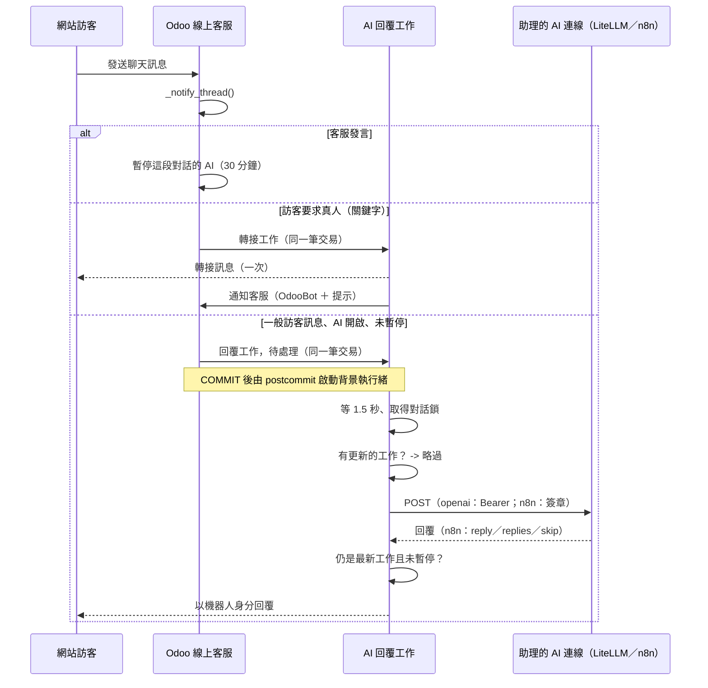
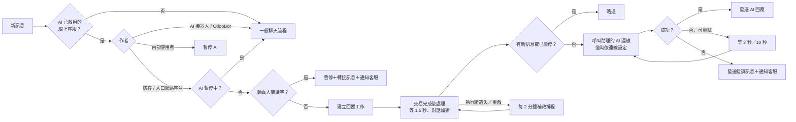
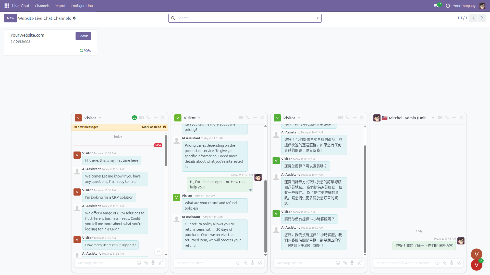
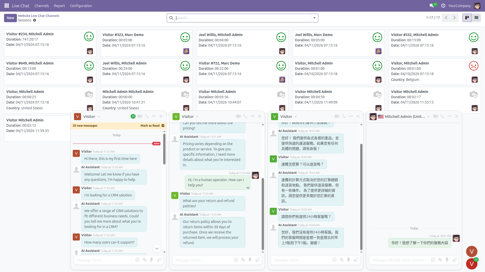
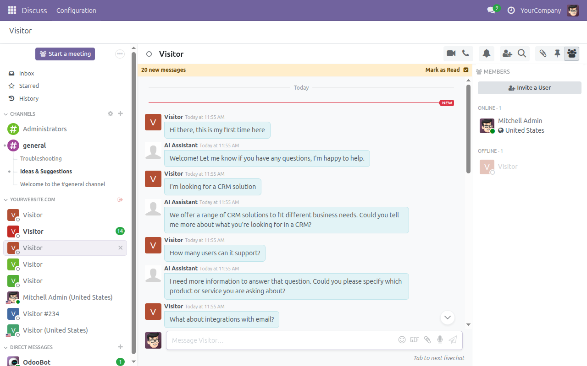
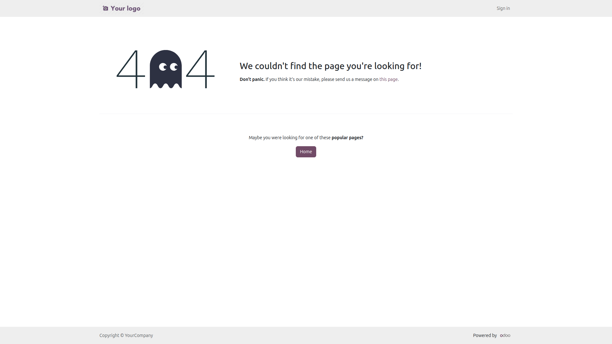
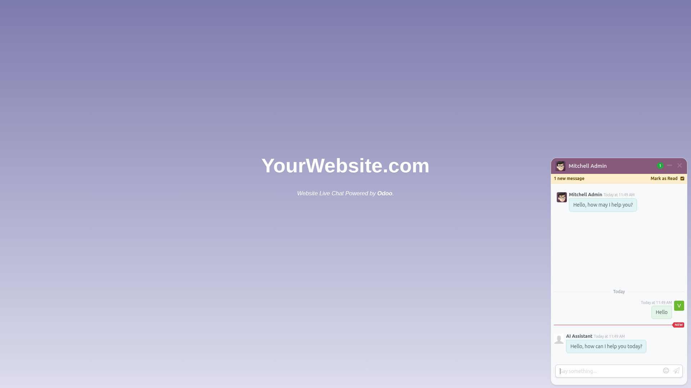
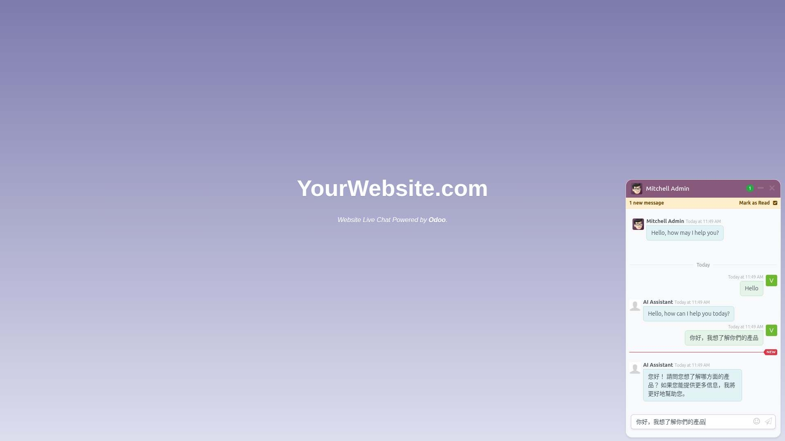
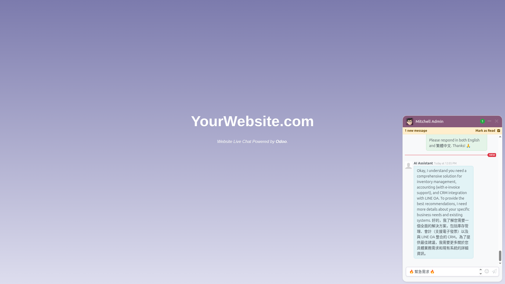

<p align="center">
  <h1 align="center">Live Chat AI Integration / 線上客服 AI 整合</h1>
</p>

<p align="center">
  <strong><code>im_livechat_ai</code> -- Odoo 18 AI 智能客服模組</strong>
</p>

<p align="center">
  
  
  
  
  
  <a href="https://github.com/WOOWTECH/Woow_odoo_ai_livechat/actions/workflows/odoo-tests.yml"></a>
</p>

<p align="center">
  用 AI 助理回覆 Odoo 線上客服的訪客：每個頻道選一個 AI 助理，助理的 AI 連線是 LiteLLM 或 n8n webhook。<br/>
  回覆工作不會遺失、客服可隨時接手。Odoo 只負責記錄、轉送、管理，其餘都交給後端。
</p>

<p align="center">
  <a href="README.md">English</a> &bull;
  <a href="#三個獨立的-ai-產品">三個獨立的 AI 產品</a> &bull;
  <a href="#對齊合約-v12">對齊（合約 v1.2）</a> &bull;
  <a href="#概述">概述</a> &bull;
  <a href="#升級到-180200">升級到 18.0.2.0.0</a> &bull;
  <a href="#升級到-180121">升級到 18.0.1.2.1</a> &bull;
  <a href="#升級到-180120">升級到 18.0.1.2.0</a> &bull;
  <a href="#從-18010x-升級">從 18.0.1.0.x 升級</a> &bull;
  <a href="#為什麼使用此模組">為什麼使用</a> &bull;
  <a href="#架構">架構</a> &bull;
  <a href="#功能特色">功能特色</a> &bull;
  <a href="#截圖">截圖</a> &bull;
  <a href="#安裝">安裝</a> &bull;
  <a href="#設定">設定</a> &bull;
  <a href="#ai-後端litellm-與-n8n">AI 後端</a> &bull;
  <a href="#協定">協定</a> &bull;
  <a href="#模組結構">模組結構</a> &bull;
  <a href="#隱私與安全">隱私與安全</a> &bull;
  <a href="#測試">測試</a> &bull;
  <a href="#疑難排解">疑難排解</a> &bull;
  <a href="#相依模組">相依模組</a> &bull;
  <a href="#參與開發">參與開發</a> &bull;
  <a href="#更新日誌">更新日誌</a> &bull;
  <a href="#授權">授權</a>
</p>

---

## 三個獨立的 AI 產品

2026-11-24 起，discuss AI、專案 AI、Live Chat AI 是三個獨立產品：各有自己的執行核心，各自下載、各自部署，不共用程式也不共用資料。

| 產品 | 模組 | repo |
|---|---|---|
| Discuss AI | `woow_ai_contact`、`woow_ai_contact_portal_discuss` | Gitea `woow-paas/Woow_odoo_discuss_ai`（GitHub 鏡像 `WOOWTECH/Woow_odoo_discuss_ai`） |
| 專案 AI | `woow_ai_task` | Gitea `woow-paas/Woow_odoo_project_ai` |
| Live Chat AI（本 repo） | `im_livechat_ai` | GitHub `WOOWTECH/Woow_odoo_ai_livechat` |

Live Chat AI 原地升級（18.0.2.0.0）。曾經把線上客服頻道搬到 Discuss AI 核心的橋接模組 `woow_ai_contact_livechat` 已在 Discuss AI 18.0.2.1.0 移除，沒有任何站台安裝過；裝著它時本模組會拒絕升級。

## 對齊（合約 v1.2）

三個產品靠同一份書面合約 [docs/CONTRACT.md](docs/CONTRACT.md) 維持一致的設定方式與運作方式：連線與助理的欄位、角色與選單、一則訊息怎麼處理、n8n 與 LiteLLM 的請求格式、使用者看到什麼、紀錄與用量、`neutralize.sql`、繁中用詞、升級規則。**這一版（18.0.2.0.0）實作合約 v1.2。** Live Chat 是只回文字的產品：LiteLLM 回覆不串流、系統訊息沒有身分區塊、不加發言者標籤（照使用者打的原文送出）、n8n 的 `events` 會帶對話事件、只有本站網址會變成可點的連結（合約 3.1）。

合約套件一字不差地放在 `im_livechat_ai/tests/contract/`（測試資料、共用檢查、`SHA256SUMS` 與 `READY`；用 `cd im_livechat_ai/tests/contract && sha256sum -c SHA256SUMS` 核對，CI 也會跑）。`tests/test_contract.py` 用本模組自己的程式跑合約的 14 項檢查（測試標籤 `woow_ai_contract`）。不要在這裡改合約套件：合約要改就出新的合約版本。

---

## 概述

**im_livechat_ai** 讓 AI 回覆 Odoo 線上客服的訪客。網站訪客或已登入的入口網站客戶在開啟 AI 的頻道發訊息時，模組會在**同一筆交易**中建立一個回覆工作；交易完成後，再把對話送到**這個頻道的 AI 助理**所用的後端，取得回覆後以助理的機器人聯絡人身分張貼到對話。

和 Discuss AI、專案 AI 一樣分兩層（合約 3.2）：

| 層 | 誰設定 | 在哪裡 | 內容 |
|---|---|---|---|
| **AI 連線** | 系統管理員 | 線上客服 > 配置 > AI 連線 | 大腦在哪裡：**LiteLLM**（OpenAI chat completions：結尾為 `/v1` 的基礎網址、API 金鑰、模型）或 **n8n webhook**（正式網址、選填的簽章金鑰）；逾時、重試次數、文件怎麼送、記錄請求內容、「可給客戶使用」、上線檢查與**測試連線** |
| **AI 助理** | 系統管理員 | 線上客服 > 配置 > AI 助理 | 角色：名稱與頭像（它的機器人聯絡人）、使用的 AI 連線、系統提示詞、歷史訊息數、錯誤訊息；勾選**「可用在 Live Chat」**後，線上客服頻道才能選它 |
| **線上客服頻道**的「AI 助理」分頁 | 線上客服管理員 | 線上客服 > 配置 > 頻道 | **由 AI 回覆**、選哪個 AI 助理（只能選可用在 Live Chat 的）、歡迎訊息、轉真人相關文字、暫停與等候分鐘數、選填的轉真人關鍵字 |

Odoo 只負責**記錄、轉送、管理**對話；角色設定、工具（查商品、Odoo MCP 等）、審核與權限都屬於後端。客服隨時可以接手：客服在對話中發言，或訪客要求真人客服時，AI 會暫停回覆這段對話。沒有預設網址、也沒有預設模型：系統管理員建好 AI 連線與 AI 助理、線上客服管理員選好助理之前，AI 不會回覆。設定 App 裡沒有本模組的任何設定。

**限制設在 LiteLLM 金鑰上。** 每個線上客服用的連線各給一把 LiteLLM 虛擬金鑰，在那裡設每分鐘請求數與 Token 數、同時請求數與預算。Odoo 沒有用量限制，只有技術性的佇列上限：每段對話一次一則回覆、每個線上客服頻道最多 30 則未完成的回覆（系統參數 `im_livechat_ai.max_active_jobs`）、整個資料庫最多 60 則（`im_livechat_ai.max_active_jobs_total`；設 0 表示不限制）、1.5 秒合併連發訊息、每個回覆工作最多處理 3 次、超過 30 分鐘的回覆工作放棄。另外，每個 Odoo 程序同時佔用資料庫連線的回覆執行緒有上限：連線池（`db_maxconn`）扣掉 cron 執行緒後的一半，另一半留給網頁請求。回覆執行緒等候名額時不佔連線；等太久的會讓工作保持等待中，由補救排程接手執行。被上限擋下的訪客訊息會收到和未就緒頻道相同的通知，客服收到一次提醒，每個頻道 10 分鐘內最多一次。**AI 用量**每月統計回覆數與 Token 數，作為人工開立發票的參考。詳見 [docs/PROTOCOL.md](docs/PROTOCOL.md#limits-and-queue-caps)。

---

## 升級到 18.0.2.0.0

`-u im_livechat_ai`（或平台的升級檢查，版本號改變時會執行）會把每個頻道的後端設定搬到兩層：

| 項目 | 結果 |
|---|---|
| 開啟 AI、或有後端網址、或有系統提示詞的頻道 | 每個頻道各得到**自己的 AI 助理**（名稱、提示詞、歷史訊息數、錯誤訊息；沿用頻道原本的機器人聯絡人），並勾選**「可用在 Live Chat」**，頻道選用它。**由 AI 回覆**維持原狀。 |
| 後端類型、網址、金鑰、模型、文件、逾時、重試次數 | **每種不同的設定一個 AI 連線**：設定與金鑰完全相同的頻道共用一個。數值依 18.0.1.3.5 實際執行的規則換算（網址正規化；n8n 逾時 0 換成 120 秒、LiteLLM 換成 45 秒；低於 10 秒的換成 10 秒；重試最多 2 次；歷史訊息數 0 換成 50）。 |
| 金鑰 | **只在 SQL 裡**複製與比對：不會進到 Python、日誌、說明或例外訊息。18.0.1.x 的欄位保留一份給回復版本用；在 18.0.2.0.0 更換或移除金鑰時，頻道上的那份會清掉。 |
| 「可給客戶使用」 | LiteLLM 一律勾選；n8n 要等系統管理員勾選。Live Chat 只在頻道分頁顯示警告。 |
| 記錄請求內容 | 新連線一律關閉；原本有記錄的頻道，已存的內容會清除。舊的呼叫紀錄會連到它的助理與連線。 |
| 選單 | 線上客服 > 配置：「AI 連線」「AI 助理」「回覆工作」「呼叫紀錄」「AI 用量」，只有系統管理員看得到。線上客服管理員照樣使用頻道的「AI 助理」分頁。 |
| Hermes | 不再支援（只接 LiteLLM 或 n8n）。伺服器日誌會列出看起來像 Hermes 的連線（INFO，只有 id）；不會改動它們。 |
| 翻譯 | 重新載入本模組附的翻譯：管理員改過的本模組翻譯會被換回內附版本。這一步失敗只寫日誌，不會中斷升級。 |
| 日誌保留天數 | 移除：呼叫紀錄與已結束的回覆工作固定保留 **30 天**，升級後第一次每日清理就會刪除更舊的資料；升級後的 INFO 會列出原本保留超過 30 天的頻道。需要更久的呼叫紀錄請先匯出。 |
| AI 用量 | 從空白開始：從升級後才開始計算（舊的呼叫紀錄只會連到它的助理，不會計入）。 |

**升級後可能不回覆的情況。** 開啟 AI 的頻道只有在助理啟用、可用在 Live Chat，而且連線就緒（啟用、網址允許、LiteLLM 有金鑰與模型）時才會回覆。升級照原樣搬設定，所以升級前就無法回覆的頻道（沒有網址、LiteLLM 沒有金鑰或模型）升級後仍然不能回覆，而且現在**不會建立回覆工作**：每段未就緒期間，對話收到一次通知、客服收到一次提醒（每個頻道 10 分鐘內最多一次）。升級後的 WARNING 會列出這些頻道的 id。

**升級前：**

1. 確認版本：`SELECT latest_version FROM ir_module_module WHERE name = 'im_livechat_ai';` 必須是 18.0.1.1.0 以上（已知站台都是 18.0.1.3.5）。
2. 執行這段唯讀盤點（18.0.1.2.0 以上；只印 id 與是非值）：

   ```sql
   SELECT id, ai_enabled,
          COALESCE(btrim(ai_endpoint_url), '') <> '' AS has_url,
          ai_api_token_secret IS NOT NULL AS has_key,
          COALESCE(ai_backend_type, 'openai') AS backend,
          COALESCE(btrim(ai_model), '') <> '' AS has_model,
          ai_log_retention_days
     FROM im_livechat_channel
    WHERE ai_enabled OR COALESCE(btrim(ai_endpoint_url), '') <> ''
    ORDER BY id;
   SELECT count(*) AS call_logs_older_than_30_days FROM llm_api_log
    WHERE create_date < now() at time zone 'UTC' - interval '30 days';
   ```

   `ai_enabled` 為真卻沒有網址，或 `backend = 'openai'` 卻沒有金鑰或模型的，升級後會是未就緒的頻道：先在 18.0.1.3.5 補好，或關閉它的 AI。保留天數超過 30 天的頻道，較舊的呼叫紀錄會在升級後第一次每日清理時刪除。
3. 找出還用到已移除欄位的地方（唯讀；每段都應該查不到資料）：

   ```sql
   -- 還用到已移除的 Live Chat AI 設定（18.0.1.1.0）的設定視圖
   SELECT id FROM ir_ui_view WHERE model = 'res.config.settings' AND arch_db::text ~ '\mlivechat_ai_[a-z_]+';
   -- 還用到已移除頻道欄位的視圖、伺服器動作與自動化、篩選、匯出與郵件範本
   WITH f(p) AS (SELECT '\m(ai_api_token|ai_api_token_set|ai_backend_type|ai_bot_name|ai_bot_partner_id|ai_connection_ready|ai_cron_lastcall|ai_document_mode|ai_endpoint_url|ai_error_message|ai_job_warning|ai_log_payload|ai_log_retention_days|ai_max_history|ai_max_retries|ai_model|ai_request_timeout|ai_stale_job_count|ai_system_prompt)\M'::text)
   SELECT 'view' AS kind, v.id FROM ir_ui_view v, f WHERE v.arch_db::text ~ f.p
      AND v.id NOT IN (SELECT res_id FROM ir_model_data WHERE model = 'ir.ui.view' AND module = 'im_livechat_ai')
   UNION ALL SELECT 'server action', a.id FROM ir_act_server a, f WHERE a.code ~ f.p
   UNION ALL SELECT 'filter', r.id FROM ir_filters r, f WHERE r.domain ~ f.p OR r.context ~ f.p
   UNION ALL SELECT 'export', e.id FROM ir_exports_line e, f WHERE e.name ~ f.p
   UNION ALL SELECT 'mail template', t.id FROM mail_template t, f WHERE t.body_html::text ~ f.p;
   ```

   查到的請先修改或移除：這類資料在升級後會出錯（頻道的這些欄位已不存在），而設定視圖會讓升級停止。

**以下情況本模組的升級會停止，而且不改本模組的任何資料：**

- 資料庫低於 18.0.1.1.0：先升到 18.0.1.3.5；
- `woow_ai_contact_livechat` 是已安裝、待升級或待移除：先解除安裝；
- 18.0.1.1.0 已退役的設定視圖（`im_livechat_ai.res_config_settings_view_form_livechat_ai`）還在，而且不是原封不動的原版（改過、被別的視圖繼承、或有別的 xmlid），或還有別的設定視圖用到已移除的 `livechat_ai_*` 欄位：請人工檢查這些視圖。原封不動的退役視圖會自動刪除。

用 `-u all` 或平台的升級檢查升級時，比本模組先載入的模組會維持已升級，而升級會一直失敗直到資料庫修好：請在升級前先做上面的檢查。

**升級後：**看 WARNING，打開 **AI 連線**（上線檢查、**測試連線**），並替每把 LiteLLM 金鑰設好限制。

**回復到 18.0.1.3.5。** 優先往前修。真的要退回時，部署 18.0.1.3.5 的程式並執行 `-u im_livechat_ai`。18.0.1.x 的頻道欄位保留了一個版本，所以頻道會回到升級當時的設定。在 18.0.2.0.0 建立或改過的助理與連線會遺失，在 18.0.2.0.0 換過的金鑰要重新輸入，在 18.0.2.0.0 新建的頻道沒有 18.0.1.3.5 的設定：請關閉它們的 AI。Odoo 會保留已移除模型的資料表，之後再升級時會沿用裡面的資料，所以回復成功後請執行一次（內容就是 `im_livechat_ai/migrations/18.0.2.0.0/rollback-cleanup.sql`）。它會印出一行 NOTICE 說明刪了什麼；若 NOTICE 說什麼都沒刪，表示回復還沒做（2.0.0 的模型仍在）：請先用 18.0.1.3.5 的程式執行 `-u im_livechat_ai`。它也會刪除回復期間的每月 AI 用量（這些資料列指向助理與連線）：若要依用量開立發票，請先匯出 AI 用量清單。

```sql
DO $$
DECLARE
  usage_rows integer := 0;
  assistants integer := 0;
  connections integer := 0;
  files integer := 0;
BEGIN
  IF NOT EXISTS (SELECT 1 FROM ir_model WHERE model IN ('im_livechat.ai.connection', 'im_livechat.ai.assistant')) THEN
    IF to_regclass('im_livechat_ai_usage_month') IS NOT NULL THEN
      DELETE FROM im_livechat_ai_usage_month;
      GET DIAGNOSTICS usage_rows = ROW_COUNT;
    END IF;
    IF to_regclass('im_livechat_ai_assistant') IS NOT NULL THEN
      DELETE FROM im_livechat_ai_assistant;
      GET DIAGNOSTICS assistants = ROW_COUNT;
    END IF;
    IF to_regclass('im_livechat_ai_connection') IS NOT NULL THEN
      DELETE FROM im_livechat_ai_connection;
      GET DIAGNOSTICS connections = ROW_COUNT;
    END IF;
    DELETE FROM ir_attachment WHERE res_model IN ('im_livechat.ai.assistant', 'im_livechat.ai.connection');
    GET DIAGNOSTICS files = ROW_COUNT;
    RAISE NOTICE 'im_livechat_ai rollback cleanup: deleted % AI usage row(s), % AI assistant(s), % AI connection(s), % attachment(s)',
      usage_rows, assistants, connections, files;
  ELSE
    RAISE NOTICE 'im_livechat_ai rollback cleanup: nothing deleted, the AI connection and AI assistant models are still installed (run it after the rollback)';
  END IF;
END $$;
```

它會移除金鑰並釋出機器人聯絡人，之後再升級時每個頻道又會得到一個助理，沿用它的機器人聯絡人。**不要用解除安裝來回復：**解除安裝會刪掉本模組的資料表，包括連線與金鑰、助理、回覆工作與呼叫紀錄。

---

## 已由其他自動回覆處理的訊息（18.0.1.3.0）

用 context key `im_livechat_ai_skip` 張貼的訊息只會記錄在對話裡，AI 不回覆、不暫停、也不轉真人。LINE 橋接（`woow_odoo_line_liff` 18.0.3.4.0，以及 BNI 問答選單）在關鍵字自動回覆已經回答時，會用這個方式轉進線上客服，客人就不會收到兩次回答。以公司本身聯絡人身分張貼的訊息（以公司名義運作的自動化）一律視為機器人，不當成訪客。

## 升級到 18.0.1.2.1

從 18.0.1.1.0 升級時請直接升到 18.0.1.2.1，不要停在 18.0.1.2.0。
18.0.1.2.0 拿掉了設定頁，但舊的設定頁畫面要到升級最後才會從資料庫刪除。如果另一個已安裝的模組也在設定頁加東西、而且比本模組晚載入，它檢查畫面時會碰到這個舊畫面（裡面引用已移除的 `livechat_ai_*` 欄位），整個升級就會停下，錯誤是 `Field "livechat_ai_base_url" does not exist in model "res.config.settings"`。
18.0.1.2.1 的 pre-migration 會先刪掉這個舊畫面。已經用 18.0.1.2.0 升級失敗的資料庫，也只要再用 18.0.1.2.1 升級一次就會修好。其他功能沒有變動。

## 升級到 18.0.1.2.0

執行 `-u im_livechat_ai`（或平台發版的升級檢查）會跑 18.0.1.2.0 的 post-migration：

| 項目 | 結果 |
|---|---|
| 後端類型 | 每個頻道都設為「OpenAI 相容」（18.0.1.1.0 只支援這種）。 |
| `im_livechat_ai.base_url`／`im_livechat_ai.api_key`（設定 → Live Chat AI） | 複製到**每個**頻道的端點網址（去掉結尾的 `/` 與 `/chat/completions`）與存取金鑰；頻道已有值的不覆寫。只有金鑰沒有網址時，用 18.0.1.1.0 當時的預設網址。 |
| `im_livechat_ai.log_payload`／`im_livechat_ai.log_retention_days` | 複製到每個頻道（**記錄對話內容**、**日誌保留天數**）。 |
| 所有 `im_livechat_ai.*` 系統參數 | 刪除（包括金鑰；模型清單快取已不再使用）。 |
| **啟用 AI 整合**、模型 | 不變：AI 開著且複製到連線的頻道會繼續回覆。模型保留原本的文字。 |
| **轉真人關鍵字**仍是 18.0.1.1.0 的預設清單 | 清空（負責人決策 40：由後端決定轉真人，關鍵字改為選用的前置篩選，預設空白）。自訂的清單保留。WARNING 那行有數量。 |
| **訪客傳的檔案**（新欄位） | Hermes 頻道（模型是 `hermes-agent` 或端點網址含 `hermes`）設為「只給下載連結」，其他頻道「直接附檔」。已有值的不改。 |
| 設定 → Live Chat AI、選單「即時聊天 → 設定 → AI 設定」 | 移除。 |
| 商品查詢工具、溫度、Max Tokens、模型清單、身分說明 | 移除：改由後端負責。 |

伺服器日誌會有一行 WARNING，只寫數量（頻道數、複製了幾個網址與金鑰、刪了幾個參數、開著 AI 且有連線的頻道數），不寫任何值。腳本可重跑：參數刪除後再跑不會改任何東西，頻道上已有的值也不會被覆寫。沒有這些參數（且 AI 都關著）的資料庫維持原狀。

升級後，原本靠 Odoo 商品工具查價的頻道就沒有工具了：請改接有自己商品工具的後端（例如 Hermes 或 n8n 搭配 Odoo MCP），或先維持關閉。

---

## 從 18.0.1.0.x 升級

> **升級後 AI 一律關閉，要等系統管理員設定好頻道的 AI 後端才會再回覆。**

升級到 18.0.1.1.0（`-u im_livechat_ai`，或平台發版時的升級檢查看到版本號改變而自動執行）會自動做以下處理：

| 項目 | 結果 |
|------|------|
| 頻道上的 **API 網址**與 **API 金鑰** | 新程式載入前先清空（pre-migration），之後移除欄位。舊金鑰不會留在資料庫。 |
| **啟用 AI 整合** | **所有**頻道都關閉。伺服器日誌會列出原本開著 AI 的頻道。 |
| **重試延遲** | 移除（固定先等 3 秒、再等 10 秒）。**最大重試次數**上限改為 2。 |
| 預設英文**錯誤訊息**（或空白） | 改成繁體中文預設文字；自訂過的文字保留不動。 |
| **轉真人關鍵字**仍是舊預設 `真人,客服,人工,真人客服,human,agent,operator`（或空白） | 改成新的預設（只認明確的要求，見[轉真人客服（暫停）](#轉真人客服暫停)）；自訂過的保留不動。 |
| AI 機器人聯絡人 | 封存並加上「AI 機器人」標籤，和 Odoo 聊天機器人一樣；沒有圖片的會換上模組附的機器人頭像。 |
| 既有 **API 日誌** | 清除對話內容與上游回應內容。 |

上表除了 API 網址／金鑰欄位之外的每一項（AI 全部關閉、最大重試次數換算、錯誤訊息、轉真人關鍵字、機器人聯絡人與頭像、清理日誌）都只在 pre-migration 看到 18.0.1.0.x 的欄位（`ai_api_key`、`ai_api_base_url` 或 `ai_retry_delay`）時才做；pre-migration 用暫時的系統參數 `im_livechat_ai.migration_1_1_0_legacy` 告訴 post-migration，post-migration 讀完就刪除。已升級過的資料庫再跑一次 18.0.1.1.0 的腳本，不會改到任何資料，管理員升級後清空或修改的值（清空的機器人名稱或錯誤訊息、取消封存的機器人聯絡人）也不會被改回來。

### 上線須知：重啟或部署後的回覆

AI 回覆平常由收到訪客訊息的 Odoo 程序裡的執行緒送出。程序停止（重啟、部署、worker 自動回收）時正在處理的回覆，以及「等候真人逾時後」的 AI 回覆，都由排程 **Live Chat AI: Recover Reply Jobs**（每 2 分鐘）送出，所以會慢 **約 1-2 分鐘**。**一定要有排程程序**：Odoo 要以 `max_cron_threads >= 1` 執行（或另外跑一個排程程序，例如 `odoo --no-http --max-cron-threads=1`）。18.0.2.0.0 起由系統管理員在 AI 助理表單的「**回覆處理方式**」區塊（排程上次執行時間、超過 5 分鐘未完成的工作數，有問題會顯示警告）與 **線上客服 > 配置 > 回覆工作** 監看。

從 18.0.1.0.x 升級後（直接升到 18.0.1.2.0 時，18.0.1.1.0 與 18.0.1.2.0 的腳本都會跑），系統管理員要：

1. 開啟 **即時聊天 → 設定 → 頻道**，選頻道，打開 **AI 整合** 分頁。
2. 選 **後端類型**，填入 **端點網址**、**存取金鑰（Token）**（LiteLLM 還要填 **模型**），儲存。
3. 按 **測試連線**，成功後再重新啟用 AI。

舊的頻道金鑰請到原供應商後台撤銷：升級只會從 Odoo 移除，備份、git 歷史或日誌裡可能還有副本。

---

## 為什麼使用此模組

| 沒有此模組 | 使用此模組 |
|---|---|
| 僅能手動回覆聊天 | AI 全天候自動回覆，客服可隨時接手 |
| 只能接一種 AI | AI 助理使用 LiteLLM 或 n8n 連線，每個頻道選一個助理 |
| 訊息可能沒人回 | 回覆工作有紀錄，重啟也會補回；連發多則只回一次 |
| 無法轉真人 | 客服發言或訪客說「真人」「客服」就暫停 AI 並通知客服 |
| 金鑰誰都看得到 | 金鑰只有系統管理員能設定、儲存後不再顯示、不進日誌；n8n 的簽章金鑰從不送出 |
| 對話內容到處存 | 呼叫紀錄預設不存對話內容，且只有系統管理員看得到 |
| 權限混在 Odoo 裡 | Odoo 只記錄與轉送；工具與權限由後端負責 |

---

## 架構

### ASCII 流程圖

```
                              Odoo 18
 +-----------------------------------------------------------------------+
 |                                                                       |
 |  Website Visitor（網站訪客／入口網站客戶）                                |
 |       |                                                               |
 |       v                                                               |
 |  discuss.channel.message_post()                                       |
 |       |                                                               |
 |       v                                                               |
 |  _notify_thread() hook                                                |
 |       |  客服發言 -> 暫停 AI（預設 30 分鐘）                                |
 |       |  訪客要求真人 -> 轉接工作（通知訪客一次 + 通知客服）                    |
 |       |  其他訪客訊息 -> 在同一筆交易建立 im_livechat.ai.job（待處理）          |
 |       v                                                               |
 |  COMMIT -> postcommit 背景執行緒（或每 2 分鐘的補救排程）                    |
 |       |  等 1.5 秒合併連發訊息，同一段對話加鎖                                 |
 |       |  有更新的工作 -> 略過，交給最新那個                                    |
 |       v                                    +------------------------+ |
 |  _ai_conversation()                        |  頻道的 AI 後端          | |
 |       |  最近 N 則歷史、客服訊息加標記          |  openai：/v1/chat/      | |
 |       v                                    |    completions          | |
 |  _generate_ai_reply() ---- POST ---------->|  n8n：簽章 Webhook       | |
 |       |  逾時依連線設定、最多重試 2 次         |                        | |
 |       |<-------- 回覆 ----------------------|                        | |
 |       |                                    +------------------------+ |
 |       v                                                               |
 |  _create_bot_message()（XSS 防護）                                       |
 |       v                                                               |
 |  訪客看到 AI 回覆                                                         |
 |                                                                       |
 +-----------------------------------------------------------------------+
```

### 時序圖



### 流程圖



---

## 功能特色

### 核心功能

- **AI 助理與 AI 連線** -- 系統管理員建立 AI 連線（LiteLLM 或 n8n webhook，含金鑰與呼叫設定）與 AI 助理（角色：使用的連線、提示詞、歷史訊息數、錯誤訊息），並在要給訪客用的助理勾選「可用在 Live Chat」。線上客服管理員為每個頻道選一個；他們看不到網址、金鑰或提示詞。
- **上線檢查** -- 每個連線都有上線檢查（「可以使用」或「未就緒」，附固定原因）與**測試連線**按鈕（LiteLLM `GET /models`、n8n ping）。頻道的 AI 無法回覆時不建立工作：每段未就緒期間，訪客收到一次通知、客服收到一次提醒（每個頻道 10 分鐘內最多一次）。通知是系統通知：從 LINE 轉進來的訪客收不到（LINE 橋接只轉送一般留言）；回覆失敗時的錯誤訊息則會送到 LINE。
- **多輪對話上下文** -- 最近 1-200 則訊息。訪客是 `user`、AI 機器人是 `assistant`，真人客服是加上 `[真人客服 姓名]` 標記的 `user`（與 `woow_ai_contact` 相同），並以對話事件告訴 AI 不要推翻同事的說法。OpenAI 訊息一定以 user 開頭、以 user 結尾。
- **訪客與入口網站客戶** -- 網站訪客、已登入的入口網站客戶與公開使用者都會得到回覆；內部使用者、這段對話指派的客服與機器人不會觸發 AI。

### 可靠的回覆流程（工作佇列）

- **有紀錄的回覆工作**（`im_livechat.ai.job`）-- 和訪客訊息在同一筆交易建立，訊息寫入成功才有工作；交易完成後才開始處理。
- **連發只回一次** -- 等 1.5 秒合併連發訊息；每段對話一把 PostgreSQL advisory lock（跨 prefork worker 與排程程序都有效）；有更新工作的舊工作會被略過，由最新的工作帶完整上下文回覆。
- **呼叫有上限** -- 連線的逾時是一次回答的時間，包含重試（10 - 300 秒；預設 LiteLLM 45 秒、n8n 120 秒）：每次呼叫最多等剩下的時間，連線最多 10 秒（後端若一直慢慢送資料，可能會更久）。最多重試 2 次（0 - 2，預設 1；先等 3 秒、再等 10 秒，且在逾時之內），而且只在請求沒送出或後端回 HTTP 429／503 時重試，讀取逾時一律不重試（後端可能還在處理；同一個工作流程不會跑兩次）。每個工作最多處理 3 次。
- **補救排程** -- 每 2 分鐘把因重啟或當機而停在「待處理／處理中」的工作重新執行；機器人已經回覆過的不會重複回覆。超過 30 分鐘仍未完成的工作會放棄。等候真人逾時後的延後回覆也由它執行（會在等候結束的時間觸發）。需要排程程序（見[上線須知](#上線須知重啟或部署後的回覆)）。
- **監看** -- AI 助理表單的「**回覆處理方式**」區塊（系統管理員）顯示排程上次執行時間與超過 5 分鐘仍在「等待中／處理中」的工作數；排程超過 5 分鐘沒跑或有卡住的工作時顯示警告。
- **失敗處理** -- 全部重試失敗時，訪客收到 AI 助理的錯誤訊息（空白時用訪客語言的預設訊息），客服會收到通知（OdooBot 訊息與不會自動消失的提示），同一頻道同一種失敗（HTTP 429、HTTP 500、逾時……）10 分鐘內只通知一次，通知會說明之後的不再提醒。
- **看得到的佇列** -- **線上客服 > 配置 > 回覆工作**（系統管理員）可看每個工作的狀態、處理次數、後端呼叫次數與簡短錯誤。

### 轉真人客服（暫停）

兩種暫停，記在對話上（`discuss.channel.ai_paused_until`、`ai_pause_reason`）：

- **客服發言**（`operator`）-- 內部使用者在對話中發言後，AI 在這段對話暫停 **30 分鐘**（**真人接手後暫停**，每個頻道可調 1-1440）；之後客服每次發言都延長到「現在 + 30 分鐘」（不會縮短）。這段期間 AI 完全不出聲：不回覆、不送通知。
- **訪客要求真人**（`handoff`）-- **由後端決定**（負責人決策 40，與 Discuss AI 同一套協定）：訪客訊息照常交給後端，後端的回答表示要轉人時才轉。LiteLLM 後端在回覆最後加一行 `[[handoff]]`（不分大小寫，可有空白、反引號或 markdown 跳脫 `\[\[handoff\]\]`）；n8n 回 `"handoff": true`（最上層或 item list 的第一項，可加 `"handoff_reason"`，最多保留 300 字），或在 `output` 結尾寫標記。Odoo 拿掉標記、先張貼回覆文字（沒有文字就張貼頻道的**轉接訊息**；有 `handoff` 時忽略 `skip`），然後轉真人：AI **等候 10 分鐘**（**等候真人分鐘數**，1-1440）、通知客服（附原因）、回覆工作記下這次轉接（**轉真人判斷來源**＝AI 後端、**轉真人原因**）。後端回答途中客服插話，答案丟掉、不轉。**Odoo 為此加的唯一提示文字**：有客服（Live Chat 頻道的操作員裡有內部使用者）的頻道，LiteLLM 請求的 system 訊息最後加一行「訪客要求真人客服、想跟真人說話時，在回覆最後單獨一行寫 [[handoff]]，系統就會轉接真人客服（不要說無法轉接；只問電話或聯絡方式不算）。When the visitor asks for a human, end your reply with a line [[handoff]] and Odoo hands the conversation to a human operator.」；n8n 改看 `channel.livechat.handoff_available`。**轉真人關鍵字**是選用的前置篩選，**預設空白**：訪客訊息含其中之一時直接轉真人、不呼叫後端（中文出現在任何位置都算，英文字詞要整個字／片語相符、不分大小寫）。
- **等候通知** -- 等候期間訪客的第一則訊息會收到一則固定回覆（**等候通知**，預設「已通知客服人員，請稍候。若客服暫時無法回覆，AI 助理會在 10 分鐘後繼續為您服務。」；`%(minutes)s` 會換成等候分鐘數）。每次等候只送一次（`discuss.channel.ai_pause_notice_sent`），不呼叫後端。
- **客服接手** -- 等候期間客服一發言，就改成客服暫停，從這次發言起算 30 分鐘，即使等候設得更長也一樣（等候設 120 分鐘時，AI 不會因此安靜 120 分鐘）；等候通知與延後回覆都會安靜取消。
- **逾時自動接回** -- 等候結束時若沒有客服回覆，AI 會回答訪客在等候期間寫的所有訊息，訪客不必再發一次：每則等候期間的訊息都有一個延後的回覆工作（`im_livechat.ai.job.deferred`），到期時間是等候結束，補救排程會在那個時間被觸發，由最新的工作一次回答全部（其他略過）。等候結束後約 1 分鐘內會收到回答（排程喚醒時間）。

### 隱私與維運

- **呼叫紀錄只有系統管理員看得到** -- 每次回答一筆：時間、助理、連線、後端類型、模型、Token、耗時、狀態（`ok`、`http_error`、`timeout`、`invalid_response`、`error`）、HTTP 狀態碼與例外類型名稱。
- **設定依角色分開** -- AI 連線與 AI 助理只有系統管理員能用（金鑰只能寫入）。頻道的「AI 助理」分頁給線上客服管理員，他們只看得到助理的說明與狀態，看不到網址、金鑰或提示詞；一般客服、員工、入口網站客戶都讀不到。AI 機器人的聯絡人由系統建立，不能指定成其他人。
- **AI 回覆只對自家網址產生連結** -- 只有 `web.base.url` 與網站網域的網址會變成可點的連結，其他網址只顯示文字。
- **預設不存對話內容** -- **記錄請求內容**（每個 AI 連線各自設定、預設關閉）只在除錯時暫時打開；關閉時會清除這個連線已保存的內容。保存的內容不含金鑰。
- **保留天數** -- 超過 30 天的呼叫紀錄與已結束的回覆工作每天自動刪除。**AI 用量**每個助理、連線、頻道、每月保留一筆。
- **簡短錯誤** -- 測試按鈕與紀錄只顯示狀態碼和一句說明；伺服器日誌只寫 id、狀態碼與例外類型名稱，絕不寫上游回應或例外內容。

### AI 身分揭露

- **歡迎訊息** -- 頻道啟用 AI 時，聊天視窗顯示 **AI 歡迎訊息**（新頻道預設「您好，我是 AI 客服助理，有什麼可以幫您？需要真人客服請輸入「找真人」。」），取代 Odoo 原本的歡迎訊息。
- **機器人頭像** -- AI 訊息的作者是 AI 助理的機器人聯絡人，名稱與圖片跟著助理（助理沒有圖片時用模組附的機器人圖 `static/img/ai_bot.png`）。
- **身分說明** -- Odoo 不加身分說明：角色由後端（或助理選填的系統提示詞）決定。
- **限制** -- 聊天視窗標題（以及歡迎訊息的作者）仍顯示這段對話指派的真人客服，因為 Odoo 每段線上客服都會指派一位客服；本模組沒有改這部分。

### 安全

- **Markdown 回覆、XSS 防護** -- AI 回覆以內建的小型轉換器顯示 markdown（段落、`**粗體**`、清單、表格、標題、`程式碼` 與程式碼區塊）；所有文字先跳脫、結果再經過淨化；只有連到本站網域的連結會變成連結。
- **迴圈防護** -- AI 機器人、OdooBot 與對話指派的客服不會觸發 AI。
- **繁體中文** -- 原文是英文，附完整 `zh_TW` 翻譯（合約用詞）；給訪客的預設文字與給客服的提醒依每個人的語言。

---

## 截圖

> 截圖是 18.0.1.0.0 版拍的。18.0.2.0.0 起頻道的「AI 助理」分頁只選 AI 助理；後端設定在 AI 連線與 AI 助理上。

### 線上客服頻道總覽

<p align="center"></p>

### AI 整合設定分頁（18.0.1.0.0 版面）

<p align="center"></p>

### 管理員 Discuss 檢視與 AI 對話

<p align="center"></p>

### 訪客端線上客服小工具

<p align="center"></p>

### 測試結果

| 基本英文問候 | 中文 UTF-8 測試 | 綜合壓力測試 |
|:---:|:---:|:---:|
|  |  |  |

---

## 安裝

### 標準 Odoo 安裝

1. **Clone 此儲存庫**，並把它加進 addons 路徑。模組正本是儲存庫根目錄的 `im_livechat_ai/`（只有這一份）：

   ```bash
   git clone https://github.com/WOOWTECH/Woow_odoo_ai_livechat.git /path/to/Woow_odoo_ai_livechat
   ```

   ```ini
   addons_path = /path/to/odoo/addons,/path/to/Woow_odoo_ai_livechat
   ```

2. **更新應用程式列表**：
   - 前往 **應用程式** 選單。
   - 點擊 **更新應用程式列表**。

3. **安裝模組**：
   - 搜尋 **"Live Chat AI"** 或 **"線上客服 AI"**。
   - 點擊 **安裝**。

4. **建立 AI 連線與 AI 助理，再到頻道選擇助理**（見[設定](#設定)）；設定好之前 AI 不會回覆。

### Docker / Podman 部署

`odoo-ailivechat/` 目錄提供本機開發用的 `docker-compose.yml`（Odoo 18 + PostgreSQL 16）。它直接掛載儲存庫根目錄的模組正本（`../im_livechat_ai`）。repo 裡不放任何密碼，請從範本複製後自行填寫。

#### 服務架構

| 服務 | 映像檔 | 內部埠 | 對外埠 | 用途 |
|------|--------|:---:|:---:|------|
| **db** | `postgres:16` | 5432 | -- | PostgreSQL 資料庫（含健康檢查） |
| **odoo** | `odoo:18.0` | 8069 | **9094**（`ODOO_PORT`） | Odoo 18 應用程式伺服器 |

#### 快速啟動

```bash
cd odoo-ailivechat/

# 1. 建立本機設定（兩個檔案都已列入 .gitignore，不會被提交）
cp .env.example .env                           # 填入 POSTGRES_PASSWORD（例如 openssl rand -base64 24）
cp config/odoo.conf.example config/odoo.conf   # admin_passwd 留空 = 資料庫管理介面鎖住

# 2. 啟動
docker compose up -d                           # 或 podman-compose up -d

# 3. 建立資料庫並安裝模組（list_db = False，資料庫管理介面已停用）
docker compose run --rm odoo -d odooailivechat -i im_livechat_ai --without-demo=all --stop-after-init
docker compose restart odoo

# Odoo 將在 http://localhost:9094 上可用
```

#### 部署目錄結構

```
Woow_odoo_ai_livechat/
├── im_livechat_ai/                 # 模組正本（掛載到容器的 /mnt/extra-addons/im_livechat_ai）
└── odoo-ailivechat/
    ├── docker-compose.yml          # 服務定義
    ├── .env.example                # 範本：資料庫名稱、帳號、密碼、對外埠
    ├── .env                        # 自己建立，不提交
    ├── config/
    │   ├── odoo.conf.example       # 範本
    │   └── odoo.conf               # 自己建立，不提交
    └── data/
        ├── postgres/               # PostgreSQL 資料（持久化）
        └── odoo/                   # Odoo 檔案儲存（持久化）
```

#### 關鍵設定說明

- **網路：** 所有服務共享 `odoo-ailivechat-network` 橋接網路，支援內部主機名稱解析。
- **資料持久化：** PostgreSQL 資料和 Odoo 檔案儲存皆以 bind volume 掛載，確保重啟後資料不遺失。
- **健康檢查：** PostgreSQL 容器包含健康檢查；Odoo 會等待資料庫就緒後才啟動。
- **密碼：** 資料庫密碼只放在 `.env`；`odoo.conf` 不放資料庫帳密（由官方映像從環境變數帶入）。AI 後端的網址與金鑰不放在這裡，由系統管理員在「線上客服 > 配置 > AI 連線」填寫。

---

## 設定

**線上客服 > 配置** 裡給系統管理員的是「AI 連線」「AI 助理」「回覆工作」「呼叫紀錄」「AI 用量」；線上客服管理員使用頻道的「AI 助理」分頁。

### 步驟 1：AI 連線（系統管理員）

| 欄位 | 說明 | 預設 |
|---|---|---|
| **後端**（`backend_type`） | 「LiteLLM（OpenAI 相容）」（存成 `openai`）或「n8n webhook」（`n8n`）。 | LiteLLM |
| **後端網址**（`endpoint_url`） | LiteLLM：結尾為 `/v1` 的基礎網址（會自動加上 `/chat/completions`）。n8n：完整的正式 webhook 網址（Chat Trigger：`…/webhook/<id>/chat`）。只能用 `https://`；`http://` 只限 `localhost`、`127.0.0.1`、`::1` 與結尾為 `.svc.cluster.local` 的主機。 | （空白） |
| **API 金鑰**（`api_key`） | LiteLLM（必填）：以 `Authorization: Bearer` 送出。n8n：選填的**簽章金鑰**，用來產生 `X-Woow-Signature`（不會送出；空白則不簽章）。只能寫入：儲存後不再顯示；留空則保留。變更後端主機或後端類型、或按**移除 API 金鑰**，都會移除它。 | （空白） |
| **模型**（`model`） | 僅 LiteLLM：LiteLLM 的模型名稱，用來選擇部署。沒有模型的 LiteLLM 連線可以儲存，但未就緒。 | （空白） |
| **逾時（秒）**（`timeout_seconds`） | 一次回答的總時間，包含重試，10 - 300。回覆不串流：訪客收到完整回答，時間到則收到錯誤訊息。 | LiteLLM 45、n8n 120 |
| **重試次數**（`max_retries`） | 0 - 2；只在請求沒送出、或後端回 HTTP 429／503 時重試（先等 3 秒、再等 10 秒，且在逾時之內）。 | 1 |
| **使用者傳送的文件**（`document_mode`） | LiteLLM：「把檔案送給模型」（4 MB 以內的文件以 `file` 部分送出）或「只給下載連結」（簽章連結）。圖片一律內嵌；n8n 一律收到連結。 | 把檔案送給模型 |
| **記錄請求內容**（`log_payload`） | 僅供除錯：在呼叫紀錄保存請求與回應內容；關閉時清除。 | 關閉 |
| **可給客戶使用**（`customer_safe`） | LiteLLM 一律勾選（只用來聊天：Odoo 從不送工具）。n8n：確認工作流程不查公司資料、不呼叫工具、不跨對話保留記憶後才勾選；變更網址或類型時自動取消。Live Chat 只在頻道上顯示警告，不會拒絕。 | n8n：不勾選 |
| **上線檢查**（`readiness`） | 「可以使用」或「未就緒」，附固定的原因（已封存、沒有網址、網址不允許、LiteLLM 沒有金鑰或模型）。 | -- |
| **測試連線** | LiteLLM：帶金鑰 `GET {endpoint}/models`（模型不在清單時顯示警告）。n8n：送出簽章的 `{"event": "ping", …}`，要回 HTTP 200。只顯示 HTTP 狀態碼與一句說明。 | -- |

### 步驟 2：AI 助理（系統管理員）

| 欄位 | 說明 | 預設 |
|---|---|---|
| **名稱**與圖片 | 訪客看到的 AI 回覆作者；機器人聯絡人會跟著改（沒有圖片時用模組附的機器人頭像）。 | -- |
| **AI 連線**（`connection_id`） | 大腦在哪裡。多個助理可以共用一個連線。 | -- |
| **可用在 Live Chat**（`livechat_available`） | 勾選時，線上客服管理員才能為頻道選這個助理。每個線上客服頻道都可能有匿名訪客：只對要回答一般大眾的助理勾選。 | 不勾選 |
| **說明** | 線上客服管理員選助理時會看到。 | （空白） |
| **系統提示詞**（`system_prompt`） | 選填，每次請求都會送出。 | （空白） |
| **歷史訊息數**（`max_history`） | 送給後端作為上下文的最近訊息數，1 - 200。 | 50 |
| **錯誤訊息**（`error_message`） | 後端失敗時貼給訪客。空白：使用訪客語言的預設訊息（繁中：抱歉，AI 客服暫時無法回覆。請稍後再試，或留下您的聯絡方式，我們的客服人員會盡快與您聯繫。）。 | （空白） |
| **機器人聯絡人**（`partner_id`） | 自動建立、保持封存、標記「AI 機器人」的聯絡人。 | 自動 |
| **回覆處理方式** | 回覆怎麼處理、補救排程上次執行時間與卡住的回覆工作（所有頻道），有問題時顯示警告。 | -- |

開啟 AI 的頻道正在用的助理或連線，不能封存、取消勾選或改成未就緒：請先關閉該頻道的 AI，或為它選別的助理。

### 步驟 3：頻道的「AI 助理」分頁（線上客服管理員）

| 欄位 | 說明 | 預設 |
|---|---|---|
| **AI 助理**（`ai_assistant_id`） | 可用在 Live Chat 的助理之一；會顯示它的說明。 | （空白） |
| **由 AI 回覆**（`ai_enabled`） | 讓這個頻道由 AI 回覆；需要一個可以回覆的助理。 | 關閉 |
| **AI 狀態**（`ai_state`） | 「關閉」「可以使用」或「未就緒」並附原因（固定句子，絕不含網址或金鑰）；助理的連線沒有標示「可給客戶使用」時顯示警告。 | -- |
| **AI 歡迎訊息**（`ai_welcome_message`） | 開啟 AI 時聊天視窗的歡迎訊息，讓訪客知道正在和 AI 對話。 | 繁中：您好，我是 AI 客服助理，有什麼可以幫您？需要真人客服請輸入「找真人」。 |
| **測試連線** | 系統管理員才看得到：測試助理的連線（n8n ping 會帶頻道與助理）。 | -- |

### 步驟 4：轉真人客服（線上客服管理員）

| 欄位 | 說明 | 預設 |
|---|---|---|
| **真人接手後暫停（分鐘）**（`ai_handoff_pause_minutes`） | 客服發言後 AI 不出聲的時間（每次發言都延長），1 - 1440。 | `30` |
| **要求真人後等候（分鐘）**（`ai_handoff_wait_minutes`） | 訪客要求真人後，AI 等客服接手多久才再回答，1 - 1440。 | `10` |
| **轉真人關鍵字**（`ai_handoff_keywords`） | 選用的前置篩選（由後端判斷是否轉真人，見[轉真人客服（暫停）](#轉真人客服暫停)）：以逗號分隔；訪客訊息含其中之一時直接轉真人、不呼叫後端。中文出現在任何位置都算，英文字詞要整個字／片語相符，不分大小寫。例如 `找真人,轉人工,talk to a human`。 | （空白） |
| **轉接訊息**（`ai_handoff_message`） | 訪客要求真人時送出一次。 | 繁中：已幫您通知客服，請稍候。 |
| **等候通知**（`ai_pause_notice`） | 等候期間訪客的第一則訊息收到一次；`%(minutes)s` 會換成等候分鐘數（其他文字照原樣送出）。 | 繁中：已通知客服人員，請稍候。若客服暫時無法回覆，AI 助理會在 %(minutes)s 分鐘後繼續為您服務。 |

暫停狀態記在對話上：`discuss.channel.ai_paused_until`、`ai_pause_reason`（`operator`／`handoff`）與 `ai_pause_notice_sent`。新頻道的預設文字使用建立者的語言。

### 步驟 5：監看（系統管理員）

- **回覆工作**：佇列，可篩選等待中／處理中、失敗、已略過與轉真人的工作；等候真人期間的延後回覆標示為**延後**，到**最早執行時間**才執行。
- **呼叫紀錄**：每次回答一筆：狀態（`ok`、`http_error`、`timeout`、`invalid_response`、`error`）、HTTP 狀態碼、耗時、Token、助理、連線與對話。只有開啟**記錄請求內容**時才有內容。
- **AI 用量**：每個助理、連線、頻道、每月（UTC）的回覆數、失敗回覆數與 Token 數。
- AI 助理表單的**回覆處理方式**：補救排程上次執行時間與卡住的工作（見[上線須知](#上線須知重啟或部署後的回覆)）。

---

## AI 後端：LiteLLM 與 n8n

### LiteLLM

| 欄位 | 值 |
|---|---|
| 後端 | 「LiteLLM（OpenAI 相容）」 |
| 後端網址 | `https://litellm.example.com/v1` |
| API 金鑰 | 這個連線專用的 LiteLLM 虛擬金鑰（`sk-...`），限定模型，並設每分鐘請求數與 Token 數、同時請求數與預算：**限制設在金鑰上** |
| 模型 | 必填，例如 `chatgpt-pool/gpt-6-sol` |

### n8n

| 欄位 | 值 |
|---|---|
| 後端 | 「n8n webhook」 |
| 後端網址 | **正式** webhook 網址，例如 `https://n8n.example.com/webhook/livechat-ai`，或叢集內的 `http://n8n.<namespace>.svc.cluster.local:5678/webhook/livechat-ai`；Chat Trigger：`…/webhook/<id>/chat` |
| 簽章金鑰 | 建議填：隨機產生（`openssl rand -hex 32`），同一個值放進工作流程的環境變數 `WOOW_AI_SIGNING_SECRET`；公開的 Chat Trigger 留空（請求不簽章） |
| 可給客戶使用 | 確認工作流程不查公司資料、不呼叫工具、不跨對話保留記憶後才勾選 |

接著按**測試連線**（HTTP 200），在這個連線上建立 AI 助理並勾選「可用在 Live Chat」；線上客服管理員在頻道選它，再開啟**由 AI 回覆**。

---

## 協定

請求與回應的格式在 [docs/PROTOCOL.md](docs/PROTOCOL.md)：LiteLLM 的請求內容與 metadata、n8n 的請求內容與簽章、接受的回答與轉真人、測試連線、訪客檔案與簽章下載網址、回覆顯示、呼叫紀錄與用量，以及 AI 無法回覆時會怎樣。格式依[合約 v1.2](docs/CONTRACT.md)：為 Discuss AI 寫的 n8n 工作流程讀同樣的鍵（`assistant`、`user`、`channel`、`surface`、`message`、`history`、`events`）；Live Chat 另外送 `contact`（線上客服頻道），給為 18.0.1.x 寫的工作流程使用。

---

## 模組結構

```
im_livechat_ai/
├── __init__.py                          # 解除安裝時刪除 18.0.1.x 的金鑰欄位
├── __manifest__.py                      # v18.0.2.0.0
├── models/
│   ├── ai_connection.py                 # im_livechat.ai.connection「AI 連線」：後端、網址、
│   │                                    #   只能寫入的金鑰（只在 SQL 欄位）、模型、逾時、
│   │                                    #   重試次數、上線檢查、測試連線、使用中保護
│   ├── ai_assistant.py                  # im_livechat.ai.assistant「AI 助理」：機器人聯絡人、
│   │                                    #   提示詞、歷史訊息數、錯誤訊息、「可用在 Live Chat」
│   ├── ai_migration.py                  # 18.0.1.x 頻道設定 -> 連線與助理
│   ├── ai_usage.py                      # im_livechat.ai.usage.month：每月用量（SQL upsert）
│   ├── im_livechat_channel.py           # 頻道「AI 助理」分頁（助理、狀態）、轉真人文字、
│   │                                    #   請求、簽章、解析回答、重試與時限、未就緒
│   │                                    #   處理、呼叫紀錄
│   ├── discuss_channel.py               # _notify_thread：客服發言暫停、轉真人、建立工作；
│   │                                    #   判斷作者；訪客身分；對話內容；訪客檔案
│   ├── livechat_ai_job.py               # im_livechat.ai.job：回覆佇列、交易後執行緒、
│   │                                    #   advisory lock、補救排程、通知客服、計算用量
│   └── llm_api_log.py                   # llm.api.log：呼叫紀錄（每次回答一筆）
├── tools/
│   ├── backend.py                       # 網址規則、n8n 簽章、精簡 JSON、重試規則
│   └── markdown.py                      # AI 回覆 markdown -> 淨化後的 HTML
├── controllers/
│   └── main.py                          # 訪客附件的簽章下載
├── views/                               # AI 連線、AI 助理、頻道「AI 助理」分頁、
│                                        #   回覆工作、呼叫紀錄、AI 用量
├── data/
│   ├── ai_data.xml                      # 「AI 機器人」標籤、預設機器人聯絡人、排程
│   └── neutralize.sql                   # 中和後的副本不會呼叫真正的後端
├── security/
│   └── ir.model.access.csv              # 系統管理員（線上客服管理員可讀可選的助理）
├── migrations/
│   ├── 18.0.1.1.0/ 18.0.1.2.0/ 18.0.1.2.1/  # 18.0.1.x 的升級（不變）
│   └── 18.0.2.0.0/                      # 檢查、保留欄位、建立連線與助理
├── tests/                               # 556 個測試，含合約檢查
│   └── contract/                        # 合約 v1.2 套件（一字不差，不在這裡改）
└── i18n/
    ├── im_livechat_ai.pot               # 英文原文
    └── zh_TW.po                         # 繁體中文（合約用詞）
```

repo 另外有 `docs/`（[CONTRACT.md](docs/CONTRACT.md)、[PROTOCOL.md](docs/PROTOCOL.md)、計畫與截圖）、`odoo-ailivechat/`（本機 Docker 環境，掛載上面的模組）與 `.github/workflows/odoo-tests.yml`（CI）。

---

## 隱私與安全

### 金鑰

AI 連線的 API 金鑰（LiteLLM）或簽章金鑰（n8n）只存在 SQL 欄位 `api_key_secret`（不是 ORM 欄位）：讀取、搜尋、匯出與表單都拿不到，複製連線不會帶過去，後端的通訊協定、主機、連接埠或後端類型改變時會移除。伺服器日誌只寫金鑰被更新或移除、由誰（id）。連線與助理只有系統管理員能用；執行時以 sudo 讀取。n8n 的簽章金鑰從不送出，只送內容的 HMAC。不跟隨轉址，所以金鑰不會被送到別的主機。解除安裝會刪掉本模組的資料表，連線與金鑰也一起刪除。

### 紀錄與對話內容

呼叫紀錄、回覆工作與用量只有系統管理員看得到。呼叫紀錄只存 HTTP 狀態碼與例外類型名稱，絕不存上游回應、標頭或金鑰。對話內容只在連線開啟**記錄請求內容**時保存（檔案的 base64 改存成 `<N bytes base64 omitted>`）；關閉時清除。伺服器日誌只寫 id、uid 與 HTTP 狀態碼；未預期的例外再加上類型名稱與程式位置，絕不寫例外內容。呼叫紀錄與已結束的工作 30 天後刪除；用量會保留。

### 訪客與客戶

線上客服的訪客大多是匿名的。LiteLLM 連線只用來聊天（Odoo 只送對話，從不送工具），一律「可給客戶使用」。n8n 工作流程只應使用公開、唯讀的工具；頻道的助理所用連線沒有標示可給客戶使用時，頻道分頁會顯示警告。LiteLLM 的系統訊息沒有身分區塊，LiteLLM 也拿不到訪客的 email（只有 n8n 會收到）。

### XSS 防護

AI 回覆由 `tools/markdown.py` 轉成 HTML（Odoo 18 沒有內建 markdown 套件）：段落與換行、`**粗體**`、`*斜體*`（`<i>`；`2*3*4` 與 `* 項目` 清單符號維持原樣）、`~~刪除線~~`、`-`／`1.` 清單、表格（`<table class="table table-sm table-bordered">`）、標題（`<h4>`）、`程式碼` 與程式碼區塊（`<pre><code>`）、引言與分隔線；超過 8 層的引言與清單會攤平顯示。超過 2000 個字元的標題行（以原文計算）照段落顯示，跳脫後超過 2000 個字元的一段文字（`&` 算 5 個字元）不套用粗體、斜體與刪除線（程式碼與連結照常）；表格最多 30 欄（更寬的照文字顯示）、3000 格（之後的列照文字顯示）。每個步驟的時間都與回覆長度成正比，任何回覆都不會卡住 worker。後端的每段文字先用 `markupsafe` 跳脫再包進這些標籤，結果再經過 Odoo 的 `html_sanitize`。只有主機是 `web.base.url` 或網站網域的 `http(s)` 連結（markdown 或直接貼的網址）會變成連結（`target="_blank" rel="noopener noreferrer"`）；含帳號資訊（`@`）或反斜線的連結以及其他連結只留文字，所以被提示注入的回覆也貼不出可點的釣魚連結。

### 迴圈防護與作者判斷

1. **排除機器人** -- AI 助理的機器人聯絡人、以前標記「AI 機器人」的頻道機器人、預設 AI 機器人與 OdooBot 都不會觸發 AI。
2. **客服** -- 有內部（非 share）使用者的聯絡人是客服：他們發言會讓 AI 暫停，並以標記過的同事發言送給後端；他們的內部備註不會送出。
3. **對話指派的客服** -- 沒有內部使用者的指派客服（例如 Odoo chatbot）視為機器人。
4. **訪客** -- 網站訪客、入口網站使用者與公開使用者是訪客。

### 輸入驗證

- 後端網址必須是 `https://`；`http://` 只限 `localhost`、`127.0.0.1`、`::1` 與 `*.svc.cluster.local` 主機（儲存時檢查，每次呼叫前再檢查一次）。
- 逾時（10 - 300 秒）、重試次數（0 - 2）、歷史訊息數（1 - 200）、暫停與等候分鐘數（1 - 1440）儲存時檢查；回覆時再把歷史訊息數限制在範圍內。
- 開啟 AI 的頻道一定有可以回覆的助理：開啟 AI 時就需要一個，正在使用的助理或連線不能封存、取消勾選或改成未就緒。

### neutralize.sql

中和後的副本（`odoo neutralize`）不會呼叫真正的後端：連線清掉網址與金鑰並封存（「可給客戶使用」回到 LiteLLM 的預設），18.0.1.x 的頻道欄位也清掉網址與金鑰。每個頻道的**由 AI 回覆**開關保留。每段指令都有檢查，所以還在 18.0.1.x 的副本也能中和。

---

## 測試

### 測試套件總覽

本模組有 **556 個自動化測試**（Odoo 18.0-20250807 與 18.0-20260926），含 14 項合約檢查。所有 HTTP 呼叫都是模擬的：不需要金鑰，也不需要連網。

| 測試檔 | 數量 | 涵蓋範圍 |
|---|---|---|
| `test_contract.py` | 14 | 合約 v1.2（標籤 `woow_ai_contract`）：回答、請求、向量、顯示、用詞、中和、檢查碼、機密、「可給客戶使用」、重試與時限、觸發時與執行時的未就緒處理、沒有身分區塊、連線、工作只用明確的值建立 |
| `test_connection.py` | 17 | AI 連線：只能寫入的金鑰、換主機或類型時移除金鑰、清掉 18.0.1.x 的副本、「可給客戶使用」、上線檢查、逾時、測試連線 |
| `test_assistant.py` | 18 | AI 助理：機器人聯絡人、複製、名稱、「可用在 Live Chat」、頻道選擇、使用中保護、誰讀得到（系統管理員、線上客服管理員） |
| `test_runtime_reads.py` | 40 | 執行時讀什麼：n8n 內容（`assistant`、`surface`、`contact`）、呼叫紀錄、用量、內部備註、依失敗種類的提醒與其認領、觸發時與執行時的未就緒處理、上限與被擋下的訊息、「無法回覆」提醒（10 分鐘間隔、未就緒與上限分開、沒通知到人不算、不與外鍵鎖衝突）、資料庫上限、每個程序的回覆名額、並行錯誤重拋、重試與時限、非預期錯誤的程式位置、回答的作者 |
| `test_migration_200.py` | 26 | 18.0.2.0.0 升級：正規化、共用連線、金鑰只在 SQL 比對且不進日誌、機器人聯絡人、可重複執行、各項檢查、退役設定視圖、保留天數與翻譯步驟、中和、回復後的清理 SQL |
| `test_client_context.py` | 15 | 用戶端送來的 `default_*` context 不會設定回覆工作、呼叫紀錄、客服提醒對話或對話的欄位；使用者自己的 `ir.default` 不會設定回覆工作或對話的欄位；一般客服的 `default_ai_*` 與 `ir.default` 都不會設定頻道的 AI |
| `test_hardening.py` | 14 | 線性移除 think（含 Unicode 大小寫折疊的標籤名）、線性處理標題、程式碼區塊、行內程式碼、引言與轉真人標記、有上限的表格與格式化、簽章連結的到期時間與簽章、依合約規則處理名稱、只有有作者時才算機器人集合 |
| `test_backend.py` | 52 | 角色權限、LiteLLM 請求格式、n8n 簽章／內容／回答、重試、18.0.1.2.x 遷移 |
| `test_edge_cases.py` | 99 | 內容、HTTP 錯誤、think 標籤、XSS、上限、紀錄 |
| `test_handoff.py` | 41 | 入口網站訪客、客服暫停、轉真人關鍵字、客服角色、機器人聯絡人 |
| `test_ai_job.py` | 39 | 在訪客交易建立工作、合併連發、鎖、略過、重試、補救排程 |
| `test_pause_disclosure.py` | 36 | 等候真人、等候通知、自動接回、範圍、AI 身分揭露 |
| `test_security_limits.py` | 27 | 連結白名單繞過（反斜線、帳號資訊）、每個頻道即時與延後回覆工作的上限 |
| `test_attachments.py` | 24 | 訪客檔案：圖片與文件（4 MB）、連結模式、危險類型、總量、簽章下載 |
| 其他 | 94 | 頻道欄位、`discuss.channel` 掛鉤、整合、審查修正、後端判斷轉真人、markdown 回覆、已由其他自動回覆處理的訊息 |

### 執行測試

```bash
# 全新資料庫；部分測試需要 website_sale、website_livechat、portal
odoo -d test_db -i website_sale,website_livechat,portal,im_livechat_ai \
  --without-demo=all --test-enable --test-tags /im_livechat_ai --stop-after-init

# 只跑合約檢查（請在正式站核心 18.0.20250807 上跑）
odoo -d test_db -i im_livechat_ai --test-enable --test-tags woow_ai_contract --stop-after-init
```

確認日誌有 `odoo.addons.im_livechat_ai.tests` 的 `Starting ...` 行（合約有 14 行 `Starting TestContract.test_contract_`）：選不到任何測試的標籤也會以「0 failed」結束。

### 自動測試（GitHub Actions）

`.github/workflows/odoo-tests.yml` 在每個 PR 執行同樣的指令（Odoo `odoo:18.0` 容器＋PostgreSQL 16），Odoo 結束碼不是 0、沒有任何 `im_livechat_ai` 測試開始、或日誌出現 `FAIL`、`ERROR`、`CRITICAL` 時就失敗。請用這個檢查保護主分支，紅燈的 PR 不能合併。

### 實測

18.0.1.0.0 的 15 個端到端情境保留在 `docs/plans/`。18.0.2.0.0 請在測試資料庫用每種後端實測：AI 連線的**測試連線**成功、頻道顯示「可以使用」、連發三則只回一次、客服發言後 AI 暫停、「我要找真人」會暫停並通知、n8n 工作流程驗證簽章成功。

---

## 疑難排解

### AI 沒有回覆

1. **剛升到 18.0.2.0.0**：設定不完整的頻道會是未就緒，請看升級的 WARNING 與頻道的 **AI 狀態**。從 18.0.1.0.x 升級時，所有頻道的 AI 都已關閉（見[從 18.0.1.0.x 升級](#從-18010x-升級)）。
2. **可以使用了嗎**：頻道的「AI 助理」分頁顯示「可以使用」；否則 **AI 狀態**會說明原因。AI 連線的**測試連線**（系統管理員）成功。
3. **是否暫停中**：客服剛發言（預設 30 分鐘內）AI 不回覆；訪客要求真人後的等候期間（預設 10 分鐘）AI 只送一次等候通知，等候結束才由補救排程回答。
4. **排程程序**：AI 助理表單的「回覆處理方式」區塊若警告「Live Chat AI: Recover Reply Jobs」超過 5 分鐘沒執行，請啟動排程程序（`max_cron_threads >= 1`）。
5. **誰發的訊息**：內部使用者（例如登入後台的管理員直接在小工具測試）發言會讓 AI 暫停，不會得到回覆；請用訪客或入口網站帳號測試。
6. **回覆工作**：找到這則訊息的工作：`已略過`（較新的訊息已回覆）、`失敗`（看錯誤欄）、一直`等待中`（補救排程是否啟用？）。
7. **伺服器日誌**：搜尋 `odoo.addons.im_livechat_ai`。

### AI 不知道商品價格

18.0.1.2.0 起 Odoo 不再查商品。請讓後端自己有商品工具（例如搭配 Odoo MCP 的 n8n 工作流程），且給線上客服訪客用的只開放公開資料。

### API 記錄顯示錯誤

| 錯誤 | 原因 | 處理方式 |
|------|------|----------|
| `HTTP 401` | 金鑰無效或已撤銷（n8n：簽章被拒） | 在 AI 連線填入有效金鑰；n8n 工作流程要用同一個簽章金鑰 |
| `HTTP 403` | 金鑰沒有使用此模型的權限 | 在 LiteLLM 允許這把金鑰使用該模型，或換模型 |
| `HTTP 404` | 網址或模型不存在 | LiteLLM：網址要以 `/v1` 結尾；n8n：用正式 webhook 網址並啟用工作流程 |
| `HTTP 3xx` | 網址會轉址（例如登入代理） | 不跟隨轉址：改填最終網址，或叢集內的 `*.svc.cluster.local` 網址 |
| `HTTP 429` | 呼叫太頻繁或額度已用完 | 檢查金鑰在 LiteLLM 的速率與預算 |
| `HTTP 5xx` | 後端或上游服務故障 | 只重試 503（與 429），等 3 秒、10 秒；檢查後端狀態 |
| 逾時／無法連線 | 網路或防火牆 | Odoo 必須連得到後端網址；每次回答依連線的逾時結束（預設 45 秒、n8n 120 秒） |
| `回應格式不正確` | n8n 回覆沒有 `reply`／`replies`／`skip` | 在 Respond to Webhook 節點回 `{"reply": {"text": ...}}` |

### Docker 相關問題

1. 確認所有容器正在執行：`docker compose ps`
2. 檢查容器日誌：`docker compose logs -f odoo`
3. 確認資料庫健康檢查通過：`docker compose logs db`
4. 啟動時出現 `set POSTGRES_PASSWORD`：還沒從 `.env.example` 建立 `.env`。

### Odoo 伺服器日誌

相關日誌可在 Odoo 伺服器日誌中搜尋以下關鍵字：

```
odoo.addons.im_livechat_ai
```

---

## 相依模組

| 模組 | 類型 | 用途 |
|------|------|------|
| `im_livechat` | Odoo 核心模組（必要） | 提供線上客服頻道模型（`im_livechat.channel`）和線上客服小工具 |
| `mail` | Odoo 核心模組（必要） | 提供 `discuss.channel`、`mail.message` 及訊息基礎架構 |

**Python 相依套件：**

| 套件 | 用途 |
|------|------|
| `requests` | 呼叫 AI 後端（Odoo 內建） |
| `markupsafe` | XSS 防護的 HTML 跳脫處理（Odoo 內建） |
| `psycopg2` | PostgreSQL 連線（回覆工作使用 READ COMMITTED）（Odoo 內建） |

> 無需安裝額外的 Python 套件，所有相依套件皆包含在標準 Odoo 18 安裝中。

**外部服務：** 每個 AI 連線一個：LiteLLM 伺服器（`/v1/chat/completions`），或有 webhook 工作流程的 n8n。

---

## 參與開發

- 儲存庫根目錄的 `im_livechat_ai/` 是唯一正本；平台映像改成從這個 repo 的版本標籤同步，不再各自修改。
- 模型、視圖、資料或遷移有變更時要升版本號：平台發版的升級檢查只在版本號改變時才會執行模組升級。
- 提交訊息用一句話寫明改了什麼、為什麼。PR 依 `.github/pull_request_template.md`（改了什麼／為什麼／怎麼測）填寫，且必須通過 **Odoo tests** 檢查。
- 改到合約範圍（連線或助理欄位、角色、佇列、請求格式、錯誤、紀錄與用量、中和、用詞）時，依 [docs/CONTRACT.md](docs/CONTRACT.md) 第 4 節的審查清單（PR 範本裡也有），可能需要出新的合約版本。
- 不要提交金鑰或密碼：只提交 `*.example` 範本；`.env`、`config/odoo.conf` 與 `.playwright-cli/` 已列入 `.gitignore`。

---

## 更新日誌

### v18.0.2.0.0

- **兩層設定，與 Discuss AI、專案 AI 對齊（[合約 v1.2](docs/CONTRACT.md)）**：「AI 連線」（`im_livechat.ai.connection`：後端、網址、只能寫入的金鑰、模型、逾時、重試次數、文件、記錄請求內容、「可給客戶使用」、上線檢查、測試連線）與「AI 助理」（`im_livechat.ai.assistant`：機器人聯絡人、提示詞、歷史訊息數、錯誤訊息、「可用在 Live Chat」），都只給系統管理員。線上客服管理員在頻道的「AI 助理」分頁選一個可用的助理。
- **只接 LiteLLM 與 n8n**：後端顯示為「LiteLLM（OpenAI 相容）」（存成 `openai`）；不再支援 Hermes（升級日誌會列出，但不改動）。
- **原地升級**：每個有設定的頻道一個助理、每種不同的後端設定一個連線，金鑰只在 SQL 複製；各項檢查（低於 18.0.1.1.0、Discuss AI 的 Live Chat 橋接、退役的設定視圖）；18.0.1.x 欄位保留一個版本供回復（見[升級到 18.0.2.0.0](#升級到-180200)）。
- **上線檢查與未就緒處理**：頻道的 AI 無法回覆時不建立回覆工作；每段未就緒期間，對話收到一次通知、客服收到一次提醒。回覆工作執行時與貼出回答前會再檢查一次（合約 3.5）。被未完成回覆上限擋下的訊息也會收到同樣的通知。每個頻道 10 分鐘內，「未就緒」與「上限」的提醒各最多一次；沒有通知到任何人的提醒不算。
- **執行**：連線的逾時是一次回答的時間（含重試），每次連線最多 10 秒（18.0.1.x 連線可用整個逾時）；兩種後端都只在請求沒送出與 HTTP 429／503 時重試；每次回答一筆呼叫紀錄，狀態依合約；每月 AI 用量；超過 4 MB 的文件改給連結；同事的內部備註不放進對話；訊息觸發時遇到 PostgreSQL 並行錯誤會重拋，讓 Odoo 重試請求（網頁與 RPC 請求；會攔下所有例外的呼叫端，例如部分 LINE webhook，不會重試）；同一頻道同一種失敗 10 分鐘內只提醒客服一次（從提醒時起算）；整個資料庫最多 60 則未完成回覆（每個頻道 30 則），每個 Odoo 程序的回覆執行緒最多佔用連線池（扣掉 cron 執行緒後）的一半，等候名額時不佔連線；LiteLLM 請求改以精簡的 UTF-8 JSON 送出；含 `@` 的名稱視為沒有名稱（合約 3.14）。
- **n8n 內容**：新增 `assistant` 與 `surface`；`contact` 仍是線上客服頻道。
- **隱私**：呼叫紀錄、回覆工作與用量只給系統管理員；線上客服管理員只讀得到可用在 Live Chat 的助理；日誌不寫例外內容；保留 30 天；`data/neutralize.sql`；用戶端送來的 `default_*` context 不會設定本模組建立的工作、紀錄、提醒或對話的欄位（合約 3.5、檢查 14）；使用者自己的 `ir.default` 不會設定回覆工作（以超級使用者建立、每個欄位都明確給值）或對話（建立時明確給定 AI 欄位）的欄位；呼叫紀錄與客服提醒以超級使用者建立；一般客服不能用 `default_ai_*` 或 `ir.default` 設定頻道的 AI。
- **翻譯**：英文原文、`i18n/im_livechat_ai.pot`、依合約用詞的 zh_TW。
- **文件**：[docs/PROTOCOL.md](docs/PROTOCOL.md)（協定移出 README）與 [docs/CONTRACT.md](docs/CONTRACT.md)（合約 v1.2）；14 項合約檢查隨測試執行。
- **18.0.2.0.0 還沒有**：後端處理時的「輸入中…」提示（合約 3.5 第 7 點）。AI 助理的機器人聯絡人不是對話成員，而 Odoo 18 只對成員顯示輸入中；預計在 18.0.2.0.1 加上。

### v18.0.1.2.0

- **所有設定都回到即時聊天頻道**：設定 App 裡已沒有本模組（移除「設定 → Live Chat AI」與「AI 設定」選單）。
- **每個頻道通用的後端連線**：後端類型（OpenAI 相容或 n8n Webhook）、端點網址、存取金鑰（Token），只有系統管理員能設定（金鑰只寫不讀、存在 SQL 欄位；只接受 https，http 只限本機與叢集內主機）。即時聊天管理員看得到連線是否已設定。測試連線（系統管理員）：送一個小的 chat completion，或簽章過的 n8n ping。
- **n8n 協定**與 woow_ai_contact 相同：`X-Woow-Timestamp`／`X-Woow-Signature` HMAC 簽章（密鑰選填、不送出）、session id `woow-ai-<db8>-<對話>`、依訪客類型的 `user`、`channel.livechat`、`events`；回覆 `reply`／`replies`／`skip`；只在沒送達或 429／503 時重試。也支援 **n8n Chat Trigger** 工作流程：內容附 `action`／`sessionId`／`chatInput`、接受 `{"output": ...}` 回覆、不需密鑰。每個頻道的「**等待後端回覆的秒數**」（預設 45 秒／n8n 120 秒，10-300 秒）。
- **OpenAI 請求**：有模型才送 `model`，訊息以 user 開頭與結尾，附 `user` 與字串 `metadata`；不送工具、溫度、max_tokens。真人客服改為標記 `[真人客服 姓名]` 的 user。
- **移除**：商品查詢工具與「允許查詢商品」、溫度、Max Tokens、LiteLLM 模型清單與快取、預設網址與模型、系統提示裡的身分說明與商品規則。這些都交給後端。
- **每個頻道的日誌設定**：記錄對話內容與日誌保留天數改成每個頻道設定；AI API 日誌記錄後端類型與 HTTP 狀態碼；AI 分頁顯示補救排程監看。
- **由後端決定轉真人**（負責人決策 40）：回覆結尾的 `[[handoff]]`（OpenAI 相容、n8n `output`）或 n8n 的 `"handoff": true`／`"handoff_reason"`；Odoo 拿掉標記、先張貼文字、等候客服並通知客服；有客服的頻道在 system 訊息加一行說明，n8n 收到 `handoff_available`。轉真人關鍵字改為選用的前置篩選，預設空白（升級時清掉 1.1.0 的預設清單）。
- **Markdown 回覆**：表格、標題、清單、程式碼、粗體與斜體都會顯示（內建轉換器、淨化過；只有本站網域的連結）。每個頻道的**等待後端回覆的秒數**（預設 45 秒／n8n 120 秒，10-300 秒）。
- **訪客傳的檔案**（負責人決策 39；訪客上傳維持關閉，決策 41）：訪客的圖片以 `image_url` data URI 送給 OpenAI 相容後端，文件以原始位元組與類型的 `file` 片段送出（直接附檔），或改給簽章下載連結（只給下載連結，例如 Hermes）；n8n 收到附件與簽章網址。簽章下載路由 `/im_livechat_ai/attachment/<id>/<expires>.<hmac>`（1 小時、只限即時聊天附件）。Odoo 不擷取文字。危險類型只給連結；有大小、數量與 7 MB 總量上限；日誌不存 base64。
- **升級**：18.0.1.1.0 的系統參數複製到每個頻道後刪除；AI 開關與模型保留；Hermes 頻道的「訪客傳的檔案」設為只給下載連結，其他為直接附檔（見[升級到 18.0.1.2.0](#升級到-180120)）。

### v18.0.1.1.0

- **LiteLLM 系統設定**：連線移到「設定 → Live Chat AI」（只有系統管理員、金鑰只寫不讀、錯誤只顯示簡短說明），拿掉頻道上的 API 網址與金鑰。頻道模型改成下拉選單，選項來自「讀取可用模型」；預設 `chatgpt-pool/gpt-6-sol`。
- **升級**：清空並移除舊的頻道金鑰／網址欄位，**所有頻道的 AI 先關閉**，等系統管理員設定 LiteLLM 後再逐一打開；移除重試延遲、最大重試次數上限改為 2；預設錯誤訊息改繁中；機器人聯絡人封存並加標籤；清理舊日誌。
- **工作佇列**：訪客訊息與 `im_livechat.ai.job` 回覆工作同一筆交易建立，交易完成後處理；等 1.5 秒合併連發、同一段對話加鎖，連發只回一次；逾時依頻道設定、最多重試 2 次（3 秒／10 秒）；每 2 分鐘補救排程；失敗時回錯誤訊息並通知客服。
- **轉真人／暫停**：入口網站客戶也會得到回覆；客服發言後 AI 暫停 30 分鐘（頻道可調）；轉真人關鍵字回一次轉接訊息、暫停並通知客服；客服訊息以標記過的同事回覆送給 LLM；啟用 AI 的當下建立機器人聯絡人。
- **商品工具**：`search_products` 與 `get_product_details`（ORM 唯讀、只查已上架、官網價格、附連結），每則回覆最多呼叫 3 次；頻道開關「允許查詢商品」；系統提示固定加上不可編造價格的規則。
- **隱私**：API 日誌與回覆工作只有即時聊天管理員看得到；預設不存對話內容（「記錄對話內容」開關）；保留 14 天（可調）。
- **儲存庫**：模組只留一份正本（Docker 直接掛載）、設定改用範本不再提交密碼、新增 GitHub Actions 自動測試與 PR 範本、所有新字串補上繁中翻譯。
- **轉真人（負責人審查）**：只認明確的轉真人關鍵字（舊預設自動換新、自訂保留）；兩種暫停：客服發言（30 分鐘、每次發言延長、完全不出聲）與訪客要求真人的等候（10 分鐘，`ai_handoff_wait_minutes`），等候期間送一次等候通知（`ai_pause_notice`），逾時沒有客服就自動接回：延後的回覆工作在等候結束時由補救排程執行，回答訪客等候期間的訊息；客服接手就取消。
- **檢查**：數值範圍每次儲存都檢查（AI 開或關），啟用 AI 時再全部檢查；送出時限制 Max Tokens／歷史訊息數／溫度；選模型或啟用 AI 時模型必須在已讀取的 LiteLLM 清單中。
- **設定頁隱私與監看**：非系統管理員不能再透過 `default_get`／`get_values` 拿到 LiteLLM 位址、日誌設定或模型清單，`set_values` 也會拒絕；設定頁顯示補救排程上次執行時間與卡住的工作。
- **AI 身分揭露**：機器人聯絡人有機器人頭像、AI 歡迎訊息（`ai_welcome_message`）、系統提示開頭固定的身分說明。
- **升級腳本**：所有資料轉換（AI 全關、重試次數換算、清日誌、錯誤訊息、機器人名稱、機器人聯絡人、關鍵字、頭像）都需要 18.0.1.0.x 欄位才會做，已升級的資料庫再跑一次不會改到資料。

### v18.0.1.0.0（2026-04-11）

- 初始版本
- 直接 LLM API 整合（OpenAI 相容 `/v1/chat/completions`）
- 每個頻道獨立的 AI 設定（API URL、金鑰、模型、系統提示詞等）
- 多輪對話上下文建構（可設定歷史訊息數 1-200）
- 非同步 daemon 執行緒 API 呼叫，不阻塞聊天操作
- 可設定重試邏輯（1-10 次重試，1-30 秒延遲）
- AI 迴圈防護（排除機器人、OdooBot、內部使用者）
- XSS 防護（Markup.escape）
- API 呼叫記錄與 token 用量追蹤
- 30 天自動清理排程
- 每個頻道獨立機器人合作夥伴與自訂名稱
- 序列化失敗自動重試
- 一鍵測試 AI 連線
- 一鍵檢視 API 記錄
- 55 項自動化測試（28 核心 + 18 頻道 + 9 整合）
- Docker / Podman 部署設定
- 雙語文件（English + 繁體中文）
- 繁體中文翻譯（`i18n/zh_TW.po`）

---

## 授權

本模組採用 [GNU 較寬鬆通用公共授權條款 v3.0 (LGPL-3)](https://www.gnu.org/licenses/lgpl-3.0.html) 授權。

---

## 致謝

由 **[WOOWTECH](https://github.com/WOOWTECH)** 開發與維護。

<p align="center">
  <a href="https://github.com/WOOWTECH/Woow_odoo_ai_livechat/issues">Bug 回報與功能建議</a>
</p>

---

<p align="center"><sub>由 <a href="https://github.com/WOOWTECH">WOOWTECH</a> 精心打造 &bull; 基於 Odoo 18</sub></p>
