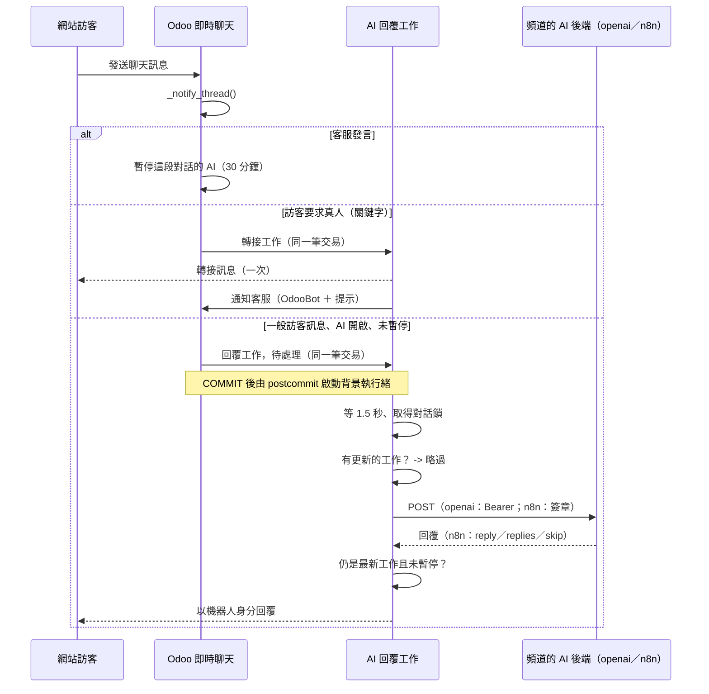
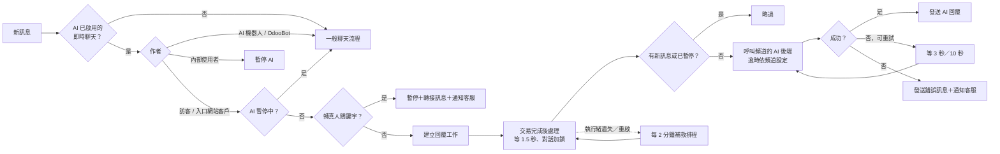

<p align="center">
  <h1 align="center">Live Chat AI Integration / 即時聊天 AI 整合</h1>
</p>

<p align="center">
  <strong><code>im_livechat_ai</code> -- Odoo 18 AI 智能客服模組</strong>
</p>

<p align="center">
  
  
  
  
  
  <a href="https://github.com/WOOWTECH/Woow_odoo_ai_livechat/actions/workflows/odoo-tests.yml"></a>
</p>

<p align="center">
  每個即時聊天頻道各自選一個 AI 後端（OpenAI 相容，例如 LiteLLM、Hermes，或 n8n Webhook）自動回覆訪客，<br/>
  回覆工作不會遺失、客服可隨時接手。Odoo 只負責記錄、轉送、管理，其餘都交給後端。
</p>

<p align="center">
  <a href="README.md">English</a> &bull;
  <a href="#概述">概述</a> &bull;
  <a href="#升級到-180120">升級到 18.0.1.2.0</a> &bull;
  <a href="#從-18010x-升級">從 18.0.1.0.x 升級</a> &bull;
  <a href="#為什麼使用此模組">為什麼使用</a> &bull;
  <a href="#架構">架構</a> &bull;
  <a href="#功能特色">功能特色</a> &bull;
  <a href="#截圖">截圖</a> &bull;
  <a href="#安裝">安裝</a> &bull;
  <a href="#設定">設定</a> &bull;
  <a href="#ai-後端litellmhermesn8n">AI 後端</a> &bull;
  <a href="#模組結構">模組結構</a> &bull;
  <a href="#安全性">安全性</a> &bull;
  <a href="#測試">測試</a> &bull;
  <a href="#疑難排解">疑難排解</a> &bull;
  <a href="#相依模組">相依模組</a> &bull;
  <a href="#參與開發">參與開發</a> &bull;
  <a href="#更新日誌">更新日誌</a> &bull;
  <a href="#授權">授權</a>
</p>

---

## 概述

**im_livechat_ai** 是由 [WOOWTECH](https://github.com/WOOWTECH) 開發的 Odoo 18 模組，讓 AI 自動回覆即時聊天的訪客。網站訪客或已登入的入口網站客戶在啟用 AI 的頻道發訊息時，模組會在**同一筆交易**中建立一個「AI 回覆工作」；交易寫入完成後，再把對話送到**這個頻道的 AI 後端**，取得回覆後以頻道的機器人身分回覆訪客。

每個頻道有自己的後端連線，由系統管理員在頻道的 **AI** 分頁（即時聊天 → 設定 → 頻道）設定：

| 後端類型 | 端點網址 | 存取金鑰（Token） | 常見後端 |
|---|---|---|---|
| **OpenAI 相容（LiteLLM、Hermes…）** | 結尾為 `/v1` 的基礎網址，系統自動加上 `/chat/completions` | API 金鑰，以 `Authorization: Bearer <token>` 送出 | LiteLLM、Hermes、任何 OpenAI 相容伺服器 |
| **n8n Webhook** | 完整的正式 Webhook 網址（Chat Trigger 的 `.../webhook/<id>/chat` 也可以） | 選填的 `X-Woow-Signature`（HMAC-SHA256）簽章密鑰，**不會送出**；空白則不簽章 | n8n 工作流程（Webhook＋AI Agent＋Respond to Webhook，或 Chat Trigger） |

Odoo 只負責**記錄、轉送、管理**對話；角色設定、工具（查商品、Odoo MCP 等）、審核與權限都屬於後端。客服隨時可以接手：客服在對話中發言，或訪客要求真人客服時，AI 會暫停回覆這段對話。沒有預設網址、也沒有預設模型：系統管理員填好頻道連線之前 AI 不會回覆。設定 App 裡已沒有本模組的任何設定。

請求格式與 `woow_ai_contact`（docs/PROTOCOL.md）的 n8n 一節相容：標頭、簽章、session id、內容與回覆格式都一樣，為本模組寫的 n8n 工作流程，之後改用 `woow_ai_contact` 也能直接沿用。

---

## 升級到 18.0.1.2.0

執行 `-u im_livechat_ai`（或平台發版的升級檢查）會跑 18.0.1.2.0 的 post-migration：

| 項目 | 結果 |
|---|---|
| 後端類型 | 每個頻道都設為「OpenAI 相容」（18.0.1.1.0 只支援這種）。 |
| `im_livechat_ai.base_url`／`im_livechat_ai.api_key`（設定 → Live Chat AI） | 複製到**每個**頻道的端點網址（去掉結尾的 `/` 與 `/chat/completions`）與存取金鑰；頻道已有值的不覆寫。只有金鑰沒有網址時，用 18.0.1.1.0 當時的預設網址。 |
| `im_livechat_ai.log_payload`／`im_livechat_ai.log_retention_days` | 複製到每個頻道（**記錄對話內容**、**日誌保留天數**）。 |
| 所有 `im_livechat_ai.*` 系統參數 | 刪除（包括金鑰；模型清單快取已不再使用）。 |
| **啟用 AI 整合**、模型 | 不變：AI 開著且複製到連線的頻道會繼續回覆。模型保留原本的文字。 |
| **訪客傳的檔案**（新欄位） | Hermes 頻道（模型是 `hermes-agent` 或端點網址含 `hermes`）設為「只給下載連結」，其他頻道「直接附檔」。已有值的不改。 |
| 設定 → Live Chat AI、選單「即時聊天 → 設定 → AI 設定」 | 移除。 |
| 商品查詢工具、溫度、Max Tokens、模型清單、身分說明 | 移除：改由後端負責。 |

伺服器日誌會有一行 WARNING，只寫數量（頻道數、複製了幾個網址與金鑰、刪了幾個參數、開著 AI 且有連線的頻道數），不寫任何值。腳本可重跑：參數刪除後再跑不會改任何東西，頻道上已有的值也不會被覆寫。沒有這些參數（且 AI 都關著）的資料庫維持原狀。

升級後，原本靠 Odoo 商品工具查價的頻道就沒有工具了：請改接有自己商品工具的後端（例如 Hermes 或 n8n 搭配 Odoo MCP），或先維持關閉。

---

## 從 18.0.1.0.x 升級

> **升級後 AI 一律關閉，要等系統管理員設定好頻道的 AI 後端才會再回覆。**

升級到 18.0.1.1.0（`-u im_livechat_ai`，或平台發版時的升級檢查看到版本號改變而自動執行）會自動做以下處理：

| 項目 | 結果 |
|------|------|
| 頻道上的 **API 網址**與 **API 金鑰** | 新程式載入前先清空（pre-migration），之後移除欄位。舊金鑰不會留在資料庫。 |
| **啟用 AI 整合** | **所有**頻道都關閉。伺服器日誌會列出原本開著 AI 的頻道。 |
| **重試延遲** | 移除（固定先等 3 秒、再等 10 秒）。**最大重試次數**上限改為 2。 |
| 預設英文**錯誤訊息**（或空白） | 改成繁體中文預設文字；自訂過的文字保留不動。 |
| **轉真人關鍵字**仍是舊預設 `真人,客服,人工,真人客服,human,agent,operator`（或空白） | 改成新的預設（只認明確的要求，見[轉真人客服（暫停）](#轉真人客服暫停)）；自訂過的保留不動。 |
| AI 機器人聯絡人 | 封存並加上「AI 機器人」標籤，和 Odoo 聊天機器人一樣；沒有圖片的會換上模組附的機器人頭像。 |
| 既有 **API 日誌** | 清除對話內容與上游回應內容。 |

上表除了 API 網址／金鑰欄位之外的每一項（AI 全部關閉、最大重試次數換算、錯誤訊息、轉真人關鍵字、機器人聯絡人與頭像、清理日誌）都只在 pre-migration 看到 18.0.1.0.x 的欄位（`ai_api_key`、`ai_api_base_url` 或 `ai_retry_delay`）時才做；pre-migration 用暫時的系統參數 `im_livechat_ai.migration_1_1_0_legacy` 告訴 post-migration，post-migration 讀完就刪除。已升級過的資料庫再跑一次 18.0.1.1.0 的腳本，不會改到任何資料，管理員升級後清空或修改的值（清空的機器人名稱或錯誤訊息、取消封存的機器人聯絡人）也不會被改回來。

### 上線須知：重啟或部署後的回覆

AI 回覆平常由收到訪客訊息的 Odoo 程序裡的執行緒送出。程序停止（重啟、部署、worker 自動回收）時正在處理的回覆，以及「等候真人逾時後」的 AI 回覆，都由排程 **Live Chat AI: Recover Reply Jobs**（每 2 分鐘）送出，所以會慢 **約 1-2 分鐘**。**一定要有排程程序**：Odoo 要以 `max_cron_threads >= 1` 執行（或另外跑一個排程程序，例如 `odoo --no-http --max-cron-threads=1`）。監看位置：每個頻道 **AI** 分頁的「**AI 回覆工作**」區塊（排程上次執行時間、超過 5 分鐘未完成的工作數，有問題會顯示警告），或 **即時聊天 → 設定 → AI 回覆工作**。

從 18.0.1.0.x 升級後（直接升到 18.0.1.2.0 時，18.0.1.1.0 與 18.0.1.2.0 的腳本都會跑），系統管理員要：

1. 開啟 **即時聊天 → 設定 → 頻道**，選頻道，打開 **AI 整合** 分頁。
2. 選 **後端類型**，填入 **端點網址**、**存取金鑰（Token）**（LiteLLM 還要填 **模型**），儲存。
3. 按 **測試連線**，成功後再重新啟用 AI。

舊的頻道金鑰請到原供應商後台撤銷：升級只會從 Odoo 移除，備份、git 歷史或日誌裡可能還有副本。

---

## 為什麼使用此模組

| 沒有此模組 | 使用此模組 |
|---|---|
| 僅能手動回覆聊天 | AI 全天候自動回覆，客服可隨時接手 |
| 只能接一種 AI | 每個頻道各自接 LiteLLM、Hermes 或 n8n 工作流程，金鑰各自獨立 |
| 訊息可能沒人回 | 回覆工作有紀錄，重啟也會補回；連發多則只回一次 |
| 無法轉真人 | 客服發言或訪客說「真人」「客服」就暫停 AI 並通知客服 |
| 金鑰誰都看得到 | 金鑰只有系統管理員能設定、儲存後不再顯示；n8n 的密鑰從不送出 |
| 對話內容到處存 | API 日誌預設不存對話內容，且只有管理員看得到 |
| 權限混在 Odoo 裡 | Odoo 只記錄與轉送；工具與權限由後端負責 |

---

## 架構

### ASCII 流程圖

```
                              Odoo 18
 +-----------------------------------------------------------------------+
 |                                                                       |
 |  Website Visitor（網站訪客／入口網站客戶）                                |
 |       |                                                               |
 |       v                                                               |
 |  discuss.channel.message_post()                                       |
 |       |                                                               |
 |       v                                                               |
 |  _notify_thread() hook                                                |
 |       |  客服發言 -> 暫停 AI（預設 30 分鐘）                                |
 |       |  訪客要求真人 -> 轉接工作（通知訪客一次 + 通知客服）                    |
 |       |  其他訪客訊息 -> 在同一筆交易建立 im_livechat.ai.job（待處理）          |
 |       v                                                               |
 |  COMMIT -> postcommit 背景執行緒（或每 2 分鐘的補救排程）                    |
 |       |  等 1.5 秒合併連發訊息，同一段對話加鎖                                 |
 |       |  有更新的工作 -> 略過，交給最新那個                                    |
 |       v                                    +------------------------+ |
 |  _ai_conversation()                        |  頻道的 AI 後端          | |
 |       |  最近 N 則歷史、客服訊息加標記          |  openai：/v1/chat/      | |
 |       v                                    |    completions          | |
 |  _generate_ai_reply() ---- POST ---------->|  n8n：簽章 Webhook       | |
 |       |  逾時依頻道設定、最多重試 2 次         |                        | |
 |       |<-------- 回覆 ----------------------|                        | |
 |       |                                    +------------------------+ |
 |       v                                                               |
 |  _create_bot_message()（XSS 防護）                                       |
 |       v                                                               |
 |  訪客看到 AI 回覆                                                         |
 |                                                                       |
 +-----------------------------------------------------------------------+
```

### 時序圖



### 流程圖



---

## 功能特色

### 核心功能

- **每個頻道一個後端** -- OpenAI 相容（LiteLLM、Hermes…）或 n8n Webhook，各自的端點網址與存取金鑰，由系統管理員在頻道的 AI 分頁設定；即時聊天管理員只看得到「連線是否已設定」。
- **模型改為文字欄位** -- 選填；OpenAI 相容後端啟用 AI 時必填（LiteLLM 需要），Hermes 會忽略，n8n 不使用；有值才送出。
- **多輪對話上下文** -- 最近 1-200 則訊息。訪客是 `user`、AI 機器人是 `assistant`，真人客服是加上 `[真人客服 姓名]` 標記的 `user`（與 `woow_ai_contact` 相同），並以對話事件告訴 AI 不要推翻同事的說法。OpenAI 訊息一定以 user 開頭、以 user 結尾。
- **訪客與入口網站客戶** -- 網站訪客、已登入的入口網站客戶與公開使用者都會得到回覆；內部使用者、這段對話指派的客服與機器人不會觸發 AI。

### 可靠的回覆流程（工作佇列）

- **有紀錄的回覆工作**（`im_livechat.ai.job`）-- 和訪客訊息在同一筆交易建立，訊息寫入成功才有工作；交易完成後才開始處理。
- **連發只回一次** -- 等 1.5 秒合併連發訊息；每段對話一把 PostgreSQL advisory lock（跨 prefork worker 與排程程序都有效）；有更新工作的舊工作會被略過，由最新的工作帶完整上下文回覆。
- **呼叫有上限** -- 每次呼叫最多等「**等待後端回覆的秒數**」（每個頻道各自設定；0＝預設：OpenAI 相容 45 秒、n8n 120 秒；10-300 秒），最多重試 2 次（先等 3 秒、再等 10 秒），每個工作最多處理 3 次。OpenAI 相容後端任何失敗都會重試；n8n 只在連不上或回 HTTP 429／503 時重試，讀取逾時一律不重試（agent 可能還在跑；同一個工作流程不會跑兩次）。
- **補救排程** -- 每 2 分鐘把因重啟或當機而停在「待處理／處理中」的工作重新執行；機器人已經回覆過的不會重複回覆。超過 30 分鐘仍未完成的工作會放棄。等候真人逾時後的延後回覆也由它執行（會在等候結束的時間觸發）。需要排程程序（見[上線須知](#上線須知重啟或部署後的回覆)）。
- **監看** -- 頻道 AI 分頁的「**AI 回覆工作**」區塊（即時聊天管理員）顯示排程上次執行時間與超過 5 分鐘仍在「待處理／處理中」的工作數；排程超過 5 分鐘沒跑或有卡住的工作時顯示警告。
- **失敗處理** -- 全部重試失敗時，訪客收到頻道的錯誤訊息（預設繁中），客服會收到通知（OdooBot 訊息與不會自動消失的提示）。
- **看得到的佇列** -- **即時聊天 → 設定 → AI 回覆工作** 可看每個工作的狀態、處理次數、後端呼叫次數與簡短錯誤。

### 轉真人客服（暫停）

兩種暫停，記在對話上（`discuss.channel.ai_paused_until`、`ai_pause_reason`）：

- **客服發言**（`operator`）-- 內部使用者在對話中發言後，AI 在這段對話暫停 **30 分鐘**（**真人接手後暫停**，每個頻道可調 1-1440）；之後客服每次發言都延長到「現在 + 30 分鐘」（不會縮短）。這段期間 AI 完全不出聲：不回覆、不送通知。
- **訪客要求真人**（`handoff`）-- 只有明確的要求才算：`找真人`、`真人客服`、`轉真人`、`轉人工`、`人工客服`、`找客服`、`聯絡客服`、`我要客服`、`human agent`、`talk to a human`、`real person`、`live agent`（可自訂）。中文關鍵字出現在訊息任何位置都算；英文字詞要整個字／整個片語相符、不分大小寫、字與字之間的空白不限。單獨的 `客服`、`人工`、`agent` 等不再轉真人（問「客服電話」會由 AI 回答）。AI 回一次轉接訊息（「已幫您通知客服，請稍候。」），通知客服，然後**等候 10 分鐘**（**等候真人分鐘數**，1-1440）。
- **等候通知** -- 等候期間訪客的第一則訊息會收到一則固定回覆（**等候通知**，預設「已通知客服人員，請稍候。若客服暫時無法回覆，AI 助理會在 10 分鐘後繼續為您服務。」；`%(minutes)s` 會換成等候分鐘數）。每次等候只送一次（`discuss.channel.ai_pause_notice_sent`），不呼叫後端。
- **客服接手** -- 等候期間客服一發言，就改成客服暫停，從這次發言起算 30 分鐘，即使等候設得更長也一樣（等候設 120 分鐘時，AI 不會因此安靜 120 分鐘）；等候通知與延後回覆都會安靜取消。
- **逾時自動接回** -- 等候結束時若沒有客服回覆，AI 會回答訪客在等候期間寫的所有訊息，訪客不必再發一次：每則等候期間的訊息都有一個延後的回覆工作（`im_livechat.ai.job.deferred`），到期時間是等候結束，補救排程會在那個時間被觸發，由最新的工作一次回答全部（其他略過）。等候結束後約 1 分鐘內會收到回答（排程喚醒時間）。

### 隱私與維運

- **AI API 日誌只有即時聊天管理員看得到** -- 只記時間、後端類型、模型、token、耗時、狀態、HTTP 狀態碼與簡短錯誤。
- **AI 設定只有即時聊天管理員能看、能改** -- 頻道的 AI 欄位（提示詞、模型、轉真人關鍵字、錯誤訊息等）只開放給 Live Chat 管理員；一般客服、員工、入口網站客戶都讀不到。後端連線（類型、端點網址、存取金鑰、記錄對話內容）與「測試連線」只開放給系統管理員。AI 機器人的聯絡人由系統建立，不能指定成其他人。
- **AI 回覆只對自家網址產生連結** -- 只有 `web.base.url` 與網站網域的網址會變成可點的連結，其他網址只顯示文字。
- **預設不存對話內容** -- **記錄對話內容**（每個頻道各自設定、只有系統管理員能改、預設關閉）只在除錯時暫時打開；關閉時會清除這個頻道已保存的內容。保存的內容不含金鑰。
- **保留天數** -- 超過頻道 **日誌保留天數**（預設 14 天）的日誌與已結束的回覆工作每天自動刪除。
- **簡短錯誤** -- 測試按鈕與日誌只顯示狀態碼和一句說明；完整錯誤只寫伺服器日誌。

### AI 身分揭露

- **歡迎訊息** -- 頻道啟用 AI 時，聊天視窗顯示 **AI 歡迎訊息**（新頻道預設「您好，我是 AI 客服助理，有什麼可以幫您？需要真人客服請輸入「找真人」。」），取代 Odoo 原本的歡迎訊息。
- **機器人頭像** -- AI 訊息的作者是機器人聯絡人，名稱是 **機器人名稱**，頭像是模組附的機器人圖（`static/img/ai_bot.png`）。
- **身分說明** -- Odoo 不再自動加身分說明：角色由後端（或頻道選填的系統提示詞）決定。
- **限制** -- 聊天視窗標題（以及歡迎訊息的作者）仍顯示這段對話指派的真人客服，因為 Odoo 每段即時聊天都會指派一位客服；本模組沒有改這部分。

### 安全

- **Markdown 回覆、XSS 防護** -- AI 回覆以內建的小型轉換器顯示 markdown（段落、`**粗體**`、清單、表格、標題、`程式碼` 與程式碼區塊）；所有文字先跳脫、結果再經過淨化；只有連到本站網域的連結會變成連結。
- **迴圈防護** -- AI 機器人、OdooBot 與對話指派的客服不會觸發 AI。
- **繁體中文** -- 給訪客與客服看的文字都是繁中，介面附完整 `zh_TW` 翻譯。

---

## 截圖

> 截圖是 18.0.1.0.0 版拍的。18.0.1.2.0 起 AI 分頁改為「**AI 後端連線**」區塊（後端類型、端點網址、存取金鑰、模型）。

### 即時聊天頻道總覽

<p align="center"></p>

### AI 整合設定分頁（18.0.1.0.0 版面）

<p align="center"></p>

### 管理員 Discuss 檢視與 AI 對話

<p align="center"></p>

### 訪客端即時聊天小工具

<p align="center"></p>

### 測試結果

| 基本英文問候 | 中文 UTF-8 測試 | 綜合壓力測試 |
|:---:|:---:|:---:|
|  |  |  |

---

## 安裝

### 標準 Odoo 安裝

1. **Clone 此儲存庫**，並把它加進 addons 路徑。模組正本是儲存庫根目錄的 `im_livechat_ai/`（只有這一份）：

   ```bash
   git clone https://github.com/WOOWTECH/Woow_odoo_ai_livechat.git /path/to/Woow_odoo_ai_livechat
   ```

   ```ini
   addons_path = /path/to/odoo/addons,/path/to/Woow_odoo_ai_livechat
   ```

2. **更新應用程式列表**：
   - 前往 **應用程式** 選單。
   - 點擊 **更新應用程式列表**。

3. **安裝模組**：
   - 搜尋 **"Live Chat AI"** 或 **"即時聊天 AI"**。
   - 點擊 **安裝**。

4. **為每個頻道設定 AI 後端**（見[設定](#設定)）；設定好之前 AI 不會回覆。

### Docker / Podman 部署

`odoo-ailivechat/` 目錄提供本機開發用的 `docker-compose.yml`（Odoo 18 + PostgreSQL 16）。它直接掛載儲存庫根目錄的模組正本（`../im_livechat_ai`）。repo 裡不放任何密碼，請從範本複製後自行填寫。

#### 服務架構

| 服務 | 映像檔 | 內部埠 | 對外埠 | 用途 |
|------|--------|:---:|:---:|------|
| **db** | `postgres:16` | 5432 | -- | PostgreSQL 資料庫（含健康檢查） |
| **odoo** | `odoo:18.0` | 8069 | **9094**（`ODOO_PORT`） | Odoo 18 應用程式伺服器 |

#### 快速啟動

```bash
cd odoo-ailivechat/

# 1. 建立本機設定（兩個檔案都已列入 .gitignore，不會被提交）
cp .env.example .env                           # 填入 POSTGRES_PASSWORD（例如 openssl rand -base64 24）
cp config/odoo.conf.example config/odoo.conf   # admin_passwd 留空 = 資料庫管理介面鎖住

# 2. 啟動
docker compose up -d                           # 或 podman-compose up -d

# 3. 建立資料庫並安裝模組（list_db = False，資料庫管理介面已停用）
docker compose run --rm odoo -d odooailivechat -i im_livechat_ai --without-demo=all --stop-after-init
docker compose restart odoo

# Odoo 將在 http://localhost:9094 上可用
```

#### 部署目錄結構

```
Woow_odoo_ai_livechat/
├── im_livechat_ai/                 # 模組正本（掛載到容器的 /mnt/extra-addons/im_livechat_ai）
└── odoo-ailivechat/
    ├── docker-compose.yml          # 服務定義
    ├── .env.example                # 範本：資料庫名稱、帳號、密碼、對外埠
    ├── .env                        # 自己建立，不提交
    ├── config/
    │   ├── odoo.conf.example       # 範本
    │   └── odoo.conf               # 自己建立，不提交
    └── data/
        ├── postgres/               # PostgreSQL 資料（持久化）
        └── odoo/                   # Odoo 檔案儲存（持久化）
```

#### 關鍵設定說明

- **網路：** 所有服務共享 `odoo-ailivechat-network` 橋接網路，支援內部主機名稱解析。
- **資料持久化：** PostgreSQL 資料和 Odoo 檔案儲存皆以 bind volume 掛載，確保重啟後資料不遺失。
- **健康檢查：** PostgreSQL 容器包含健康檢查；Odoo 會等待資料庫就緒後才啟動。
- **密碼：** 資料庫密碼只放在 `.env`；`odoo.conf` 不放資料庫帳密（由官方映像從環境變數帶入）。AI 後端的網址與金鑰不放在這裡，由系統管理員在各即時聊天頻道的 AI 分頁填寫。

---

## 設定

所有設定都在頻道上：**即時聊天 → 設定 → 頻道 →（頻道）→ AI 整合** 分頁。

### 步驟 1：後端連線（只有系統管理員）

| 欄位 | 說明 | 預設值 |
|------|------|--------|
| **後端類型**（`ai_backend_type`） | 「OpenAI 相容（LiteLLM、Hermes…）」或「n8n Webhook」；即時聊天管理員只能看、不能改 | OpenAI 相容 |
| **端點網址**（`ai_endpoint_url`） | OpenAI 相容：結尾為 `/v1` 的基礎網址（貼上 `/chat/completions` 會自動去掉）。n8n：完整的正式 Webhook 網址。只接受 `https://`；`http://` 只限 `localhost`、`127.0.0.1`、`::1` 與結尾為 `.svc.cluster.local` 的主機（`http://hermes:8642/v1` 這種短名稱會被拒絕） | 空白 |
| **存取金鑰（Token）**（`ai_api_token`） | OpenAI 相容（必填）：API 金鑰（`Authorization: Bearer <token>`）。n8n（選填）：簽章密鑰（不會送出）；空白則請求不簽章，例如公開的 Chat Trigger。只寫不讀：儲存後不再顯示（表單會顯示是否已儲存），留空即保留 | 空白 |
| **模型（選填）**（`ai_model`） | 文字欄位。OpenAI 相容後端啟用 AI 時必填（LiteLLM 需要）；Hermes 會忽略；n8n 不使用。即時聊天管理員可以改 | 空白 |
| **訪客傳的檔案**（`ai_document_mode`） | OpenAI 相容後端：**直接附檔（LiteLLM／OpenAI）** 把訪客的文件（PDF、Word、Excel、文字檔）原封不動附上，LiteLLM／OpenAI 可直接讀；**只給下載連結（Hermes 等）** 改給簽章下載連結，由後端自己下載。圖片兩種模式都直接附上；n8n 一律只給連結。見[訪客傳的檔案](#訪客傳的檔案)。即時聊天管理員可以改 | 直接附檔（升級時 Hermes 頻道設為只給下載連結） |
| **測試連線** | OpenAI 相容：用頻道的模型送一個小的 chat completion。n8n：送 `{"event": "ping", ..., "action": "loadPreviousSession"}`（有密鑰時會簽章），要回 HTTP 200；Chat Trigger 不會因此執行 agent。只顯示狀態碼和一句說明 | -- |
| **記錄對話內容**（`ai_log_payload`） | 在這個頻道的 AI API 日誌保存請求與回應內容；關閉時清除 | 關閉 |

即時聊天管理員看不到上面這些欄位，只會看到一行：「後端連線已設定（由系統管理員管理）」或「尚未設定後端連線，請系統管理員填寫」。他們不能讀寫網址、金鑰與記錄對話內容，連線不完整時也不能啟用 AI。

### 步驟 2：在頻道啟用 AI（即時聊天管理員）

勾選 **啟用 AI 整合**。連線必須完整（網址；OpenAI 相容後端還要金鑰與模型）；啟用的當下會建立機器人聯絡人。

檢查規則：數值範圍每次儲存都會檢查（AI 開或關都一樣），啟用 AI 時會全部再檢查一次；送出請求時歷史訊息數會再限制在範圍內。

### 設定欄位一覽

| 欄位 | 類型 | 預設值 | 說明 |
|------|------|--------|------|
| `ai_enabled` | Boolean | `False` | 啟用/停用 AI 整合 |
| `ai_backend_type` | Selection | `openai` | 後端類型（只有系統管理員能改） |
| `ai_endpoint_url` | Char | -- | 端點網址（只有系統管理員能讀寫） |
| `ai_api_token` | Char（只寫） | -- | 存取金鑰（只有系統管理員能寫；值存在不屬於 ORM 的 SQL 欄位；n8n 可留空） |
| `ai_model` | Char | -- | 模型（選填） |
| `ai_document_mode` | Selection | `file` | 訪客傳的檔案：`file` 直接附檔（LiteLLM／OpenAI）、`link` 只給下載連結（Hermes 等） |
| `ai_system_prompt` | Text | -- | 選填的系統提示詞；空白時 Odoo 不送 system 訊息，只有對話事件（客服發言、等候真人逾時） |
| `ai_max_history` | Integer | `50` | 最大歷史訊息數，用於建構對話上下文（1-200） |
| `ai_max_retries` | Integer | `2` | 呼叫失敗後的重試次數（0-2；先等 3 秒、再等 10 秒；n8n 只在連不上或回 429／503 時重試） |
| `ai_request_timeout` | Integer | `0` | 等待後端回覆的秒數：0＝預設（OpenAI 相容 45 秒、n8n 120 秒；智居顧問回答整棟規劃的長問題要 112 秒），否則 10-300 秒。測試連線按鈕維持自己的短逾時。超過約 120 秒時，請確認後端前面的代理（例如 Cloudflare）與 Odoo 的 `limit_time_real` 允許：長呼叫期間回收的 worker 會在 `limit_time_real` 後被終止，再由補救排程重試 |
| `ai_error_message` | Text | 抱歉，AI 客服暫時無法回覆。請稍後再試，或留下您的聯絡方式，我們的客服人員會盡快與您聯繫。 | 全部重試失敗後發送給訪客的訊息（同時通知客服） |
| `ai_handoff_pause_minutes` | Integer | `30` | 客服發言後 AI 暫停回覆的分鐘數，客服每次發言都會延長（1-1440） |
| `ai_handoff_wait_minutes` | Integer | `10` | 訪客要求真人後，AI 等候客服的分鐘數；逾時沒有客服回覆就由 AI 接回（1-1440） |
| `ai_handoff_keywords` | Char | `找真人,真人客服,轉真人,轉人工,人工客服,找客服,聯絡客服,我要客服,human agent,talk to a human,real person,live agent` | 轉真人關鍵字，以逗號分隔；中文出現在任何位置都算，英文字詞要整個字／片語相符、不分大小寫 |
| `ai_handoff_message` | Text | 已幫您通知客服，請稍候。 | 訪客要求真人時回覆一次的訊息 |
| `ai_pause_notice` | Text | 已通知客服人員，請稍候。若客服暫時無法回覆，AI 助理會在 %(minutes)s 分鐘後繼續為您服務。 | 等候期間訪客第一則訊息收到的固定回覆（每次等候一次）；`%(minutes)s` 換成等候分鐘數，其他文字照原樣送出 |
| `ai_bot_partner_id` | Many2one | 自動建立 | 機器人聯絡人（已封存、標籤「AI 機器人」、機器人頭像），作為 AI 訊息的作者 |
| `ai_bot_name` | Char | `AI 客服助理` | 機器人在聊天中的顯示名稱 |
| `ai_welcome_message` | Text | 您好，我是 AI 客服助理，有什麼可以幫您？需要真人客服請輸入「找真人」。 | 啟用 AI 時聊天視窗的歡迎訊息 |
| `ai_log_payload` | Boolean | `False` | 記錄對話內容（只有系統管理員能改） |
| `ai_log_retention_days` | Integer | `14` | 這個頻道的 AI API 日誌與已結束回覆工作的保留天數（1-3650） |

### 步驟 3：轉真人客服與暫停

暫停狀態存在對話上：`discuss.channel.ai_paused_until`（「AI 暫停到」）、`ai_pause_reason`（`operator` 客服發言／`handoff` 訪客要求真人）、`ai_pause_notice_sent`（這次等候已送過等候通知）。行為見[轉真人客服（暫停）](#轉真人客服暫停)。

### UI 操作按鈕與選單

- **測試連線**（系統管理員）-- 測試頻道的後端，只顯示狀態碼和一句說明。
- **AI API 日誌**（頻道上的按鈕，即時聊天管理員）-- 開啟這個頻道的 AI API 日誌（後端、模型、token、耗時、狀態、HTTP 狀態碼），預設顯示最近 7 天；只有打開「記錄對話內容」時才有對話內容。
- **AI 回覆工作**（即時聊天 → 設定）-- 回覆佇列，可篩選待處理／處理中、失敗、略過與轉真人；等候真人期間的延後回覆會標示「延後」，到「預定處理時間」才處理。
- **AI 回覆工作監看**（頻道 AI 分頁）-- 排程上次執行時間與卡住的工作（見[上線須知](#上線須知重啟或部署後的回覆)）。
- **AI API 日誌**（即時聊天 → 設定）-- 全部頻道的 AI API 日誌。

---

## AI 後端：LiteLLM、Hermes、n8n

三種後端的設定方式都一樣（系統管理員，在頻道的 AI 分頁）：**後端類型**、**端點網址**、**存取金鑰（Token）**，按 **測試連線**，再由即時聊天管理員啟用 AI。每個頻道可以接不同的後端。

### LiteLLM（OpenAI 相容）

| 欄位 | 值 |
|---|---|
| 後端類型 | OpenAI 相容（LiteLLM、Hermes…） |
| 端點網址 | `https://litellm.example.com/v1` |
| 存取金鑰（Token） | 給這個頻道用的 LiteLLM 虛擬金鑰（`sk-...`），只允許指定模型，設好預算與速率上限 |
| 模型（選填） | 必填，例如 `chatgpt-pool/gpt-6-sol` |

### Hermes（OpenAI 相容）

| 欄位 | 值 |
|---|---|
| 後端類型 | OpenAI 相容（LiteLLM、Hermes…） |
| 端點網址 | `http://hermes.<namespace>.svc.cluster.local:8642/v1`（叢集內），或代理會讓 `/v1` 以 Bearer 通過的公開 `https://` 網址 |
| 存取金鑰（Token） | Hermes 的 `API_SERVER_KEY` |
| 模型（選填） | 任意文字，例如 `hermes-agent`（Hermes 會忽略、用自己的模型；但 OpenAI 相容後端啟用 AI 時本模組需要有值） |
| 訪客傳的檔案 | **只給下載連結（Hermes 等）**：Hermes 不收 `file` 片段，由它的 agent 下載簽章連結 |

Hermes 會載入自己的工具：給即時聊天（匿名訪客）用的頻道，請接只載入公開、唯讀工具的 Hermes。

### 請求格式（OpenAI 相容）

```http
POST {端點網址}/chat/completions
Authorization: Bearer <存取金鑰>
Content-Type: application/json
```

```json
{
  "model": "chatgpt-pool/gpt-6-sol",
  "messages": [
    {"role": "system", "content": "<頻道系統提示詞與對話事件；兩者都沒有就不送>"},
    {"role": "user", "content": "請問營業時間？"}
  ],
  "user": "woow-ai-0edfec80-42",
  "metadata": {"session_id": "woow-ai-0edfec80-42", "odoo_guest_id": "7", "odoo_name": "訪客", "odoo_lang": "zh_TW",
               "odoo_is_portal": "false", "odoo_is_guest": "true", "livechat_channel": "官網客服"}
}
```

- `model` 有值才送；不送 `tools`、`temperature`、`max_tokens`、`stream`（由後端決定）。不串流，逾時依頻道的「等待後端回覆的秒數」（預設 45 秒）。
- `messages` 一定以 user 開頭、以 user 結尾：第一則訪客訊息之前的歡迎訊息會拿掉；最後一則訪客訊息之後的機器人訊息會移到它前面（若會變成第一則，就合併成開頭的一則 user 引述）。
- `user` 與 `metadata.session_id` 是 `woow-ai-<database.uuid 前 8 碼>-<discuss.channel id>`，同一段對話固定不變。`metadata` 的值都是字串，不含 email。
- 回覆：一般的 chat completion，取 `choices[0].message.content`（文字或文字片段）；`<think>` 區塊會移除。
- 帶附件的訪客訊息會變成內容片段清單，見[訪客傳的檔案](#訪客傳的檔案)。

### n8n Webhook

| 欄位 | 值 |
|---|---|
| 後端類型 | n8n Webhook |
| 端點網址 | **正式（production）** Webhook 網址，例如 `https://n8n.example.com/webhook/livechat-ai`（或 `http://n8n.<namespace>.svc.cluster.local:5678/webhook/livechat-ai`） |
| 存取金鑰（Token） | 建議填隨機產生的簽章密鑰，例如 `openssl rand -hex 32`；同一個值放進 n8n 的環境變數 `WOOW_AI_SIGNING_SECRET`。也可以留空（工作流程不驗簽章，請求就不簽章） |
| 模型（選填） | 不使用 |

請求（`POST {端點網址}`），精簡的 UTF-8 JSON，**沒有 `Authorization` 標頭**；有密鑰時才加上兩個簽章標頭：

```http
Content-Type: application/json
X-Woow-Timestamp: 1793430000
X-Woow-Signature: sha256=<hex HMAC-SHA256(密鑰, "<X-Woow-Timestamp>.<原始 body>")>
```

```json
{
  "event": "message",
  "session_id": "woow-ai-0edfec80-42",
  "contact": {"id": 3, "name": "官網客服"},
  "user": {"user_id": null, "partner_id": null, "guest_id": 7, "name": "訪客", "email": "", "lang": "zh_TW",
           "tz": "Asia/Taipei", "is_portal": false, "is_guest": true, "company_id": null, "visitor_key": "guest:7"},
  "channel": {"id": 42, "type": "livechat",
              "livechat": {"livechat_channel_id": 3, "livechat_channel_name": "官網客服", "channel_id": 3,
                           "channel_name": "官網客服", "operator_name": "客服小明", "country_code": "TW",
                           "visitor_kind": "guest"}},
  "system_prompt": "",
  "message": {"id": 991, "text": "請問營業時間？", "attachments": []},
  "history": [{"role": "assistant", "text": "您好，有什麼可以幫您？", "attachments": []}],
  "events": [{"time": "2026-11-01T07:55:00Z", "kind": "operator", "text": "..."}],
  "action": "sendMessage",
  "sessionId": "woow-ai-0edfec80-42",
  "chatInput": "請問營業時間？"
}
```

- `action`、`sessionId`、`chatInput` 是 n8n **Chat Trigger** 會讀的欄位（值同 `session_id` 與 `message.text`）；Webhook 節點的工作流程可以忽略。
- `contact` 是即時聊天頻道；`channel` 是這段對話（`discuss.channel`）。`message` 是正在回答的訪客訊息；`history` 是其餘上下文（真人客服是開頭為 `[真人客服 姓名] ` 的 `user`）。`events` 是模型必須知道的事實（`operator`：客服在對話中發言過；`resume`：等候真人逾時、沒有客服回覆），沒有時是 `[]`。`attachments` 是訪客訊息的檔案：`{"id", "name", "mimetype", "size", "url", "expires_at"}`，附 1 小時有效的簽章下載網址（不內嵌任何內容）；機器人與客服的訊息一律是 `[]`。見[訪客傳的檔案](#訪客傳的檔案)。
- `user` 依 woow_ai_contact docs/LIVECHAT.md 的訪客表（訪客、入口網站使用者、員工以訪客身分、沒有使用者的聯絡人、公開使用者）。即時聊天訪客多半是匿名的：`channel.type` 是 `livechat` 或 `user.is_guest` 為 true 時，只能給模型公開資料的工具。
- **測試連線** 會送 `{"event": "ping", "contact": {...}, "action": "loadPreviousSession", "sessionId": "woow-ai-ping-<頻道 id>"}`；非 `message` 的事件請回 HTTP 200（例如 `{"skip": true}`）。Chat Trigger 會自己回應 `loadPreviousSession`，不會執行 agent。

回覆：HTTP 200 的 JSON，在頻道的「等待後端回覆的秒數」內（預設 120 秒）：

```json
{"reply": {"text": "markdown 文字"}}
{"reply": "text"}
{"replies": [{"text": "第一則"}, {"text": "第二則"}]}
{"skip": true}
{"output": "markdown 文字"}
```

`reply` 發一則訊息、`replies` 發多則（最多 10 則）、`skip` 不發（工作完成但沒有訊息）、`output`（n8n AI Agent 與 Chat Trigger 的預設回覆）發一則。也接受 n8n 的項目清單（`[{"reply": ...}]`、`[{"output": ...}]`）。其他（非 200、不是 JSON、沒有 `reply`／`replies`／`skip`／`output`、文字是空的）都算錯誤：訪客收到頻道的錯誤訊息、客服收到通知、AI API 日誌留下 HTTP 狀態碼。Agent 失敗時請回非 200（例如 502）。每次呼叫依頻道的「等待後端回覆的秒數」逾時（預設 120 秒），只有連不上或 n8n 回 429／503 時才重試；讀取逾時（agent 可能還在跑）或其他回應都不重試。不跟隨轉址。回覆附件不支援（只送文字）。

#### 驗證簽章（必做）

驗證**原始位元組**（在 Webhook 節點開啟 *Raw Body*），時間戳與現在相差超過 300 秒就拒絕，並用固定時間比較。Code 節點（需要 `NODE_FUNCTION_ALLOW_BUILTIN=crypto`；密鑰放在環境變數，不要寫在工作流程裡）：

```js
const crypto = require('crypto');
const SECRET = $env.WOOW_AI_SIGNING_SECRET;
const item = $input.first();
const raw = (await this.helpers.getBinaryDataBuffer(0, 'data')).toString('utf8');
const h = Object.fromEntries(Object.entries(item.json.headers || {}).map(([k, v]) => [k.toLowerCase(), v]));
const ts = String(h['x-woow-timestamp'] || '');
if (!/^\d+$/.test(ts) || Math.abs(Date.now() / 1000 - Number(ts)) > 300) throw new Error('stale');
const expected = 'sha256=' + crypto.createHmac('sha256', SECRET).update(ts + '.' + raw).digest('hex');
const a = Buffer.from(expected), b = Buffer.from(String(h['x-woow-signature'] || ''));
if (a.length !== b.length || !crypto.timingSafeEqual(a, b)) throw new Error('bad signature');
return [{ json: JSON.parse(raw) }];
```

#### n8n Chat Trigger（託管聊天）工作流程

以 **Chat Trigger** 節點開頭（公開聊天、不驗證）的既有工作流程可以直接使用，例如智居顧問：

- **端點網址**：`<n8n>/webhook/<webhookId>/chat`（例如 `https://n8n.example.com/webhook/smart-home-advisor/chat`）；**存取金鑰（Token）**留空（公開的 Chat Trigger 不驗簽章；若自行加了驗證，再填密鑰）。
- Odoo 會送 `action: "sendMessage"`、`sessionId`、`chatInput`（以及所有協定欄位）；Chat Trigger 回 `{"output": "..."}`，發成一則訊息（連到官網的 markdown 連結與 `**粗體**` 都會顯示）。
- 這類 agent 每次回答約 20-30 秒：n8n 預設逾時 120 秒（「等待後端回覆的秒數」；顧問最長要 112 秒，Cloudflare 在 100 秒時沒有切斷），讀取逾時一律不重試。
- 限制：這種工作流程**依 `sessionId` 自己保存記憶**，不看 Odoo 送的 `history` 與 `events`，所以看不到轉真人期間真人客服說了什麼，也無法確認請求真的來自 Odoo。新的工作流程請優先用 **Webhook** 節點開頭並驗證簽章（見下方）。

#### 最小 n8n 工作流程

1. **Webhook** -- HTTP Method `POST`，Path 例如 `livechat-ai`，Authentication `None`，開啟 *Raw Body*，Respond 選 `Using 'Respond to Webhook' Node`。
2. **Code** -- 上面的簽章檢查（簽章錯誤就丟出錯誤，後面都不執行，n8n 回非 200）。
3. **IF** -- `{{ $json.event }}` 等於 `message`；false 分支接一個回 `{"skip": true}` 的 **Respond to Webhook**（測試連線的 ping）。
4. **AI Agent** -- Prompt `{{ $json.message.text }}`；System Message `{{ ($json.system_prompt || '你是我們網站的客服助理。') + ($json.events.length ? '\n\nConversation events (facts, not your words):\n' + $json.events.map(e => '- ' + e.time + ' ' + e.text).join('\n') : '') }}`；選一個 Chat Model；記憶（選用）用 `{{ $json.session_id }}` 當 key；只接公開、唯讀的工具（商品查詢、營業時間）。
5. **Respond to Webhook** -- Respond With `JSON`，Response Body `{{ JSON.stringify({ reply: { text: $json.output } }) }}`。

把正式 Webhook 網址填進 **端點網址**、密鑰填進 **存取金鑰（Token）**，按 **測試連線**（HTTP 200），再啟用 AI。n8n 每次執行都會保存 Webhook 內容（也就是對話）：請設定執行紀錄保留期限，或不保存成功的執行。超過「等待後端回覆的秒數」（最多 300 秒）的工作流程，請立刻回 `{"skip": true}`。

### 訪客傳的檔案

**訪客**在聊天中傳的圖片與檔案原封不動交給後端：Odoo 不擷取文字、不轉檔（負責人決策 39，與 woow_ai_contact 同一套規則）。機器人、OdooBot 與客服訊息的附件一律不送。

**OpenAI 相容後端**：帶檔案的那則訪客訊息，user 內容會變成片段清單：

```json
{"role": "user", "content": [
  {"type": "text", "text": "請看報價單\n[附件] 報價單.pdf（application/pdf，85.2 KB）：檔案已附在這則訊息"},
  {"type": "image_url", "image_url": {"url": "data:image/png;base64,..."}},
  {"type": "file", "file": {"filename": "報價單.pdf", "file_data": "data:application/pdf;base64,..."}}
]}
```

| 檔案 | 怎麼送 |
|---|---|
| 圖片（png、jpeg、gif、webp；依內容判斷類型，不看檔名） | `image_url` data URI，兩種模式都一樣。只看最近 3 則訪客訊息，最多 4 張，每張 5 MB 以內。 |
| 文件（PDF、Word `docx`、Excel `xlsx`／`xls`、`txt`／`md`／`csv`／`tsv`／`json`），**訪客傳的檔案＝直接附檔** | `file` 片段，原始位元組與原始 mimetype，另加一行 `[附件] <檔名>（<mimetype>，<大小>）：檔案已附在這則訊息`。只看最近 5 則訪客訊息，最多 5 個，每個 5 MB 以內。 |
| **只給下載連結** 模式的文件、較早的檔案、其他檔案（壓縮檔、音訊、影片…）、超過上限的檔案 | 一行 `[附件] <檔名>（<mimetype>，<大小>）：<簽章網址>`；因為上限被略過的檔案再加一行 `[附件說明] <檔名>：<原因>`。 |
| 危險或會執行的類型：html、svg、xml、javascript、執行檔與腳本、含執行檔的 zip、Odoo 看不到內容的壓縮檔（rar、7z、tar、gz…） | 一律只給連結，不內嵌（檢查檔名、上傳的類型與內容）。 |

同一個請求的 data URI 合計上限 **7 MB**（圖片優先、新的優先；Hermes 會拒絕超過 10 MB 的請求）。上限都是 `models/discuss_channel.py` 開頭的常數。

**n8n**：`message.attachments` 與 `history[].attachments` 是 `{"id", "name", "mimetype", "size", "url", "expires_at"}`，不內嵌內容，工作流程需要時自己下載。

**簽章下載網址**（兩種後端）：`GET {web.base.url}/im_livechat_ai/attachment/<id>/<expires>.<hex HMAC-SHA256(database.secret, "im_livechat_ai|<id>|<checksum>|<expires>")>`，1 小時有效。只提供即時聊天對話中訊息的附件，一律以下載方式回應（`Content-Disposition: attachment`、`X-Content-Type-Options: nosniff`、`Cache-Control: private, no-store`）；過期、簽章錯誤或其他附件都回 404。網址以系統參數 **`web.base.url`** 組成，它必須是網站的公開網址（後端從那裡下載；同一台伺服器有多個資料庫時，這個網址必須經由 db filter 對到這個資料庫）。

**日誌**：開啟「記錄對話內容」時，每個 data URI 的 base64 會存成 `<N bytes base64 omitted>`。

---

## 模組結構

```
im_livechat_ai/
├── __init__.py                   # 解除安裝時刪除金鑰欄位
├── __manifest__.py               # 版本 18.0.1.2.0
├── models/
│   ├── im_livechat_channel.py    # 頻道 AI 欄位、每個頻道的後端連線（只寫的金鑰欄位）、
│   │                             #   openai／n8n 請求、簽章、回覆解析、重試、
│   │                             #   機器人聯絡人、轉真人關鍵字、AI 分頁監看
│   ├── discuss_channel.py        # _notify_thread 攔截：客服發言暫停、轉真人、
│   │                             #   建立工作；作者判斷；訪客身分；
│   │                             #   _ai_conversation／_build_llm_messages；
│   │                             #   訪客檔案（上限、簽章網址）
│   ├── livechat_ai_job.py        # im_livechat.ai.job：回覆佇列、postcommit 執行緒、
│   │                             #   advisory lock、補救排程、通知客服
│   └── llm_api_log.py            # llm.api.log：AI API 日誌（預設只存中繼資料）、
│                                 #   每個頻道的保留天數
├── tools/
│   └── markdown.py               # AI 回覆 markdown -> 淨化過的 HTML
├── controllers/
│   └── main.py                   # 訪客附件的簽章下載（/im_livechat_ai/attachment/...）
├── views/
│   ├── im_livechat_channel_views.xml  # 頻道表單的「AI 整合」分頁
│   ├── llm_api_log_views.xml          # AI API 日誌（選單：AI API 日誌）
│   └── livechat_ai_job_views.xml      # 回覆工作（選單：AI 回覆工作）
├── data/
│   └── ai_data.xml               # 「AI 機器人」標籤、預設機器人、每日日誌清理排程、
│                                 #   每 2 分鐘的回覆工作補救排程
├── security/
│   └── ir.model.access.csv       # 日誌與工作：只有即時聊天管理員（讀取／刪除）
├── migrations/
│   ├── 18.0.1.1.0/               # 從 18.0.1.0.x：清空頻道金鑰、關閉 AI、清理日誌
│   └── 18.0.1.2.0/               # 系統參數 -> 每個頻道，再刪除 im_livechat_ai.* 參數；
│                                 #   每個頻道的「訪客傳的檔案」（Hermes：只給連結）
├── tests/                        # 379 項測試（見「測試」）
└── i18n/
    └── zh_TW.po                  # 繁體中文翻譯
```

儲存庫另有 `odoo-ailivechat/`（本機 Docker，掛載上面的模組）、`.github/workflows/odoo-tests.yml`（自動測試）與 `docs/`。

---

## 安全性

### 後端連線與金鑰

端點網址、存取金鑰與記錄對話內容都加上 `groups='base.group_system'`，其他人新增或修改時也會被擋；即時聊天管理員只看得到「連線已設定」的計算欄位與後端類型（唯讀）。金鑰存在不屬於 ORM 的 SQL 欄位（`ai_api_token_secret`）：讀取頻道永遠拿不到它，表單欄位只寫不讀，複製頻道時不會複製網址與金鑰，解除安裝模組時會刪除這個欄位。n8n 的金鑰是選填，只用來計算 `X-Woow-Signature`，不會送出（n8n 會保存每次執行的標頭）。不跟隨轉址，金鑰不會被送到別的主機。介面上的錯誤與日誌都不含上游回應內容。

### API 日誌與對話內容

`llm.api.log` 與 `im_livechat.ai.job` 只有即時聊天管理員看得到。日誌預設不存對話內容（訪客檔案的 base64 也一律不存，只留 `<N bytes base64 omitted>`）；「記錄對話內容」（每個頻道各自設定）只用於短暫除錯，關閉時會清除這個頻道已保存的內容。每日清理排程依各頻道的保留天數（預設 14 天）刪除舊資料。

### XSS 防護

AI 回覆由 `tools/markdown.py` 轉成 HTML（與 woow_ai_contact 同一個不需套件的轉換器；Odoo 18 沒有內建 markdown 套件）：段落與換行、`**粗體**`、`*斜體*`（`<i>`；`2*3*4` 與 `* 項目` 清單不受影響）、`~~刪除線~~`、`-`／`1.` 清單、表格（`<table class="table table-sm table-bordered">`）、標題（`<h4>`）、`程式碼` 與程式碼區塊（`<pre><code>`）、引言與分隔線。後端送來的每段文字都先用 `markupsafe` 跳脫才包進這些標籤，結果再經過 Odoo 的 `html_sanitize`。只有主機是 `web.base.url` 或網站網域的 `http(s)` 連結（markdown 或裸網址）會變成連結（`target="_blank" rel="noopener noreferrer"`），其他連結只留文字，避免提示注入的釣魚連結。

### 迴圈防護與作者判斷

- **頻道 AI 機器人**（`ai_bot_partner_id`）、**預設 AI 機器人**（`im_livechat_ai.partner_ai_bot`）與 **OdooBot**（`base.partner_root`）不會觸發 AI。
- 擁有**內部使用者帳號**的聯絡人是客服：發言會暫停 AI，並以標記過的同事訊息送給後端。
- 這段對話**指派的客服**若沒有內部使用者帳號（例如 Odoo 聊天機器人），視為機器人。
- **網站訪客、入口網站客戶與公開使用者**都是訪客。

### 輸入驗證

| 驗證項目 | 詳細說明 |
|----------|----------|
| 端點網址 | 必須是 `https://`；`http://` 只限 `localhost`、`127.0.0.1`、`::1` 與 `*.svc.cluster.local`（儲存時檢查，每次呼叫前再檢查） |
| 歷史訊息數 | 必須介於 1-200 之間 |
| 最大重試次數 | 必須介於 0-2 之間 |
| 暫停／等候分鐘數 | 必須介於 1-1440 之間 |
| 日誌保留天數 | 必須介於 1-3650 之間 |
| 檢查時機 | 每次儲存都檢查（AI 開或關）；啟用 AI 時全部再檢查；送出時再限制歷史訊息數 |
| 必填欄位 | 啟用 AI 時，必須有端點網址與金鑰；OpenAI 相容後端還要有模型 |

### 最佳實踐

1. **每個頻道用專用的金鑰**（LiteLLM 設定可用模型、每月預算與速率上限；n8n 用隨機簽章密鑰）。
2. **定期輪換 API 金鑰**，降低金鑰洩漏風險。
3. **監控 API 日誌與回覆工作**，定期檢查失敗或被略過的工作。
4. **「記錄對話內容」除錯完立刻關閉**。
5. **限制系統提示詞範圍**，避免 AI 回覆超出客服範疇。

---

## 測試

### 測試套件總覽

本模組包含 **379 項自動化測試**。所有 HTTP 呼叫都用 mock，不需要金鑰或網路。

| 測試套件 | 檔案 | 測試數 | 說明 |
|----------|------|:---:|------|
| 核心單元測試 | `test_im_livechat_ai.py` | 22 | 頻道欄位與預設值、驗證、後端呼叫、測試連線、日誌 |
| 頻道整合測試 | `test_discuss_channel.py` | 18 | 訊息攔截、訪客判斷、對話上下文建構 |
| 端對端整合測試 | `test_integration.py` | 9 | 完整流程、重試、錯誤訊息、每個頻道各自的連線 |
| 邊界情境測試 | `test_edge_cases.py` | 97 | 回應格式、HTTP 錯誤、think 標籤、XSS、上限、日誌 |
| 後端連線測試 | `test_backend.py` | 54 | 連線權限（即時聊天管理員與系統管理員）、只寫的金鑰、網址規則、OpenAI 請求格式、n8n 簽章／內容／回覆、各後端的重試規則、n8n Chat Trigger（不需密鑰、`output` 回覆）、每個頻道的「等待後端回覆的秒數」、每個頻道的日誌設定、18.0.1.2.0 與 18.0.1.1.0 升級腳本 |
| 回覆工作測試 | `test_ai_job.py` | 38 | 與訊息同交易建立、合併連發、加鎖、略過、重試、補救排程 |
| 轉真人測試 | `test_handoff.py` | 43 | 入口網站客戶、客服暫停、轉真人關鍵字、客服角色、機器人聯絡人、中文預設 |
| 分支審查修正 | `test_review_fixes.py` | 20 | AI 設定權限、機器人聯絡人保護、測試連線權限、哪些訊息會觸發、後端呼叫期間不留交易 |
| 回覆格式 | `test_reply_markdown.py` | 8 | Markdown 回覆：真實的智居顧問回覆（表格、粗體、商品連結、外站連結只留文字）、標題、清單、程式碼、段落、連結網域限制、所有 HTML 都跳脫 |
| 訪客檔案 | `test_attachments.py` | 23 | 圖片成為 `image_url` data URI（依內容判斷類型）、文件成為原始位元組與類型的 `file` 片段、連結模式、危險類型只給連結、大小／數量／時間上限與 7 MB 總量（含 `[附件說明]`）、只用訪客訊息、n8n 附件與簽章網址、簽章下載路由（有效 200 並帶安全標頭；過期、簽章錯誤、非即時聊天附件 404）、日誌不存 base64、升級時的「訪客傳的檔案」規則 |
| 暫停與身分揭露 | `test_pause_disclosure.py` | 47 | 明確轉真人關鍵字、只提到客服的問句不轉、客服暫停與等候真人、等候通知、逾時自動接回、範圍檢查、文字模型、沒有設定頁、AI 分頁工作監看、AI 身分揭露、18.0.1.1.0 升級腳本可重跑 |

### 執行測試

```bash
# 全新資料庫；部分測試需要 website_sale、website_livechat、portal
odoo -d test_db -i website_sale,website_livechat,portal,im_livechat_ai \
  --without-demo=all --test-enable --test-tags /im_livechat_ai --stop-after-init

# Docker 環境中執行
docker compose run --rm odoo -d test_db -i website_sale,website_livechat,portal,im_livechat_ai \
  --without-demo=all --test-enable --test-tags /im_livechat_ai --stop-after-init
```

請確認日誌裡有 `odoo.addons.im_livechat_ai.tests` 的 `Starting ...` 行：標籤選不到任何測試時，結尾一樣會顯示「0 failed」。

### 自動測試（GitHub Actions）

`.github/workflows/odoo-tests.yml` 在每個 PR 用 `odoo:18.0` 容器與 PostgreSQL 16 執行同樣的指令；Odoo 結束碼不是 0、沒有任何 `im_livechat_ai` 測試開始、或日誌出現 `FAIL`、`ERROR`、`CRITICAL` 時就判定失敗。請在主分支的保護規則把這個檢查設為必須通過，PR 沒過就不能合併。

### 實測

18.0.1.0.0 的 15 情境端對端測試計畫保留在 `docs/plans/`。18.0.1.2.0 請在測試站每種後端各接一個真的確認：**測試連線**成功、連發 3 則只得到 1 個回覆、客服發言後 AI 暫停、說「我要找真人」會暫停並通知客服、n8n 工作流程驗證簽章通過。

---

## 疑難排解

### AI 沒有回覆

1. **剛從 18.0.1.0.x 升級**：所有頻道的 AI 都已關閉，請設定後端後逐一重新啟用（見[從 18.0.1.0.x 升級](#從-18010x-升級)）。
2. **後端設定好了嗎**：頻道 AI 分頁顯示「後端連線已設定（由系統管理員管理）」，且 **測試連線**（系統管理員）成功。
3. **是否暫停中**：客服剛發言（預設 30 分鐘內）AI 不回覆；訪客要求真人後的等候期間（預設 10 分鐘）AI 只送一次等候通知，等候結束才由補救排程回答。
4. **排程程序**：頻道 AI 分頁的「AI 回覆工作」區塊若警告「Live Chat AI: Recover Reply Jobs」超過 5 分鐘沒執行，請啟動排程程序（`max_cron_threads >= 1`）。
5. **誰發的訊息**：內部使用者（例如登入後台的管理員直接在小工具測試）發言會讓 AI 暫停，不會得到回覆；請用訪客或入口網站帳號測試。
6. **AI 回覆工作**：找到這則訊息的工作：`略過`（較新的訊息已回覆）、`失敗`（看錯誤欄）、一直`待處理`（補救排程是否啟用？）。
7. **伺服器日誌**：搜尋 `odoo.addons.im_livechat_ai`。

### AI 不知道商品價格

18.0.1.2.0 起 Odoo 不再查商品。請讓後端自己有商品工具（例如 Hermes 或 n8n 搭配 Odoo MCP），且給即時聊天訪客用的只開放公開資料。

### API 記錄顯示錯誤

| 錯誤 | 原因 | 處理方式 |
|------|------|----------|
| `HTTP 401` | 金鑰無效或已撤銷（n8n：簽章被拒） | 在頻道 AI 分頁填入有效金鑰；n8n 工作流程要用同一個密鑰 |
| `HTTP 403` | 金鑰沒有使用此模型的權限 | 在 LiteLLM 允許這把金鑰使用該模型，或換模型 |
| `HTTP 404` | 網址或模型不存在 | OpenAI 相容：網址要以 `/v1` 結尾；n8n：用正式 Webhook 網址並啟用工作流程 |
| `HTTP 3xx` | 網址會轉址（例如登入代理） | 不跟隨轉址：改填最終網址，或叢集內的 `*.svc.cluster.local` 網址 |
| `HTTP 429` | 呼叫太頻繁或額度已用完 | 檢查金鑰在 LiteLLM 的速率與預算 |
| `HTTP 5xx` | 後端或上游服務故障 | OpenAI 相容會自動重試（3 秒、10 秒）；n8n 只重試 503；檢查後端狀態 |
| 逾時／無法連線 | 網路或防火牆 | Odoo 必須連得到端點網址；每次呼叫依頻道的「等待後端回覆的秒數」逾時（預設 45 秒、n8n 120 秒） |
| `回應格式不正確` | n8n 回覆沒有 `reply`／`replies`／`skip` | 在 Respond to Webhook 節點回 `{"reply": {"text": ...}}` |

### Docker 相關問題

1. 確認所有容器正在執行：`docker compose ps`
2. 檢查容器日誌：`docker compose logs -f odoo`
3. 確認資料庫健康檢查通過：`docker compose logs db`
4. 啟動時出現 `set POSTGRES_PASSWORD`：還沒從 `.env.example` 建立 `.env`。

### Odoo 伺服器日誌

相關日誌可在 Odoo 伺服器日誌中搜尋以下關鍵字：

```
odoo.addons.im_livechat_ai
```

---

## 相依模組

| 模組 | 類型 | 用途 |
|------|------|------|
| `im_livechat` | Odoo 核心模組（必要） | 提供即時聊天頻道模型（`im_livechat.channel`）和即時聊天小工具 |
| `mail` | Odoo 核心模組（必要） | 提供 `discuss.channel`、`mail.message` 及訊息基礎架構 |

**Python 相依套件：**

| 套件 | 用途 |
|------|------|
| `requests` | 呼叫 AI 後端（Odoo 內建） |
| `markupsafe` | XSS 防護的 HTML 跳脫處理（Odoo 內建） |
| `psycopg2` | PostgreSQL 連線（回覆工作使用 READ COMMITTED）（Odoo 內建） |

> 無需安裝額外的 Python 套件，所有相依套件皆包含在標準 Odoo 18 安裝中。

**外部服務：** 每個頻道一個：提供 `/v1/chat/completions` 的 OpenAI 相容伺服器（LiteLLM、Hermes…），或有 Webhook 工作流程的 n8n。

---

## 參與開發

- 儲存庫根目錄的 `im_livechat_ai/` 是唯一正本；平台映像改成從這個 repo 的版本標籤同步，不再各自修改。
- 模型、視圖、資料或遷移有變更時要升版本號：平台發版的升級檢查只在版本號改變時才會執行模組升級。
- 提交訊息用一句話寫明改了什麼、為什麼。PR 依 `.github/pull_request_template.md`（改了什麼／為什麼／怎麼測）填寫，且必須通過 **Odoo tests** 檢查。
- 不要提交金鑰或密碼：只提交 `*.example` 範本；`.env`、`config/odoo.conf` 與 `.playwright-cli/` 已列入 `.gitignore`。

---

## 更新日誌

### v18.0.1.2.0

- **所有設定都回到即時聊天頻道**：設定 App 裡已沒有本模組（移除「設定 → Live Chat AI」與「AI 設定」選單）。
- **每個頻道通用的後端連線**：後端類型（OpenAI 相容或 n8n Webhook）、端點網址、存取金鑰（Token），只有系統管理員能設定（金鑰只寫不讀、存在 SQL 欄位；只接受 https，http 只限本機與叢集內主機）。即時聊天管理員看得到連線是否已設定。測試連線（系統管理員）：送一個小的 chat completion，或簽章過的 n8n ping。
- **n8n 協定**與 woow_ai_contact 相同：`X-Woow-Timestamp`／`X-Woow-Signature` HMAC 簽章（密鑰選填、不送出）、session id `woow-ai-<db8>-<對話>`、依訪客類型的 `user`、`channel.livechat`、`events`；回覆 `reply`／`replies`／`skip`；只在沒送達或 429／503 時重試。也支援 **n8n Chat Trigger** 工作流程：內容附 `action`／`sessionId`／`chatInput`、接受 `{"output": ...}` 回覆、不需密鑰。每個頻道的「**等待後端回覆的秒數**」（預設 45 秒／n8n 120 秒，10-300 秒）。
- **OpenAI 請求**：有模型才送 `model`，訊息以 user 開頭與結尾，附 `user` 與字串 `metadata`；不送工具、溫度、max_tokens。真人客服改為標記 `[真人客服 姓名]` 的 user。
- **移除**：商品查詢工具與「允許查詢商品」、溫度、Max Tokens、LiteLLM 模型清單與快取、預設網址與模型、系統提示裡的身分說明與商品規則。這些都交給後端。
- **每個頻道的日誌設定**：記錄對話內容與日誌保留天數改成每個頻道設定；AI API 日誌記錄後端類型與 HTTP 狀態碼；AI 分頁顯示補救排程監看。
- **訪客傳的檔案**（負責人決策 39）：訪客的圖片以 `image_url` data URI 送給 OpenAI 相容後端，文件以原始位元組與類型的 `file` 片段送出（直接附檔），或改給簽章下載連結（只給下載連結，例如 Hermes）；n8n 收到附件與簽章網址。簽章下載路由 `/im_livechat_ai/attachment/<id>/<expires>.<hmac>`（1 小時、只限即時聊天附件）。Odoo 不擷取文字。危險類型只給連結；有大小、數量與 7 MB 總量上限；日誌不存 base64。
- **升級**：18.0.1.1.0 的系統參數複製到每個頻道後刪除；AI 開關與模型保留；Hermes 頻道的「訪客傳的檔案」設為只給下載連結，其他為直接附檔（見[升級到 18.0.1.2.0](#升級到-180120)）。

### v18.0.1.1.0

- **LiteLLM 系統設定**：連線移到「設定 → Live Chat AI」（只有系統管理員、金鑰只寫不讀、錯誤只顯示簡短說明），拿掉頻道上的 API 網址與金鑰。頻道模型改成下拉選單，選項來自「讀取可用模型」；預設 `chatgpt-pool/gpt-6-sol`。
- **升級**：清空並移除舊的頻道金鑰／網址欄位，**所有頻道的 AI 先關閉**，等系統管理員設定 LiteLLM 後再逐一打開；移除重試延遲、最大重試次數上限改為 2；預設錯誤訊息改繁中；機器人聯絡人封存並加標籤；清理舊日誌。
- **工作佇列**：訪客訊息與 `im_livechat.ai.job` 回覆工作同一筆交易建立，交易完成後處理；等 1.5 秒合併連發、同一段對話加鎖，連發只回一次；逾時依頻道設定、最多重試 2 次（3 秒／10 秒）；每 2 分鐘補救排程；失敗時回錯誤訊息並通知客服。
- **轉真人／暫停**：入口網站客戶也會得到回覆；客服發言後 AI 暫停 30 分鐘（頻道可調）；轉真人關鍵字回一次轉接訊息、暫停並通知客服；客服訊息以標記過的同事回覆送給 LLM；啟用 AI 的當下建立機器人聯絡人。
- **商品工具**：`search_products` 與 `get_product_details`（ORM 唯讀、只查已上架、官網價格、附連結），每則回覆最多呼叫 3 次；頻道開關「允許查詢商品」；系統提示固定加上不可編造價格的規則。
- **隱私**：API 日誌與回覆工作只有即時聊天管理員看得到；預設不存對話內容（「記錄對話內容」開關）；保留 14 天（可調）。
- **儲存庫**：模組只留一份正本（Docker 直接掛載）、設定改用範本不再提交密碼、新增 GitHub Actions 自動測試與 PR 範本、所有新字串補上繁中翻譯。
- **轉真人（負責人審查）**：只認明確的轉真人關鍵字（舊預設自動換新、自訂保留）；兩種暫停：客服發言（30 分鐘、每次發言延長、完全不出聲）與訪客要求真人的等候（10 分鐘，`ai_handoff_wait_minutes`），等候期間送一次等候通知（`ai_pause_notice`），逾時沒有客服就自動接回：延後的回覆工作在等候結束時由補救排程執行，回答訪客等候期間的訊息；客服接手就取消。
- **檢查**：數值範圍每次儲存都檢查（AI 開或關），啟用 AI 時再全部檢查；送出時限制 Max Tokens／歷史訊息數／溫度；選模型或啟用 AI 時模型必須在已讀取的 LiteLLM 清單中。
- **設定頁隱私與監看**：非系統管理員不能再透過 `default_get`／`get_values` 拿到 LiteLLM 位址、日誌設定或模型清單，`set_values` 也會拒絕；設定頁顯示補救排程上次執行時間與卡住的工作。
- **AI 身分揭露**：機器人聯絡人有機器人頭像、AI 歡迎訊息（`ai_welcome_message`）、系統提示開頭固定的身分說明。
- **升級腳本**：所有資料轉換（AI 全關、重試次數換算、清日誌、錯誤訊息、機器人名稱、機器人聯絡人、關鍵字、頭像）都需要 18.0.1.0.x 欄位才會做，已升級的資料庫再跑一次不會改到資料。

### v18.0.1.0.0（2026-04-11）

- 初始版本
- 直接 LLM API 整合（OpenAI 相容 `/v1/chat/completions`）
- 每個頻道獨立的 AI 設定（API URL、金鑰、模型、系統提示詞等）
- 多輪對話上下文建構（可設定歷史訊息數 1-200）
- 非同步 daemon 執行緒 API 呼叫，不阻塞聊天操作
- 可設定重試邏輯（1-10 次重試，1-30 秒延遲）
- AI 迴圈防護（排除機器人、OdooBot、內部使用者）
- XSS 防護（Markup.escape）
- API 呼叫記錄與 token 用量追蹤
- 30 天自動清理排程
- 每個頻道獨立機器人合作夥伴與自訂名稱
- 序列化失敗自動重試
- 一鍵測試 AI 連線
- 一鍵檢視 API 記錄
- 55 項自動化測試（28 核心 + 18 頻道 + 9 整合）
- Docker / Podman 部署設定
- 雙語文件（English + 繁體中文）
- 繁體中文翻譯（`i18n/zh_TW.po`）

---

## 授權

本模組採用 [GNU 較寬鬆通用公共授權條款 v3.0 (LGPL-3)](https://www.gnu.org/licenses/lgpl-3.0.html) 授權。

---

## 致謝

由 **[WOOWTECH](https://github.com/WOOWTECH)** 開發與維護。

<p align="center">
  <a href="https://github.com/WOOWTECH/Woow_odoo_ai_livechat/issues">Bug 回報與功能建議</a>
</p>

---

<p align="center"><sub>由 <a href="https://github.com/WOOWTECH">WOOWTECH</a> 精心打造 &bull; 基於 Odoo 18</sub></p>
