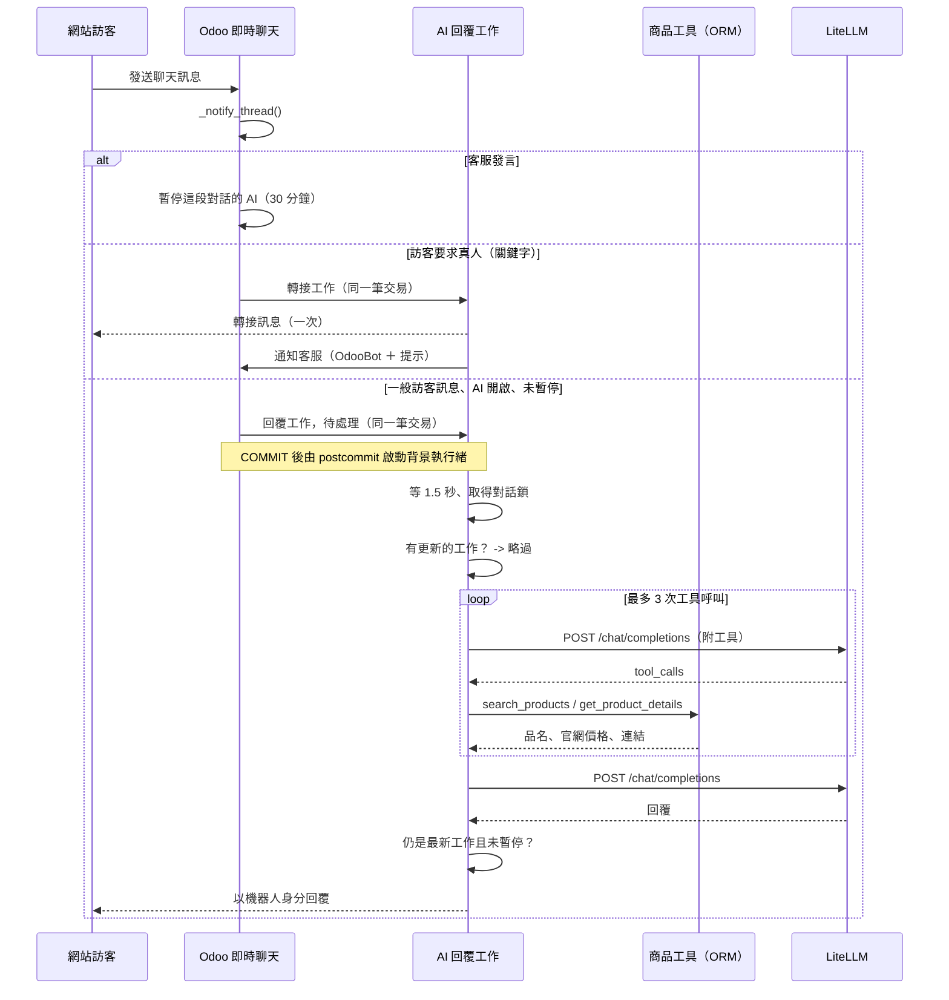
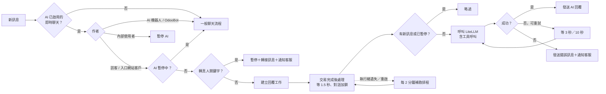

<p align="center">
  <h1 align="center">Live Chat AI Integration / 即時聊天 AI 整合</h1>
</p>

<p align="center">
  <strong><code>im_livechat_ai</code> -- Odoo 18 AI 智能客服模組</strong>
</p>

<p align="center">
  
  
  
  
  
  <a href="https://github.com/WOOWTECH/Woow_odoo_ai_livechat/actions/workflows/odoo-tests.yml"></a>
</p>

<p align="center">
  透過公司的 LiteLLM 閘道，讓 AI 自動回覆 Odoo 即時聊天的訪客，<br/>
  回覆工作不會遺失、客服可隨時接手，商品價格只引用官網資料。
</p>

<p align="center">
  <a href="README.md">English</a> &bull;
  <a href="#概述">概述</a> &bull;
  <a href="#從-18010x-升級">升級須知</a> &bull;
  <a href="#為什麼使用此模組">為什麼使用</a> &bull;
  <a href="#架構">架構</a> &bull;
  <a href="#功能特色">功能特色</a> &bull;
  <a href="#截圖">截圖</a> &bull;
  <a href="#安裝">安裝</a> &bull;
  <a href="#設定">設定</a> &bull;
  <a href="#模組結構">模組結構</a> &bull;
  <a href="#安全性">安全性</a> &bull;
  <a href="#測試">測試</a> &bull;
  <a href="#疑難排解">疑難排解</a> &bull;
  <a href="#相依模組">相依模組</a> &bull;
  <a href="#參與開發">參與開發</a> &bull;
  <a href="#更新日誌">更新日誌</a> &bull;
  <a href="#授權">授權</a>
</p>

---

## 概述

**im_livechat_ai** 是由 [WOOWTECH](https://github.com/WOOWTECH) 開發的 Odoo 18 模組，讓 AI 自動回覆即時聊天的訪客。網站訪客或已登入的入口網站客戶在啟用 AI 的頻道發訊息時，模組會在**同一筆交易**中建立一個「AI 回覆工作」；交易寫入完成後，再把對話送到公司的 **LiteLLM** 閘道（OpenAI 相容的 `/v1/chat/completions`），取得回覆後以頻道的機器人身分回覆訪客。

連線設定（LiteLLM 位址與 API 金鑰）是全站共用的系統設定，只有系統管理員看得到、改得到。每個頻道只選擇模型（選項來自 LiteLLM 的模型清單）、系統提示詞與行為參數。客服隨時可以接手：客服在對話中發言，或訪客要求真人客服時，AI 會暫停回覆這段對話。安裝電子商務模組後，AI 會用唯讀工具查詢已上架商品、官網價格與連結，不會自行編造。

預設閘道為 `https://paas-cs-32e92be2-5b2e4e66.woowtech.io/v1`，預設模型為 `chatgpt-pool/gpt-6-sol`（支援工具呼叫）。其他 OpenAI 相容的閘道用法相同。

---

## 從 18.0.1.0.x 升級

> **升級後 AI 一律關閉，要等系統管理員設定好 LiteLLM 才會再回覆。**

升級到 18.0.1.1.0（`-u im_livechat_ai`，或平台發版時的升級檢查看到版本號改變而自動執行）會自動做以下處理：

| 項目 | 結果 |
|------|------|
| 頻道上的 **API 網址**與 **API 金鑰** | 新程式載入前先清空（pre-migration），之後移除欄位。舊金鑰不會留在資料庫。 |
| **啟用 AI 整合** | **所有**頻道都關閉。伺服器日誌會列出原本開著 AI 的頻道。 |
| **重試延遲** | 移除（固定先等 3 秒、再等 10 秒）。**最大重試次數**上限改為 2。 |
| 預設英文**錯誤訊息**（或空白） | 改成繁體中文預設文字；自訂過的文字保留不動。 |
| **轉真人關鍵字**仍是舊預設 `真人,客服,人工,真人客服,human,agent,operator`（或空白） | 改成新的預設（只認明確的要求，見[步驟 3](#步驟-3轉真人客服與暫停)）；自訂過的保留不動。 |
| AI 機器人聯絡人 | 封存並加上「AI 機器人」標籤，和 Odoo 聊天機器人一樣；沒有圖片的會換上模組附的機器人頭像。 |
| 既有 **API 日誌** | 清除對話內容與上游回應內容。 |

「AI 全部關閉」「最大重試次數換算」「清理日誌」只在 pre-migration 看到 18.0.1.0.x 的欄位（`ai_api_key`、`ai_api_base_url` 或 `ai_retry_delay`）時才做；pre-migration 用暫時的系統參數 `im_livechat_ai.migration_1_1_0_legacy` 告訴 post-migration，post-migration 讀完就刪除。已升級過的資料庫再跑一次 18.0.1.1.0 的腳本，不會改到任何資料。

#### 上線須知：重啟或部署後的回覆

AI 回覆平常由收到訪客訊息的 Odoo 程序裡的執行緒送出。程序停止（重啟、部署、worker 自動回收）時正在處理的回覆，以及「等候真人逾時後」的 AI 回覆，都由排程 **Live Chat AI: Recover Reply Jobs**（每 2 分鐘）送出，所以會慢 **約 1-2 分鐘**。**一定要有排程程序**：Odoo 要以 `max_cron_threads >= 1` 執行（或另外跑一個排程程序，例如 `odoo --no-http --max-cron-threads=1`）。監看位置：**設定 → Live Chat AI → 回覆工作**（排程上次執行時間、超過 5 分鐘未完成的工作數，有問題會顯示警告），或 **即時聊天 → 設定 → AI 回覆工作**。

升級後，系統管理員要：

1. 開啟 **設定 → Live Chat AI**（或 **即時聊天 → 設定 → AI 設定**）。
2. 填入 **LiteLLM 位址**與專用的 **LiteLLM API 金鑰**（`odoo-livechat`），儲存。
3. 按 **讀取可用模型**，再按 **測試連線**。
4. 到 **即時聊天 → 設定 → 頻道 → AI 整合** 逐一重新啟用 AI 並選擇模型。

舊的頻道金鑰請到原供應商後台撤銷：升級只會從 Odoo 移除，備份、git 歷史或日誌裡可能還有副本。

---

## 為什麼使用此模組

| 沒有此模組 | 使用此模組 |
|---|---|
| 僅能手動回覆聊天 | AI 全天候自動回覆，客服可隨時接手 |
| 客服要自己查價格與規格 | AI 只引用商品工具查到的官網資料，並附連結 |
| 訊息可能沒人回 | 回覆工作有紀錄，重啟也會補回；連發多則只回一次 |
| 無法轉真人 | 客服發言或訪客說「真人」「客服」就暫停 AI 並通知客服 |
| 金鑰散在各頻道 | 一把只有管理員能設定的 LiteLLM 金鑰，可在閘道設預算與速率上限 |
| 對話內容到處存 | API 日誌預設不存對話內容，且只有管理員看得到 |
| 需整合外部工具 | 在 Odoo 內完成，只呼叫 LiteLLM 閘道 |

---

## 架構

### ASCII 流程圖

```
                              Odoo 18
 +-----------------------------------------------------------------------+
 |                                                                       |
 |  Website Visitor（網站訪客／入口網站客戶）                                |
 |       |                                                               |
 |       v                                                               |
 |  discuss.channel.message_post()                                       |
 |       |                                                               |
 |       v                                                               |
 |  _notify_thread() hook                                                |
 |       |  客服發言 -> 暫停 AI（預設 30 分鐘）                                |
 |       |  訪客要求真人 -> 轉接工作（通知訪客一次 + 通知客服）                    |
 |       |  其他訪客訊息 -> 在同一筆交易建立 im_livechat.ai.job（待處理）          |
 |       v                                                               |
 |  COMMIT -> postcommit 背景執行緒（或每 2 分鐘的補救排程）                    |
 |       |  等 1.5 秒合併連發訊息，同一段對話加鎖                                 |
 |       |  有更新的工作 -> 略過，交給最新那個                                    |
 |       v                                    +------------------------+ |
 |  _build_llm_messages()                     |   LiteLLM 閘道          | |
 |       |  最近 N 則歷史、客服訊息加標記          |   /v1/chat/completions  | |
 |       v                                    |                        | |
 |  _generate_ai_reply() ---- POST ---------->|  chatgpt-pool/         | |
 |       |  逾時 45 秒、最多重試 2 次             |  gpt-6-sol ...         | |
 |       |<-------- tool_calls / 回覆 ---------|                        | |
 |       |                                    +------------------------+ |
 |       |  工具呼叫（每則回覆最多 3 次）                                       |
 |       +---> im_livechat.ai.tools：search_products / get_product_details |
 |       |     （ORM 唯讀，只查已上架商品）                                     |
 |       v                                                               |
 |  _create_bot_message()（XSS 防護）                                       |
 |       v                                                               |
 |  訪客看到 AI 回覆                                                         |
 |                                                                       |
 +-----------------------------------------------------------------------+
```

### 時序圖



### 流程圖



---

## 功能特色

### 核心功能

- **公司 LiteLLM 閘道** -- 全站共用一組 OpenAI 相容位址與 API 金鑰（設定 → Live Chat AI），只有系統管理員能管理。
- **頻道模型下拉選單** -- 選項來自「讀取可用模型」（`GET {位址}/models`）快取的清單；頻道目前存的值一定保留可選。
- **多輪對話上下文** -- 最近 1-200 則訊息，以 system / user / assistant 角色送出。真人客服的訊息以 `assistant` 角色送出並標記 `[真人客服 姓名]`，系統提示也會告訴 AI 不要推翻同事的說法。
- **訪客與入口網站客戶** -- 網站訪客、已登入的入口網站客戶與公開使用者都會得到回覆；內部使用者、這段對話指派的客服與機器人不會觸發 AI。

### 可靠的回覆流程（工作佇列）

- **有紀錄的回覆工作**（`im_livechat.ai.job`）-- 和訪客訊息在同一筆交易建立，訊息寫入成功才有工作；交易完成後才開始處理。
- **連發只回一次** -- 等 1.5 秒合併連發訊息；每段對話一把 PostgreSQL advisory lock（跨 prefork worker 與排程程序都有效）；有更新工作的舊工作會被略過，由最新的工作帶完整上下文回覆。
- **呼叫有上限** -- 每次呼叫逾時 45 秒，最多重試 2 次（先等 3 秒、再等 10 秒），每個工作最多處理 3 次。
- **補救排程** -- 每 2 分鐘把因重啟或當機而停在「待處理／處理中」的工作重新執行；機器人已經回覆過的不會重複回覆。超過 30 分鐘仍未完成的工作會放棄。等候真人逾時後的延後回覆也由它執行（會在等候結束的時間觸發）。需要排程程序（見[上線須知](#上線須知重啟或部署後的回覆)）。
- **監看** -- **設定 → Live Chat AI → 回覆工作**（系統管理員）顯示排程上次執行時間與超過 5 分鐘仍在「待處理／處理中」的工作數；排程超過 5 分鐘沒跑或有卡住的工作時顯示警告。
- **失敗處理** -- 全部重試失敗時，訪客收到頻道的錯誤訊息（預設繁中），客服會收到通知（OdooBot 訊息與不會自動消失的提示）。
- **看得到的佇列** -- **即時聊天 → 設定 → AI 回覆工作** 可看每個工作的狀態、處理次數、LLM 呼叫次數與簡短錯誤。

### 轉真人客服（暫停）

兩種暫停，記在對話上（`discuss.channel.ai_paused_until`、`ai_pause_reason`）：

- **客服發言**（`operator`）-- 內部使用者在對話中發言後，AI 在這段對話暫停 **30 分鐘**（**真人接手後暫停**，每個頻道可調 1-1440）；客服每次發言都延長到「現在 + 30 分鐘」（不會縮短）。這段期間 AI 完全不出聲：不回覆、不送通知。
- **訪客要求真人**（`handoff`）-- 只有明確的要求才算：`找真人`、`真人客服`、`轉真人`、`轉人工`、`人工客服`、`找客服`、`聯絡客服`、`我要客服`、`human agent`、`talk to a human`、`real person`、`live agent`（可自訂）。中文關鍵字出現在訊息任何位置都算；英文字詞要整個字／整個片語相符、不分大小寫、字與字之間的空白不限。單獨的 `客服`、`人工`、`agent` 等不再轉真人（問「客服電話」會由 AI 回答）。AI 回一次轉接訊息（「已幫您通知客服，請稍候。」），通知客服，然後**等候 10 分鐘**（**等候真人分鐘數**，1-1440）。
- **等候通知** -- 等候期間訪客的第一則訊息會收到一則固定回覆（**等候通知**，預設「已通知客服人員，請稍候。若客服暫時無法回覆，AI 助理會在 10 分鐘後繼續為您服務。」；`%(minutes)s` 會換成等候分鐘數）。每次等候只送一次（`discuss.channel.ai_pause_notice_sent`），不呼叫 LLM。
- **客服接手** -- 等候期間客服一發言，就改成客服暫停（30 分鐘）；等候通知與延後回覆都會安靜取消。
- **逾時自動接回** -- 等候結束時若沒有客服回覆，AI 會回答訪客在等候期間寫的所有訊息，訪客不必再發一次：每則等候期間的訊息都有一個延後的回覆工作（`im_livechat.ai.job.deferred`），到期時間是等候結束，補救排程會在那個時間被觸發，由最新的工作一次回答全部（其他略過）。等候結束後約 1 分鐘內會收到回答（排程喚醒時間）。

### 商品查詢工具（需電子商務模組）

- **search_products** -- 最多 8 筆已上架、可銷售的商品：品名（有安裝繁中時用繁中）、官網價格區間、簡短說明、分類、完整網址。
- **get_product_details** -- 單一商品：說明、屬性、各規格的官網價格與網址、選配屬性與加價。
- **ORM 唯讀，不經過 MCP** -- 只查頻道所屬網站已上架的商品；價格是未登入訪客看到的官網價格（網站價目表與含稅設定）。
- **每則回覆最多呼叫工具 3 次**（全部輪數合計，最多 3 輪，超過 90 秒不再開新的一輪），之後 AI 必須用已查到的資料回答。
- **固定價格規則** -- 系統提示一定會加上：價格、規格、庫存只能使用工具查到的官網資料；沒有工具（或關閉「允許查詢商品」）時，AI 會請訪客留下聯絡方式，不會報價。
- **頻道開關** -- **允許查詢商品**（預設開啟）。

### 隱私與維運

- **API 日誌只有即時聊天管理員看得到** -- 只記時間、模型、token、耗時、狀態、要求的工具名稱與簡短錯誤。
- **AI 設定只有即時聊天管理員能看、能改** -- 頻道的 AI 欄位（提示詞、模型、轉真人關鍵字、錯誤訊息等）與「測試 AI 連線」只開放給 Live Chat 管理員；一般客服、員工、入口網站客戶都讀不到。AI 機器人的聯絡人由系統建立，不能指定成其他人。
- **AI 回覆只對自家網址產生連結** -- 只有 `web.base.url` 與網站網域的網址會變成可點的連結，其他網址只顯示文字。
- **預設不存對話內容** -- **記錄對話內容**（預設關閉）只在除錯時暫時打開；關閉時會清除已保存的內容。
- **保留天數** -- 超過 **14 天**（可調）的日誌與已結束的回覆工作每天自動刪除。
- **簡短錯誤** -- 測試按鈕與日誌只顯示狀態碼和一句說明；完整錯誤只寫伺服器日誌。

### AI 身分揭露

- **歡迎訊息** -- 頻道啟用 AI 時，聊天視窗顯示 **AI 歡迎訊息**（預設「您好，我是 AI 客服助理，可以先為您解答商品與價格問題；需要真人客服請輸入「找真人」。」），取代 Odoo 原本的歡迎訊息。
- **機器人頭像** -- AI 訊息的作者是機器人聯絡人，名稱是 **機器人名稱**，頭像是模組附的機器人圖（`static/img/ai_bot.png`）。
- **身分說明** -- 系統提示一定以「你是 {網站或公司名稱} 的 AI 客服助理「{機器人名稱}」。被問到身分時就這樣回答；不要自稱 ChatGPT、GPT、Codex、OpenAI 或其他產品／模型名稱。」開頭，接著才是頻道提示詞、客服訊息說明與商品規則。
- **限制** -- 聊天視窗標題（以及歡迎訊息的作者）仍顯示這段對話指派的真人客服，因為 Odoo 每段即時聊天都會指派一位客服；本模組沒有改這部分。

### 安全

- **XSS 防護** -- AI 回覆一律跳脫；只有 markdown 連結與 `http(s)` 網址會變成連結，`**文字**` 變粗體。
- **迴圈防護** -- AI 機器人、OdooBot 與對話指派的客服不會觸發 AI。
- **繁體中文** -- 給訪客與客服看的文字都是繁中，介面附完整 `zh_TW` 翻譯。

---

## 截圖

> 截圖是 18.0.1.0.0 版拍的。現在頻道表單上改成模型下拉選單、沒有 API 網址與金鑰欄位，連線設定移到「設定 → Live Chat AI」。

### 即時聊天頻道總覽

<p align="center"></p>

### AI 整合設定分頁（18.0.1.0.0 版面）

<p align="center"></p>

### 管理員 Discuss 檢視與 AI 對話

<p align="center"></p>

### 訪客端即時聊天小工具

<p align="center"></p>

### 測試結果

| 基本英文問候 | 中文 UTF-8 測試 | 綜合壓力測試 |
|:---:|:---:|:---:|
|  |  |  |

---

## 安裝

### 標準 Odoo 安裝

1. **Clone 此儲存庫**，並把它加進 addons 路徑。模組正本是儲存庫根目錄的 `im_livechat_ai/`（只有這一份）：

   ```bash
   git clone https://github.com/WOOWTECH/Woow_odoo_ai_livechat.git /path/to/Woow_odoo_ai_livechat
   ```

   ```ini
   addons_path = /path/to/odoo/addons,/path/to/Woow_odoo_ai_livechat
   ```

2. **更新應用程式列表**：
   - 前往 **應用程式** 選單。
   - 點擊 **更新應用程式列表**。

3. **安裝模組**：
   - 搜尋 **"Live Chat AI"** 或 **"即時聊天 AI"**。
   - 點擊 **安裝**。
   - 需要商品查詢工具時，另外安裝 **電子商務**（`website_sale`）。

4. **設定 LiteLLM**（見[設定](#設定)）；設定好之前 AI 不會回覆。

### Docker / Podman 部署

`odoo-ailivechat/` 目錄提供本機開發用的 `docker-compose.yml`（Odoo 18 + PostgreSQL 16）。它直接掛載儲存庫根目錄的模組正本（`../im_livechat_ai`）。repo 裡不放任何密碼，請從範本複製後自行填寫。

#### 服務架構

| 服務 | 映像檔 | 內部埠 | 對外埠 | 用途 |
|------|--------|:---:|:---:|------|
| **db** | `postgres:16` | 5432 | -- | PostgreSQL 資料庫（含健康檢查） |
| **odoo** | `odoo:18.0` | 8069 | **9094**（`ODOO_PORT`） | Odoo 18 應用程式伺服器 |

#### 快速啟動

```bash
cd odoo-ailivechat/

# 1. 建立本機設定（兩個檔案都已列入 .gitignore，不會被提交）
cp .env.example .env                           # 填入 POSTGRES_PASSWORD（例如 openssl rand -base64 24）
cp config/odoo.conf.example config/odoo.conf   # admin_passwd 留空 = 資料庫管理介面鎖住

# 2. 啟動
docker compose up -d                           # 或 podman-compose up -d

# 3. 建立資料庫並安裝模組（list_db = False，資料庫管理介面已停用）
docker compose run --rm odoo -d odooailivechat -i im_livechat_ai --without-demo=all --stop-after-init
docker compose restart odoo

# Odoo 將在 http://localhost:9094 上可用
```

#### 部署目錄結構

```
Woow_odoo_ai_livechat/
├── im_livechat_ai/                 # 模組正本（掛載到容器的 /mnt/extra-addons/im_livechat_ai）
└── odoo-ailivechat/
    ├── docker-compose.yml          # 服務定義
    ├── .env.example                # 範本：資料庫名稱、帳號、密碼、對外埠
    ├── .env                        # 自己建立，不提交
    ├── config/
    │   ├── odoo.conf.example       # 範本
    │   └── odoo.conf               # 自己建立，不提交
    └── data/
        ├── postgres/               # PostgreSQL 資料（持久化）
        └── odoo/                   # Odoo 檔案儲存（持久化）
```

#### 關鍵設定說明

- **網路：** 所有服務共享 `odoo-ailivechat-network` 橋接網路，支援內部主機名稱解析。
- **資料持久化：** PostgreSQL 資料和 Odoo 檔案儲存皆以 bind volume 掛載，確保重啟後資料不遺失。
- **健康檢查：** PostgreSQL 容器包含健康檢查；Odoo 會等待資料庫就緒後才啟動。
- **密碼：** 資料庫密碼只放在 `.env`；`odoo.conf` 不放資料庫帳密（由官方映像從環境變數帶入）。LiteLLM 位址與金鑰不放在這裡，由系統管理員在 Odoo 設定頁填寫。

---

## 設定

### 步驟 1：系統層級 LiteLLM 連線（只有系統管理員）

開啟 **設定 → Live Chat AI**（也可從 **即時聊天 → 設定 → AI 設定** 進入）。只有系統管理員（`base.group_system`）看得到、改得到，值存在 `ir.config_parameter`。

| 設定 | 說明 | 預設值 |
|------|------|--------|
| **LiteLLM 位址**（`im_livechat_ai.base_url`） | 公司 LiteLLM 閘道的 OpenAI 相容位址，以 `/v1` 結尾 | `https://paas-cs-32e92be2-5b2e4e66.woowtech.io/v1` |
| **LiteLLM API 金鑰**（`im_livechat_ai.api_key`） | 專用的 `odoo-livechat` 金鑰；儲存後不再顯示，留空表示沿用目前的金鑰 | -- |
| **讀取可用模型** | 呼叫 `GET {位址}/models`，更新頻道「模型」下拉選單（存在 `im_livechat_ai.model_cache`） | -- |
| **測試連線** | 用預設模型送出一個小請求，只顯示狀態碼和一句說明，完整錯誤只寫伺服器日誌 | -- |
| **記錄對話內容**（`im_livechat_ai.log_payload`） | 在 API 日誌保存對話內容；關閉時會清除已保存的內容 | 關閉 |
| **日誌保留天數**（`im_livechat_ai.log_retention_days`） | 每日清理排程刪除超過天數的日誌與已結束的回覆工作 | `14` |
| **回覆工作**（唯讀） | 排程「Live Chat AI: Recover Reply Jobs」上次執行時間、超過 5 分鐘仍在「待處理／處理中」的工作數；排程超過 5 分鐘沒跑或有卡住的工作時顯示警告 | -- |

只有系統管理員拿得到這些值：其他人（包括入口網站使用者、即時聊天管理員）呼叫 `res.config.settings` 的 `default_get`／`get_values` 時，`livechat_ai_*` 的值會被拿掉；欄位只開放 `base.group_system`；非系統管理員呼叫 `set_values` 會被拒絕。

建議的 LiteLLM 金鑰（`odoo-livechat`）：只允許指定的模型、每月預算上限（例如 20 美元）、速率上限（例如每分鐘 20 次）。就算金鑰外洩，損失也有上限，用量也會出現在閘道的花費紀錄。

### 步驟 2：在頻道啟用 AI（即時聊天管理員）

1. 前往 **即時聊天 → 設定 → 頻道**。
2. 選擇現有頻道或建立新頻道，開啟 **AI 整合** 分頁。
3. 勾選 **啟用 AI 整合**、選擇 **模型**。系統必須已設定 LiteLLM 金鑰才能啟用；啟用的當下會建立機器人聯絡人。
4. 點擊 **測試 AI 連線** 驗證設定是否正確。

檢查規則：下表的數值範圍每次儲存都會檢查（AI 開或關都一樣），啟用 AI 時會全部再檢查一次（舊版存下的超出範圍數值要先改好）。模型在選擇或變更時、以及啟用 AI 時，必須在已讀取的 LiteLLM 模型清單中（或是預設的 `chatgpt-pool/gpt-6-sol`）；沒變動的舊值（例如 `MiniMax-M1`）不會擋住其他欄位的儲存。送出請求時，Max Tokens、歷史訊息數與溫度會再限制在範圍內（存成 0 的 Max Tokens 會以 1024 送出）。

### 設定欄位一覽

| 欄位 | 類型 | 預設值 | 說明 |
|------|------|--------|------|
| `ai_enabled` | Boolean | `False` | 啟用/停用 AI 整合 |
| `ai_model` | Selection | `chatgpt-pool/gpt-6-sol` | 從 LiteLLM 模型清單選擇（目前的值一定保留可選） |
| `ai_product_lookup` | Boolean | `True` | 允許查詢商品（需電子商務模組） |
| `ai_system_prompt` | Text | -- | 系統提示詞，定義 AI 助理的角色與行為；商品價格規則（與客服訊息說明）一定會附加在後面 |
| `ai_max_history` | Integer | `50` | 最大歷史訊息數，用於建構對話上下文（1-200） |
| `ai_temperature` | Float | `0.7` | 溫度參數，控制回覆的隨機性（0.0-2.0） |
| `ai_max_tokens` | Integer | `1024` | AI 回覆的最大 token 數（1-8192） |
| `ai_max_retries` | Integer | `2` | 呼叫失敗或逾時後的重試次數（0-2；每次逾時 45 秒，先等 3 秒、再等 10 秒） |
| `ai_error_message` | Text | 抱歉，AI 客服暫時無法回覆。請稍後再試，或留下您的聯絡方式，我們的客服人員會盡快與您聯繫。 | 全部重試失敗後發送給訪客的訊息（同時通知客服） |
| `ai_handoff_pause_minutes` | Integer | `30` | 客服發言後 AI 暫停回覆的分鐘數，客服每次發言都會延長（1-1440） |
| `ai_handoff_wait_minutes` | Integer | `10` | 訪客要求真人後，AI 等候客服的分鐘數；逾時沒有客服回覆就由 AI 接回（1-1440） |
| `ai_handoff_keywords` | Char | `找真人,真人客服,轉真人,轉人工,人工客服,找客服,聯絡客服,我要客服,human agent,talk to a human,real person,live agent` | 轉真人關鍵字，以逗號分隔；中文出現在任何位置都算，英文字詞要整個字／片語相符、不分大小寫 |
| `ai_handoff_message` | Text | 已幫您通知客服，請稍候。 | 訪客要求真人時回覆一次的訊息 |
| `ai_pause_notice` | Text | 已通知客服人員，請稍候。若客服暫時無法回覆，AI 助理會在 %(minutes)s 分鐘後繼續為您服務。 | 等候期間訪客第一則訊息收到的固定回覆（每次等候一次）；`%(minutes)s` 換成等候分鐘數，其他文字照原樣送出 |
| `ai_bot_partner_id` | Many2one | 自動建立 | 機器人聯絡人（已封存、標籤「AI 機器人」、機器人頭像），作為 AI 訊息的作者 |
| `ai_bot_name` | Char | `AI 客服助理` | 機器人在聊天中的顯示名稱（也用在系統提示開頭的身分說明） |
| `ai_welcome_message` | Text | 您好，我是 AI 客服助理，可以先為您解答商品與價格問題；需要真人客服請輸入「找真人」。 | 啟用 AI 時聊天視窗的歡迎訊息 |

### 步驟 3：轉真人客服與暫停

暫停狀態存在對話上：`discuss.channel.ai_paused_until`（「AI 暫停到」）、`ai_pause_reason`（`operator` 客服發言／`handoff` 訪客要求真人）、`ai_pause_notice_sent`（這次等候已送過等候通知）。行為見[轉真人客服（暫停）](#轉真人客服暫停)。

### UI 操作按鈕與選單

- **測試 AI 連線**（即時聊天管理員）-- 用頻道的模型送出測試請求，只顯示狀態碼和一句說明。
- **查看 API 記錄**（即時聊天管理員）-- 開啟篩選至當前頻道的 API 呼叫記錄，預設顯示最近 7 天；只有打開「記錄對話內容」時才有對話內容。
- **AI 回覆工作**（即時聊天 → 設定）-- 回覆佇列，可篩選待處理／處理中、失敗、略過與轉真人；等候真人期間的延後回覆會標示「延後」，到「預定處理時間」才處理。
- **回覆工作監看**（設定 → Live Chat AI，只有系統管理員）-- 排程上次執行時間與卡住的工作（見[上線須知](#上線須知重啟或部署後的回覆)）。
- **AI API 日誌**（即時聊天 → 設定）-- 全部頻道的 API 呼叫記錄。
- **AI 設定**（即時聊天 → 設定，只有系統管理員）-- 開啟 LiteLLM 設定頁。

---

## 模組結構

```
im_livechat_ai/
├── __init__.py
├── __manifest__.py               # 版本 18.0.1.1.0
├── models/
│   ├── im_livechat_channel.py    # 頻道 AI 欄位、LiteLLM 連線（_llm_request、
│   │                             #   _fetch_llm_models）、含工具輪次與重試的
│   │                             #   回覆產生、機器人聯絡人、轉真人關鍵字
│   ├── discuss_channel.py        # _notify_thread 攔截：客服發言暫停、轉真人、
│   │                             #   建立工作；作者判斷；_build_llm_messages
│   ├── livechat_ai_job.py        # im_livechat.ai.job：回覆佇列、postcommit 執行緒、
│   │                             #   advisory lock、補救排程、通知客服
│   ├── livechat_ai_tools.py      # im_livechat.ai.tools：search_products、
│   │                             #   get_product_details（ORM 唯讀）
│   ├── llm_api_log.py            # llm.api.log：預設只存中繼資料、保留天數清理
│   └── res_config_settings.py    # 設定 → Live Chat AI（只有系統管理員）
├── views/
│   ├── im_livechat_channel_views.xml  # 頻道表單的「AI 整合」分頁
│   ├── llm_api_log_views.xml          # API 日誌（選單：AI API 日誌）
│   ├── livechat_ai_job_views.xml      # 回覆工作（選單：AI 回覆工作）
│   └── res_config_settings_views.xml  # 設定頁＋選單：AI 設定
├── data/
│   └── ai_data.xml               # 「AI 機器人」標籤、預設機器人、每日日誌清理排程、
│                                 #   每 2 分鐘的回覆工作補救排程
├── security/
│   └── ir.model.access.csv       # 日誌與工作：只有即時聊天管理員（讀取／刪除）
├── migrations/18.0.1.1.0/
│   ├── pre-migrate.py            # 清空頻道的 API 網址／金鑰
│   └── post-migrate.py           # 移除舊欄位、關閉 AI、清理日誌、中文錯誤訊息、
│                                 #   機器人加標籤
├── tests/                        # 371 項測試（見「測試」）
└── i18n/
    └── zh_TW.po                  # 繁體中文翻譯
```

儲存庫另有 `odoo-ailivechat/`（本機 Docker，掛載上面的模組）、`.github/workflows/odoo-tests.yml`（自動測試）與 `docs/`。

---

## 安全性

### LiteLLM 金鑰

LiteLLM 位址與金鑰存在 `ir.config_parameter`，只有系統管理員能讀寫，設定頁的每個欄位也都加上 `groups='base.group_system'`。頻道只選模型，所以即時聊天使用者或管理員既看不到金鑰，也沒辦法把金鑰送到別的網址。金鑰在設定頁只能寫入、不會再顯示，也不會留在暫存的設定資料表。介面上的錯誤與日誌都不含上游回應內容。

### API 日誌與對話內容

`llm.api.log` 與 `im_livechat.ai.job` 只有即時聊天管理員看得到。日誌預設不存對話內容；「記錄對話內容」只用於短暫除錯，關閉時會清除已保存的內容。每日清理排程依保留天數（預設 14 天）刪除舊資料。

### XSS 防護

AI 回覆在發送前一律用 `markupsafe` 跳脫。只有 markdown 連結與 `http(s)` 網址會變成連結（`target="_blank" rel="noopener noreferrer"`），`**文字**` 變粗體，換行轉成 `<br/>`；所有文字與網址都經過跳脫。

### 迴圈防護與作者判斷

- **頻道 AI 機器人**（`ai_bot_partner_id`）、**預設 AI 機器人**（`im_livechat_ai.partner_ai_bot`）與 **OdooBot**（`base.partner_root`）不會觸發 AI。
- 擁有**內部使用者帳號**的聯絡人是客服：發言會暫停 AI，並以同事回覆的身分送給 LLM。
- 這段對話**指派的客服**若沒有內部使用者帳號（例如 Odoo 聊天機器人），視為機器人。
- **網站訪客、入口網站客戶與公開使用者**都是訪客。

### 商品工具

工具只做 ORM 唯讀查詢，限頻道所屬網站已上架、可銷售的商品，不經過 MCP 或外部呼叫；每則回覆的輪數與次數都有上限。

### 輸入驗證

| 驗證項目 | 詳細說明 |
|----------|----------|
| LiteLLM 位址格式 | 必須以 `http://` 或 `https://` 開頭 |
| 歷史訊息數 | 必須介於 1-200 之間 |
| 溫度參數 | 必須介於 0.0-2.0 之間 |
| 最大重試次數 | 必須介於 0-2 之間 |
| 暫停／等候分鐘數 | 必須介於 1-1440 之間 |
| Max Tokens | 必須介於 1-8192 之間 |
| 檢查時機 | 每次儲存都檢查（AI 開或關）；啟用 AI 時全部再檢查；送出時再限制在範圍內 |
| 模型 | 選擇／變更或啟用 AI 時，必須在已讀取的 LiteLLM 模型清單中（或是預設模型） |
| 日誌保留天數 | 至少 1 天 |
| 必填欄位 | 啟用 AI 時，必須選模型，且系統管理員已設定 LiteLLM 金鑰 |

### 最佳實踐

1. **使用專用的 LiteLLM 金鑰**，並在閘道設定可用模型、每月預算與速率上限。
2. **定期輪換 API 金鑰**，降低金鑰洩漏風險。
3. **監控 API 日誌與回覆工作**，定期檢查失敗或被略過的工作。
4. **「記錄對話內容」除錯完立刻關閉**。
5. **限制系統提示詞範圍**，避免 AI 回覆超出客服範疇。

---

## 測試

### 測試套件總覽

本模組包含 **371 項自動化測試**。所有 HTTP 呼叫都用 mock，不需要 LiteLLM 金鑰或網路。

| 測試套件 | 檔案 | 測試數 | 說明 |
|----------|------|:---:|------|
| 核心單元測試 | `test_im_livechat_ai.py` | 25 | 頻道欄位、驗證、LLM 呼叫、機器人訊息、日誌 |
| 頻道整合測試 | `test_discuss_channel.py` | 18 | 訊息攔截、訪客判斷、對話上下文建構 |
| 端對端整合測試 | `test_integration.py` | 9 | 完整流程、多輪對話、重試、錯誤訊息 |
| 邊界情境測試 | `test_edge_cases.py` | 97 | 回應格式、think 標籤、XSS、上限、日誌 |
| LiteLLM 設定測試 | `test_litellm_settings.py` | 42 | 只有管理員能設定、金鑰只寫不讀、模型清單、隱私、升級遷移 |
| 回覆工作測試 | `test_ai_job.py` | 38 | 與訊息同交易建立、合併連發、加鎖、略過、重試、補救排程 |
| 轉真人測試 | `test_handoff.py` | 43 | 入口網站客戶、客服暫停、轉真人關鍵字、客服角色、機器人聯絡人、中文預設 |
| 商品工具測試 | `test_product_tools.py` | 37 | 搜尋與詳情、只查已上架、價格、工具輪數與上限 |
| 分支審查修正 | `test_review_fixes.py` | 20 | AI 設定權限、機器人聯絡人保護、哪些訊息會觸發、LLM 呼叫期間不留交易、重試次數遷移 |
| 暫停與身分揭露 | `test_pause_disclosure.py` | 42 | 明確轉真人關鍵字、客服暫停與等候真人、等候通知、逾時自動接回（延後工作）、範圍與模型檢查、設定頁隱私、工作監看、AI 身分揭露、升級腳本可重跑 |

### 執行測試

```bash
# 全新資料庫；部分測試需要 website_sale、website_livechat、portal
odoo -d test_db -i website_sale,website_livechat,portal,im_livechat_ai \
  --without-demo=all --test-enable --test-tags /im_livechat_ai --stop-after-init

# Docker 環境中執行
docker compose run --rm odoo -d test_db -i website_sale,website_livechat,portal,im_livechat_ai \
  --without-demo=all --test-enable --test-tags /im_livechat_ai --stop-after-init
```

請確認日誌裡有 `odoo.addons.im_livechat_ai.tests` 的 `Starting ...` 行：標籤選不到任何測試時，結尾一樣會顯示「0 failed」。

### 自動測試（GitHub Actions）

`.github/workflows/odoo-tests.yml` 在每個 PR 用 `odoo:18.0` 容器與 PostgreSQL 16 執行同樣的指令；Odoo 結束碼不是 0、沒有任何 `im_livechat_ai` 測試開始、或日誌出現 `FAIL`、`ERROR`、`CRITICAL` 時就判定失敗。請在主分支的保護規則把這個檢查設為必須通過，PR 沒過就不能合併。

### 實測

18.0.1.0.0 的 15 情境端對端測試計畫保留在 `docs/plans/`。18.0.1.1.0 請在測試站用真的 LiteLLM 金鑰確認：連發 3 則只得到 1 個回覆、客服發言後 AI 暫停、說「我要找真人」會暫停並通知客服、問商品價格會回官網價格並附連結。

---

## 疑難排解

### AI 沒有回覆

1. **剛從 18.0.1.0.x 升級**：所有頻道的 AI 都已關閉，請設定 LiteLLM 後逐一重新啟用（見[升級須知](#從-18010x-升級)）。
2. **LiteLLM 設定好了嗎**：「設定 → Live Chat AI」顯示「已設定金鑰」，且 **測試連線** 成功。
3. **是否暫停中**：客服剛發言（預設 30 分鐘內）AI 不回覆；訪客要求真人後的等候期間（預設 10 分鐘）AI 只送一次等候通知，等候結束才由補救排程回答。
4. **排程程序**：「設定 → Live Chat AI → 回覆工作」若警告「Live Chat AI: Recover Reply Jobs」超過 5 分鐘沒執行，請啟動排程程序（`max_cron_threads >= 1`）。
5. **誰發的訊息**：內部使用者（例如登入後台的管理員直接在小工具測試）發言會讓 AI 暫停，不會得到回覆；請用訪客或入口網站帳號測試。
6. **AI 回覆工作**：找到這則訊息的工作：`略過`（較新的訊息已回覆）、`失敗`（看錯誤欄）、一直`待處理`（補救排程是否啟用？）。
7. **伺服器日誌**：搜尋 `odoo.addons.im_livechat_ai`。

### 下拉選單沒有想要的模型

到「設定 → Live Chat AI」按 **讀取可用模型**。清單就是這把 LiteLLM 金鑰可以用的模型。

### AI 不知道商品價格

商品查詢需要電子商務模組、頻道開啟 **允許查詢商品**，且商品已在頻道所屬網站上架。沒有工具時 AI 會請訪客留下聯絡方式，不會報價。

### API 記錄顯示錯誤

| 錯誤 | 原因 | 處理方式 |
|------|------|----------|
| `HTTP 401` | 金鑰無效或已撤銷 | 到「設定 → Live Chat AI」填入有效金鑰 |
| `HTTP 403` | 金鑰沒有使用此模型的權限 | 在 LiteLLM 允許這把金鑰使用該模型，或換模型 |
| `HTTP 404` | 網址或模型不存在 | 位址要以 `/v1` 結尾；重新讀取模型清單 |
| `HTTP 429` | 呼叫太頻繁或額度已用完 | 檢查金鑰在 LiteLLM 的速率與預算 |
| `HTTP 5xx` | 閘道或上游服務故障 | 會自動重試（3 秒、10 秒）；檢查 LiteLLM 狀態 |
| 逾時／無法連線 | 網路或防火牆 | Odoo 必須連得到 LiteLLM 位址；每次呼叫 45 秒逾時 |

### Docker 相關問題

1. 確認所有容器正在執行：`docker compose ps`
2. 檢查容器日誌：`docker compose logs -f odoo`
3. 確認資料庫健康檢查通過：`docker compose logs db`
4. 啟動時出現 `set POSTGRES_PASSWORD`：還沒從 `.env.example` 建立 `.env`。

### Odoo 伺服器日誌

相關日誌可在 Odoo 伺服器日誌中搜尋以下關鍵字：

```
odoo.addons.im_livechat_ai
```

---

## 相依模組

| 模組 | 類型 | 用途 |
|------|------|------|
| `im_livechat` | Odoo 核心模組（必要） | 提供即時聊天頻道模型（`im_livechat.channel`）和即時聊天小工具 |
| `mail` | Odoo 核心模組（必要） | 提供 `discuss.channel`、`mail.message` 及訊息基礎架構 |
| `website_sale` | Odoo 核心模組（選用） | 商品查詢工具（已上架商品、官網價格） |

**Python 相依套件：**

| 套件 | 用途 |
|------|------|
| `requests` | 呼叫 LiteLLM（Odoo 內建） |
| `markupsafe` | XSS 防護的 HTML 跳脫處理（Odoo 內建） |
| `psycopg2` | PostgreSQL 連線（回覆工作使用 READ COMMITTED）（Odoo 內建） |

> 無需安裝額外的 Python 套件，所有相依套件皆包含在標準 Odoo 18 安裝中。

**外部服務：** LiteLLM（或其他 OpenAI 相容）閘道，需提供 `/v1/chat/completions` 與 `/v1/models`；商品工具需要模型支援工具呼叫。

---

## 參與開發

- 儲存庫根目錄的 `im_livechat_ai/` 是唯一正本；平台映像改成從這個 repo 的版本標籤同步，不再各自修改。
- 模型、視圖、資料或遷移有變更時要升版本號：平台發版的升級檢查只在版本號改變時才會執行模組升級。
- 提交訊息用一句話寫明改了什麼、為什麼。PR 依 `.github/pull_request_template.md`（改了什麼／為什麼／怎麼測）填寫，且必須通過 **Odoo tests** 檢查。
- 不要提交金鑰或密碼：只提交 `*.example` 範本；`.env`、`config/odoo.conf` 與 `.playwright-cli/` 已列入 `.gitignore`。

---

## 更新日誌

### v18.0.1.1.0

- **LiteLLM 系統設定**：連線移到「設定 → Live Chat AI」（只有系統管理員、金鑰只寫不讀、錯誤只顯示簡短說明），拿掉頻道上的 API 網址與金鑰。頻道模型改成下拉選單，選項來自「讀取可用模型」；預設 `chatgpt-pool/gpt-6-sol`。
- **升級**：清空並移除舊的頻道金鑰／網址欄位，**所有頻道的 AI 先關閉**，等系統管理員設定 LiteLLM 後再逐一打開；移除重試延遲、最大重試次數上限改為 2；預設錯誤訊息改繁中；機器人聯絡人封存並加標籤；清理舊日誌。
- **工作佇列**：訪客訊息與 `im_livechat.ai.job` 回覆工作同一筆交易建立，交易完成後處理；等 1.5 秒合併連發、同一段對話加鎖，連發只回一次；逾時 45 秒、最多重試 2 次（3 秒／10 秒）；每 2 分鐘補救排程；失敗時回錯誤訊息並通知客服。
- **轉真人／暫停**：入口網站客戶也會得到回覆；客服發言後 AI 暫停 30 分鐘（頻道可調）；轉真人關鍵字回一次轉接訊息、暫停並通知客服；客服訊息以標記過的同事回覆送給 LLM；啟用 AI 的當下建立機器人聯絡人。
- **商品工具**：`search_products` 與 `get_product_details`（ORM 唯讀、只查已上架、官網價格、附連結），每則回覆最多呼叫 3 次；頻道開關「允許查詢商品」；系統提示固定加上不可編造價格的規則。
- **隱私**：API 日誌與回覆工作只有即時聊天管理員看得到；預設不存對話內容（「記錄對話內容」開關）；保留 14 天（可調）。
- **儲存庫**：模組只留一份正本（Docker 直接掛載）、設定改用範本不再提交密碼、新增 GitHub Actions 自動測試與 PR 範本、所有新字串補上繁中翻譯。
- **轉真人（負責人審查）**：只認明確的轉真人關鍵字（舊預設自動換新、自訂保留）；兩種暫停：客服發言（30 分鐘、每次發言延長、完全不出聲）與訪客要求真人的等候（10 分鐘，`ai_handoff_wait_minutes`），等候期間送一次等候通知（`ai_pause_notice`），逾時沒有客服就自動接回：延後的回覆工作在等候結束時由補救排程執行，回答訪客等候期間的訊息；客服接手就取消。
- **檢查**：數值範圍每次儲存都檢查（AI 開或關），啟用 AI 時再全部檢查；送出時限制 Max Tokens／歷史訊息數／溫度；選模型或啟用 AI 時模型必須在已讀取的 LiteLLM 清單中。
- **設定頁隱私與監看**：非系統管理員不能再透過 `default_get`／`get_values` 拿到 LiteLLM 位址、日誌設定或模型清單，`set_values` 也會拒絕；設定頁顯示補救排程上次執行時間與卡住的工作。
- **AI 身分揭露**：機器人聯絡人有機器人頭像、AI 歡迎訊息（`ai_welcome_message`）、系統提示開頭固定的身分說明。
- **升級腳本**：只屬於舊版的步驟（AI 全關、重試次數換算、清日誌）需要 18.0.1.0.x 欄位才會做，已升級的資料庫再跑一次不會改到資料。

### v18.0.1.0.0（2026-04-11）

- 初始版本
- 直接 LLM API 整合（OpenAI 相容 `/v1/chat/completions`）
- 每個頻道獨立的 AI 設定（API URL、金鑰、模型、系統提示詞等）
- 多輪對話上下文建構（可設定歷史訊息數 1-200）
- 非同步 daemon 執行緒 API 呼叫，不阻塞聊天操作
- 可設定重試邏輯（1-10 次重試，1-30 秒延遲）
- AI 迴圈防護（排除機器人、OdooBot、內部使用者）
- XSS 防護（Markup.escape）
- API 呼叫記錄與 token 用量追蹤
- 30 天自動清理排程
- 每個頻道獨立機器人合作夥伴與自訂名稱
- 序列化失敗自動重試
- 一鍵測試 AI 連線
- 一鍵檢視 API 記錄
- 55 項自動化測試（28 核心 + 18 頻道 + 9 整合）
- Docker / Podman 部署設定
- 雙語文件（English + 繁體中文）
- 繁體中文翻譯（`i18n/zh_TW.po`）

---

## 授權

本模組採用 [GNU 較寬鬆通用公共授權條款 v3.0 (LGPL-3)](https://www.gnu.org/licenses/lgpl-3.0.html) 授權。

---

## 致謝

由 **[WOOWTECH](https://github.com/WOOWTECH)** 開發與維護。

<p align="center">
  <a href="https://github.com/WOOWTECH/Woow_odoo_ai_livechat/issues">Bug 回報與功能建議</a>
</p>

---

<p align="center"><sub>由 <a href="https://github.com/WOOWTECH">WOOWTECH</a> 精心打造 &bull; 基於 Odoo 18</sub></p>
